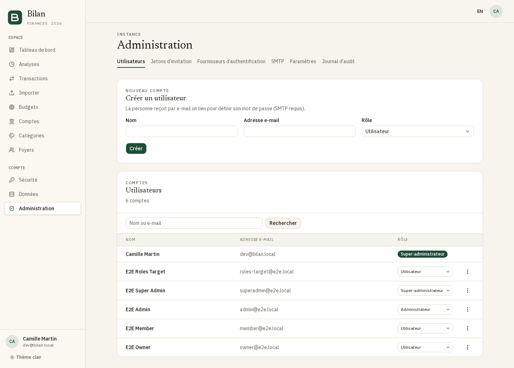
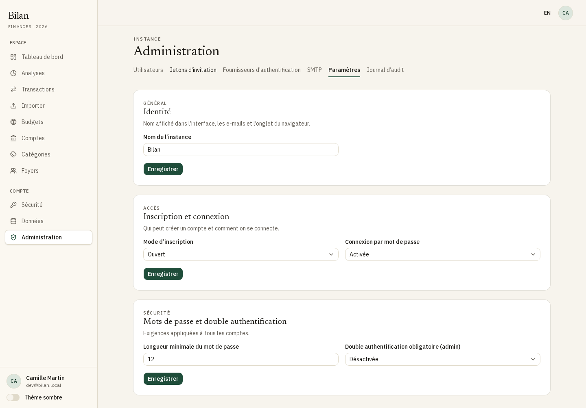
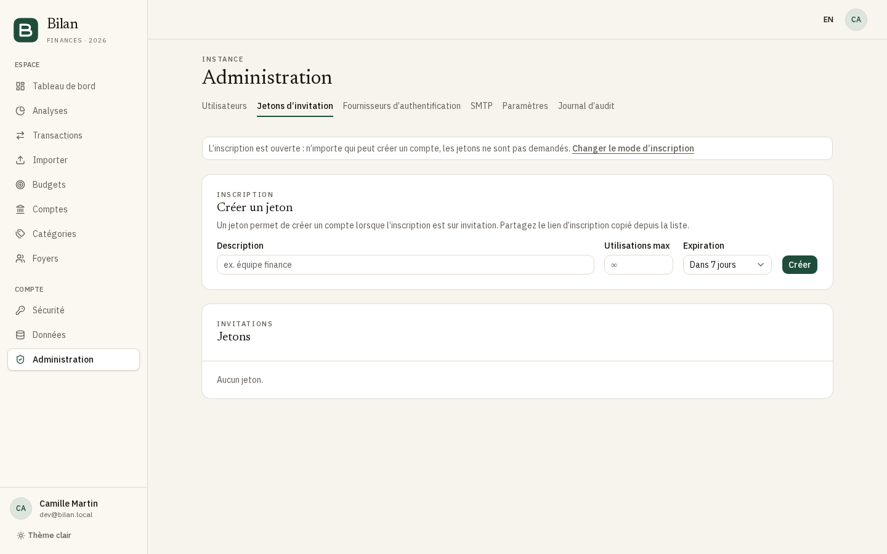
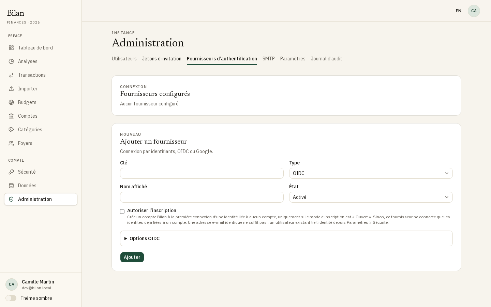
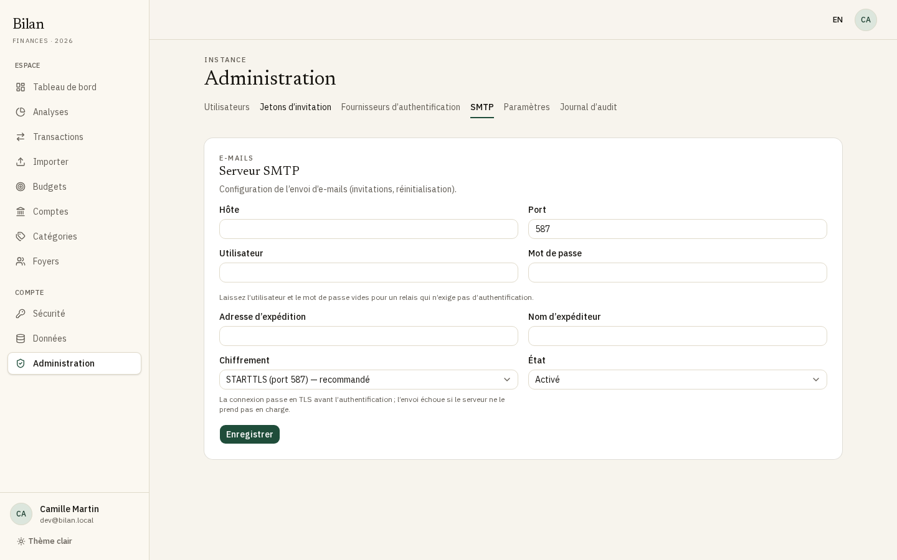
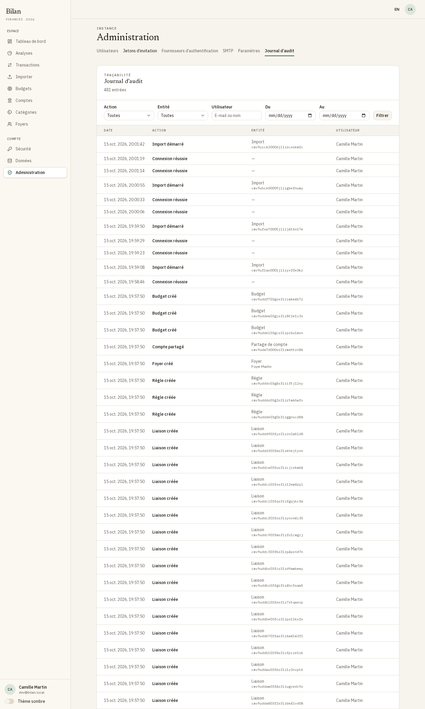

[English](admin-guide.md) · **Français**

# Guide d'administration de Bilan

Ce guide couvre l'administration d'une instance Bilan depuis l'interface web : premier démarrage, utilisateurs et rôles, inscription et connexion, authentification unique (SSO), e-mails et journal d'audit. Pour l'installation, les variables d'environnement, les sauvegardes et les tâches planifiées, consultez le [guide d'auto-hébergement](self-hosting.fr.md).

Presque tout se configure dans l'application. Les modifications s'appliquent immédiatement, sans redémarrage. Seuls les secrets d'amorçage et l'adresse publique (`APP_URL`) se trouvent dans le fichier d'environnement.

## Sommaire

- [Premier démarrage : l'assistant d'installation](#premier-démarrage--lassistant-dinstallation)
- [L'espace d'administration](#lespace-dadministration)
- [Rôles et permissions](#rôles-et-permissions)
- [Gérer les utilisateurs](#gérer-les-utilisateurs)
- [Paramètres d'inscription et de connexion](#paramètres-dinscription-et-de-connexion)
- [Jetons d'invitation](#jetons-dinvitation)
- [Authentification unique (OIDC et Google)](#authentification-unique-oidc-et-google)
- [E-mails (SMTP)](#e-mails-smtp)
- [Vérification des adresses e-mail](#vérification-des-adresses-e-mail)
- [Journal d'audit](#journal-daudit)
- [Notes de sécurité](#notes-de-sécurité)

## Premier démarrage : l'assistant d'installation

Tant que la base ne contient aucun utilisateur, toutes les pages redirigent vers l'assistant d'installation (`/setup`). Ouvrez l'application à son adresse `APP_URL` et suivez les quatre étapes. Rien n'est enregistré avant le clic sur **Terminer** à la dernière étape.

1. **Compte administrateur** : nom, adresse e-mail et mot de passe (12 caractères minimum par défaut). Ce compte devient le premier **Super-administrateur**. Son adresse est marquée comme vérifiée, puisque personne d'autre ne pourrait la vérifier.
2. **E-mail (SMTP)** : facultatif. Renseignez le serveur, ou cliquez sur **Passer** et configurez-le plus tard dans **Administration > SMTP**. Gardez le chiffrement par défaut **STARTTLS (port 587)**, sauf si votre fournisseur en demande un autre. Voir [E-mails (SMTP)](#e-mails-smtp).
3. **Connexion externe** : facultatif. Ajoute un fournisseur OIDC générique, de clé `oidc`. Un fournisseur Google s'ajoute ensuite, depuis **Fournisseurs d'authentification**.
   - L'assistant affiche l'**URL de redirection** à déclarer chez votre fournisseur d'identité : `<APP_URL>/api/auth/oauth2/callback/oidc`.
   - **Tester la connexion** vérifie le document de découverte de l'issuer. Le test ne contacte que des adresses `https` publiques, car l'assistant est accessible avant toute connexion. Un fournisseur d'identité sur un réseau privé ou sur `localhost` ne peut pas être testé ici, et le message l'indique, mais il fonctionnera à la connexion : continuez sans tester.
   - Le fournisseur est créé sans autoriser l'inscription. Voir [Autoriser l'inscription](#autoriser-linscription).
4. **Mode d'inscription** : **Sur invitation** est le choix par défaut et recommandé. Voir [Mode d'inscription](#mode-dinscription).

Cliquez sur **Terminer** : le compte est créé et vous êtes connecté. Ensuite, `/setup` renvoie une page 404.

## L'espace d'administration

Ouvrez **Administration** dans la barre latérale (l'entrée n'apparaît que pour les administrateurs). L'espace compte six onglets, chacun affiché seulement si votre rôle le permet.

| Onglet                          | Rôle                                                                                        |
| ------------------------------- | ------------------------------------------------------------------------------------------- |
| Utilisateurs                    | Créer, rechercher, changer les rôles, désactiver et supprimer des comptes                   |
| Jetons d'invitation             | Jetons permettant de s'inscrire quand l'inscription est sur invitation                      |
| Fournisseurs d'authentification | Fournisseurs SSO (OIDC, Google)                                                             |
| SMTP                            | Serveur d'envoi des e-mails                                                                 |
| Paramètres                      | Nom de l'instance, mode d'inscription, règles de mot de passe et de double authentification |
| Journal d'audit                 | Historique des actions effectuées sur l'instance                                            |

## Rôles et permissions

Chaque compte a un rôle d'instance : **Utilisateur**, **Administrateur** ou **Super-administrateur**. Ces rôles sont distincts des rôles dans les foyers, que les foyers gèrent eux-mêmes.

| Action                                                                                                | Utilisateur | Administrateur                             | Super-administrateur                  |
| ----------------------------------------------------------------------------------------------------- | ----------- | ------------------------------------------ | ------------------------------------- |
| Utiliser l'application (comptes, transactions, budgets, foyers)                                       | Oui         | Oui                                        | Oui                                   |
| Voir la liste des utilisateurs et le journal d'audit                                                  | Non         | Oui                                        | Oui                                   |
| Créer des utilisateurs                                                                                | Non         | Rôle **Utilisateur** uniquement            | **Utilisateur** ou **Administrateur** |
| Désactiver et réactiver des utilisateurs                                                              | Non         | Comptes de rôle **Utilisateur** uniquement | Tout le monde sauf soi-même           |
| Changer les rôles                                                                                     | Non         | Non                                        | Tout le monde sauf soi-même           |
| Marquer une adresse e-mail comme vérifiée                                                             | Non         | Non                                        | Tout le monde sauf soi-même           |
| Supprimer définitivement des utilisateurs                                                             | Non         | Non                                        | Tout le monde sauf soi-même           |
| Changer le nom de l'instance                                                                          | Non         | Oui                                        | Oui                                   |
| Mode d'inscription, connexion par mot de passe, longueur minimale, double authentification des admins | Non         | Non                                        | Oui                                   |
| Jetons d'invitation, fournisseurs d'authentification, SMTP                                            | Non         | Non                                        | Oui                                   |

Règles de rang :

- Personne ne peut changer son propre rôle, ni désactiver ou supprimer son propre compte depuis l'administration.
- Seul un super-administrateur peut agir sur un administrateur ou un autre super-administrateur.
- Un administrateur ne peut pas créer, promouvoir ni gérer un compte de rang égal ou supérieur.
- Le dernier super-administrateur actif ne peut pas être rétrogradé, ni supprimer son propre compte.
- Un super-administrateur désactivé garde son rôle mais ne peut plus agir, et ne compte pas comme super-administrateur actif.

Pour donner le rôle **Super-administrateur** à quelqu'un, créez son compte en **Utilisateur** ou **Administrateur**, puis changez son rôle.

Les jetons d'invitation et **Marquer l'adresse comme vérifiée** sont volontairement réservés aux super-administrateurs : un administrateur peut créer des comptes, mais pas distribuer de jetons d'inscription ni se porter garant de l'adresse e-mail de quelqu'un.

## Gérer les utilisateurs

### Créer un utilisateur

1. Allez dans **Administration > Utilisateurs**.
2. Dans **Créer un utilisateur**, saisissez le **Nom** et l'**Adresse e-mail**. Les super-administrateurs choisissent aussi le **Rôle** (**Utilisateur** ou **Administrateur**).
3. Cliquez sur **Créer**.

La personne reçoit un e-mail avec un lien pour choisir son mot de passe. Le lien est valable 1 heure ; passé ce délai, elle utilise **Mot de passe oublié ?** sur la page de connexion. Suivre ce lien vérifie aussi son adresse e-mail.

Ce parcours nécessite un serveur SMTP fonctionnel : le lien n'est transmis que par e-mail, et Bilan ne le montre jamais à l'administrateur. Sans SMTP, le compte est tout de même créé, mais la confirmation indique qu'aucun e-mail n'a été envoyé : la personne ne peut pas se connecter tant que le SMTP n'est pas configuré, puis elle utilise **Mot de passe oublié ?** sur la page de connexion. Sur une instance sans SMTP, faites plutôt inscrire les personnes avec un [jeton d'invitation](#jetons-dinvitation).

### Rechercher

Saisissez une partie d'un nom ou d'une adresse e-mail dans le champ de recherche et cliquez sur **Rechercher**. **Effacer** réinitialise la liste. Des badges à côté du nom signalent les comptes **Désactivé** et les adresses non vérifiées (**Adresse non vérifiée**).

### Changer un rôle

Les super-administrateurs voient un sélecteur de rôle sur chaque ligne (les administrateurs voient un badge en lecture seule).

1. Choisissez le nouveau rôle dans le sélecteur.
2. Confirmez avec **Changer le rôle**. Le changement prend effet immédiatement.

Une promotion en **Super-administrateur** affiche un avertissement : ce rôle a tous les droits, y compris sur les autres administrateurs et la suppression de comptes.

### Désactiver ou réactiver un utilisateur

1. Ouvrez le menu d'actions de la ligne (les trois points).
2. Choisissez **Désactiver**, puis confirmez.

Les sessions de la personne sont fermées et toute connexion est refusée (mot de passe, clé d'accès, SSO). Ses données sont conservées. Choisissez **Réactiver** pour lui permettre de se reconnecter.

### Marquer une adresse e-mail comme vérifiée

Réservé aux super-administrateurs. À utiliser sur les instances sans SMTP, où les utilisateurs ne peuvent pas recevoir de lien de vérification (voir [Vérification des adresses e-mail](#vérification-des-adresses-e-mail)).

1. Ouvrez le menu d'actions de la ligne et choisissez **Marquer l'adresse comme vérifiée**.
2. Confirmez avec **Marquer comme vérifiée**.

Ne le faites que si vous savez que l'adresse appartient bien à cette personne : les invitations de foyer envoyées à cette adresse lui seront proposées.

### Supprimer un utilisateur

1. Ouvrez le menu d'actions de la ligne et choisissez **Supprimer définitivement**.
2. Lisez le résumé de l'impact. Selon les cas, il indique :
   - les comptes bancaires qui disparaissent avec leur historique, et si des membres de foyer perdent l'accès à des comptes partagés ;
   - les foyers transmis à un autre membre, ou supprimés quand la personne en est la seule membre ;
   - les lignes de budget d'autres personnes qui ne seront plus limitées à l'un de ses comptes.
3. Saisissez l'adresse e-mail de la personne pour confirmer, puis cliquez sur **Supprimer définitivement**.

Le compte et toutes ses données sont effacés, et ses entrées du journal d'audit sont anonymisées. Action irréversible.

## Paramètres d'inscription et de connexion

**Administration > Paramètres** comporte trois cartes, chacune avec son bouton **Enregistrer**. Les administrateurs ne voient que la première.

| Paramètre                                   | Valeurs                           | Défaut         | Effet                                                                                         |
| ------------------------------------------- | --------------------------------- | -------------- | --------------------------------------------------------------------------------------------- |
| Nom de l'instance                           | Texte, 40 caractères maximum      | Bilan          | Affiché dans l'interface, les e-mails et l'onglet du navigateur                               |
| Mode d'inscription                          | Ouvert, Sur invitation, Désactivé | Sur invitation | Qui peut créer un compte                                                                      |
| Connexion par mot de passe                  | Activée, Désactivée               | Activée        | Propose ou non la connexion et l'inscription par e-mail et mot de passe                       |
| Longueur minimale du mot de passe           | 8 à 128                           | 12             | S'applique aux nouveaux mots de passe (inscription, réinitialisation, changement)             |
| Double authentification obligatoire (admin) | Activée, Désactivée               | Désactivée     | Les administrateurs doivent activer la double authentification pour utiliser l'administration |

### Mode d'inscription

| Mode           | Page d'inscription                                            | Inscription par SSO                                                     |
| -------------- | ------------------------------------------------------------- | ----------------------------------------------------------------------- |
| Ouvert         | Tout le monde peut créer un compte                            | Possible pour les fournisseurs où **Autoriser l'inscription** est coché |
| Sur invitation | Nécessite un [jeton d'invitation](#jetons-dinvitation) valide | Jamais                                                                  |
| Désactivé      | Affiche « Les inscriptions sont fermées sur cette instance. » | Jamais                                                                  |

Quel que soit le mode, les administrateurs peuvent toujours créer des comptes depuis **Utilisateurs**.

La page de connexion n'affiche **Créer un compte** que si la page d'inscription permet de s'inscrire : pas en mode **Désactivé**, ni quand la connexion par mot de passe est désactivée et qu'aucun fournisseur SSO ne peut créer de compte.

### Connexion par mot de passe

Une fois désactivée, la page de connexion ne propose plus l'e-mail et le mot de passe. Les utilisateurs se connectent avec une clé d'accès ou une identité SSO. Assurez-vous que chaque utilisateur, à commencer par vous, dispose d'une clé d'accès ou d'une identité liée à un fournisseur actif : l'enregistrement est refusé tant que des utilisateurs se retrouveraient sans aucun moyen de connexion, et le message indique combien. Les utilisateurs créés par un administrateur qui n'ont jamais choisi leur mot de passe comptent aussi.

### Double authentification obligatoire (admin)

Une fois ce paramètre activé, un administrateur ou super-administrateur sans double authentification est renvoyé vers **Sécurité** dès qu'il ouvre l'administration, où un bandeau en explique la raison, et ses actions d'administration sont refusées. Ses autres pages fonctionnent normalement. Ses droits d'administration reviennent dès qu'il active la double authentification (application d'authentification) sur cette page.

L'activation de la double authentification demande le mot de passe du compte. La double authentification de Bilan ne protège que les connexions par mot de passe : les connexions par SSO ou par clé d'accès ne demandent jamais son code. Un administrateur sans mot de passe (SSO uniquement, éventuellement avec des clés d'accès) n'est donc pas concerné par ce paramètre ; c'est la double authentification de son fournisseur d'identité qui le protège. S'il définit plus tard un mot de passe (**Mot de passe oublié ?** sur la page de connexion), le paramètre s'applique aussi à lui. Tant que la **Connexion par mot de passe** est désactivée, le paramètre ne s'applique à personne, puisqu'aucune connexion ne demande le code.

Un administrateur qui a à la fois un mot de passe et une identité SSO est concerné par le paramètre. Une fois sa double authentification activée, une connexion par mot de passe demande le code, et une connexion par SSO s'en remet au fournisseur d'identité.

Activez votre propre double authentification avant d'activer ce paramètre.

## Jetons d'invitation

Seuls les super-administrateurs voient cet onglet. Un jeton d'invitation permet de créer un compte quand le mode d'inscription est **Sur invitation**. Un bandeau en haut de l'onglet vous prévient quand le mode est **Ouvert** (les jetons ne sont pas demandés) ou **Désactivé** (les jetons sont refusés).

### Créer un jeton

1. Allez dans **Administration > Jetons d'invitation**.
2. Renseignez :
   - **Description** : facultative, pour vous y retrouver (par exemple, la personne concernée) ;
   - **Utilisations max** : laissez vide pour un nombre illimité, ou saisissez de 1 à 10 000 ;
   - **Expiration** : dans 1, 7 (par défaut), 30 ou 90 jours, ou **Jamais**.
3. Cliquez sur **Créer**.

### Partager un jeton

Dans la liste **Jetons**, utilisez **Copier le lien d'inscription** sur la ligne du jeton et envoyez ce lien à la personne. Il ouvre la page d'inscription avec le jeton déjà renseigné. La liste affiche pour chaque jeton ses utilisations, son expiration et son statut : **Actif**, **Révoqué**, **Expiré** ou **Épuisé**.

Une inscription qui échoue ne consomme pas un jeton à usage unique.

### Révoquer ou supprimer un jeton

- **Révoquer** empêche toute nouvelle utilisation du jeton. Les comptes déjà créés ne sont pas touchés.
- **Supprimer** retire le jeton de la liste. Révoquez un jeton actif avant de le supprimer.

## Authentification unique (OIDC et Google)

Bilan prend en charge tout fournisseur OpenID Connect (Authentik, Keycloak, Authelia, Zitadel, Microsoft Entra ID, etc.) ainsi que Google. Les fournisseurs activés apparaissent sous forme de boutons sur la page de connexion.

### URL de redirection à déclarer chez le fournisseur d'identité

Déclarez cette URL comme URI de redirection (callback) autorisée dans le client créé chez le fournisseur d'identité :

| Type de fournisseur | URL de redirection                         |
| ------------------- | ------------------------------------------ |
| OIDC                | `<APP_URL>/api/auth/oauth2/callback/<clé>` |
| Google              | `<APP_URL>/api/auth/callback/google`       |

`<clé>` est la **Clé** du fournisseur dans Bilan. `<APP_URL>` est l'adresse publique exacte du fichier d'environnement, sans barre oblique finale. Exemple : avec `APP_URL=https://bilan.example.com` et la clé `authentik`, l'URL est `https://bilan.example.com/api/auth/oauth2/callback/authentik`.

La même URL sert à la connexion et à la liaison d'une identité à un compte existant.

### Ajouter un fournisseur

1. Créez un client (confidentiel, flux « authorization code ») chez votre fournisseur d'identité, avec l'URL de redirection ci-dessus.
2. Allez dans **Administration > Fournisseurs d'authentification**, carte **Ajouter un fournisseur**.
3. Remplissez le formulaire, puis cliquez sur **Ajouter**.

| Champ                   | Description                                                                                                                |
| ----------------------- | -------------------------------------------------------------------------------------------------------------------------- |
| Clé                     | Lettres minuscules, chiffres, `-` ou `_`. Fait partie de l'URL de redirection OIDC. Non modifiable ensuite.                |
| Type                    | **OIDC** ou **Google**. Non modifiable ensuite. Un seul fournisseur Google est possible.                                   |
| Nom affiché             | Libellé du bouton de connexion                                                                                             |
| État                    | **Activé** affiche le fournisseur sur la page de connexion ; **Désactivé** le masque et refuse les connexions par ce biais |
| Issuer                  | OIDC uniquement, obligatoire. L'URL de l'issuer ; Bilan lit `<issuer>/.well-known/openid-configuration`.                   |
| Client ID               | Obligatoire                                                                                                                |
| Client secret           | Obligatoire. Stocké chiffré. En modification, laissez vide pour conserver l'actuel.                                        |
| Autoriser l'inscription | Voir [Autoriser l'inscription](#autoriser-linscription)                                                                    |

Pour un fournisseur OIDC, **Options OIDC avancées** regroupe les réglages facultatifs :

| Champ                                          | Description                                                                                                |
| ---------------------------------------------- | ---------------------------------------------------------------------------------------------------------- |
| Scopes                                         | Séparés par des virgules. Par défaut : `openid,email,profile`.                                             |
| Claim → nom                                    | Claim userinfo à utiliser comme nom, si ce n'est pas le claim standard.                                    |
| Claim → e-mail                                 | Claim userinfo à utiliser comme adresse e-mail, si ce n'est pas le claim standard.                         |
| URL d'autorisation, URL de token, URL userinfo | À renseigner seulement si le document de découverte du fournisseur est inutilisable : elles le remplacent. |
| PKCE                                           | À cocher si le fournisseur prend en charge ou exige PKCE.                                                  |

Un fournisseur Google ne prend qu'un **Client ID** et un **Client secret** : le formulaire masque les autres champs. Créez un client OAuth de type « Application Web » dans la console Google Cloud et ajoutez `<APP_URL>/api/auth/callback/google` à ses URI de redirection autorisées.

La connexion par mot de passe n'est pas un fournisseur : elle se règle avec **Connexion par mot de passe** dans **Paramètres**.

### Autoriser l'inscription

**Autoriser l'inscription** est décoché par défaut. Un fournisseur sans cette option ne connecte que des identités déjà liées à un compte Bilan.

Avec **Autoriser l'inscription**, la première connexion d'une identité liée à aucun compte crée un nouveau compte Bilan, mais uniquement si le mode d'inscription est **Ouvert**. En mode **Sur invitation** ou **Désactivé**, le fournisseur ne crée jamais de compte. Les fournisseurs qui autorisent l'inscription apparaissent aussi sur la page d'inscription quand celle-ci est ouverte.

Une adresse e-mail identique ne suffit jamais à lier une identité à un compte existant : une personne qui a déjà un compte et se connecte par SSO pour la première fois obtient une erreur. Elle doit d'abord lier son identité.

### Lier une identité (côté utilisateur)

1. L'utilisateur se connecte à Bilan (mot de passe ou clé d'accès).
2. Il ouvre **Sécurité**, carte **Identités connectées**, et clique sur **Lier** suivi du nom du fournisseur.
3. Il se connecte chez le fournisseur d'identité, puis revient dans Bilan.

L'adresse e-mail de l'identité doit correspondre à celle du compte, et une identité ne peut être liée qu'à un seul compte. Si sa session date de plus d'un jour, Bilan lui demande d'abord de se reconnecter. L'utilisateur peut délier une identité depuis la même carte, sauf si c'est son seul moyen de connexion.

### Modifier, désactiver ou supprimer un fournisseur

Chaque fournisseur configuré a sa propre carte avec le même formulaire. Cliquez sur **Enregistrer** après une modification.

- Pour suspendre un fournisseur, passez son **État** à **Désactivé**. Les utilisateurs liés conservent leur liaison. Quand la connexion par mot de passe est désactivée, c'est refusé si un utilisateur se retrouvait sans aucun moyen de connexion.
- **Supprimer** retire le fournisseur et toutes les identités qui y sont liées. La confirmation indique le nombre de comptes liés. La suppression est refusée si un utilisateur se retrouvait sans aucun moyen de connexion (ni mot de passe, ni clé d'accès, ni autre fournisseur actif) : désactivez plutôt le fournisseur. Si la connexion par mot de passe est désactivée, la désactivation est refusée aussi : réactivez la connexion par mot de passe, ou faites d'abord ajouter à ces utilisateurs une clé d'accès ou un autre fournisseur.

### Dépannage

- **La connexion et la liaison ne fonctionnent que depuis `APP_URL`.** Si les utilisateurs ouvrent l'application par une autre adresse (IP, autre nom d'hôte, `http` au lieu de `https`), le SSO et les clés d'accès échouent. La liaison affiche alors « Liaison impossible depuis cette adresse ». Servez l'application derrière le reverse proxy HTTPS, à l'adresse `APP_URL` : voir [Reverse proxy (HTTPS)](self-hosting.fr.md#reverse-proxy-https).
- **Erreur de redirect URI** chez le fournisseur d'identité : comparez l'URL reçue avec le tableau ci-dessus, y compris la clé et le schéma.
- **Adresse non vérifiée après une connexion SSO** : Bilan ne fait confiance qu'à un claim `email_verified` égal à `true`, et seulement pour le claim standard `email` (pas pour un claim remappé).

## E-mails (SMTP)

### Configurer

Bilan n'inclut pas de serveur de messagerie : utilisez un compte SMTP existant (voir [Prérequis](self-hosting.fr.md#prérequis)).

1. Allez dans **Administration > SMTP**.
2. Remplissez le formulaire et cliquez sur **Enregistrer**.

| Champ                | Description                                                                                                                                                                                                                                                                                                                                                                                                                   |
| -------------------- | ----------------------------------------------------------------------------------------------------------------------------------------------------------------------------------------------------------------------------------------------------------------------------------------------------------------------------------------------------------------------------------------------------------------------------- |
| Hôte                 | Nom du serveur SMTP                                                                                                                                                                                                                                                                                                                                                                                                           |
| Port                 | En général 587 (STARTTLS), 465 (TLS implicite) ou 25 (relais local sans chiffrement). Par défaut : 587.                                                                                                                                                                                                                                                                                                                       |
| Utilisateur          | Compte SMTP. Laissez l'utilisateur et le mot de passe vides pour un relais qui n'exige pas d'authentification.                                                                                                                                                                                                                                                                                                                |
| Mot de passe         | Stocké chiffré. Laissez vide pour conserver l'actuel ; il n'est conservé que si l'hôte, le port, le chiffrement et l'utilisateur sont inchangés. Requis avec un utilisateur.                                                                                                                                                                                                                                                  |
| Adresse d'expédition | Adresse d'expéditeur de tous les e-mails                                                                                                                                                                                                                                                                                                                                                                                      |
| Nom d'expéditeur     | Nom d'expéditeur facultatif                                                                                                                                                                                                                                                                                                                                                                                                   |
| Chiffrement          | **STARTTLS (port 587)**, par défaut et recommandé : la connexion passe en TLS avant l'authentification, et rien n'est envoyé si le serveur ne le prend pas en charge. **TLS implicite (port 465)** : TLS dès l'ouverture de la connexion. **Aucun** : le mot de passe et les e-mails, liens de réinitialisation compris, circulent en clair ; à réserver à un relais sur la même machine ou sur un réseau local de confiance. |
| État                 | **Activé** envoie les e-mails ; **Désactivé** conserve la configuration sans rien envoyer                                                                                                                                                                                                                                                                                                                                     |

La combinaison par défaut (587 avec **STARTTLS**) convient à la plupart des fournisseurs. Pour le port 465, choisissez **TLS implicite**. Changer le chiffrement passe aussi le port à celui qui correspond (587, 465 ou 25), sauf si vous avez saisi un port personnalisé.

### Envoyer un e-mail de test

Cliquez sur **Envoyer un e-mail de test**. Le test utilise la configuration enregistrée, même désactivée, et l'envoie à votre propre adresse. En cas d'échec, le message indique si le serveur a refusé l'identifiant, s'il est injoignable, s'il ne répond pas ou s'il a refusé l'expéditeur. Les détails figurent dans les journaux du serveur. Vous pouvez envoyer 5 tests par minute.

### Supprimer la configuration

**Supprimer la configuration** efface les réglages SMTP. Plus aucun e-mail n'est envoyé tant qu'une nouvelle configuration n'est pas enregistrée.

### Ce que Bilan envoie

| E-mail                           | Quand                                                                                                          |
| -------------------------------- | -------------------------------------------------------------------------------------------------------------- |
| Vérification de l'adresse        | Après l'inscription, et quand l'utilisateur clique sur **Renvoyer l'e-mail** dans le bandeau                   |
| Réinitialisation du mot de passe | **Mot de passe oublié ?** sur la page de connexion (lien valable 1 heure)                                      |
| Compte créé                      | Un administrateur crée le compte (lien de définition du mot de passe, valable 1 heure)                         |
| Mot de passe modifié             | Après un changement ou une réinitialisation du mot de passe                                                    |
| Invitation dans un foyer         | Un administrateur du foyer invite quelqu'un (lien et code)                                                     |
| Alertes de sécurité              | Nouvelle connexion (mot de passe, clé d'accès ou SSO), clé d'accès ajoutée, double authentification désactivée |

Les e-mails sont rédigés dans la langue du destinataire.

### Sans SMTP

Bilan fonctionne sans SMTP, avec ces différences :

- Invitations dans un foyer : la personne qui invite voit « L'e-mail est désactivé : transmettez ce lien. » avec un lien à copier et à transmettre par un autre moyen.
- Les utilisateurs créés par un administrateur ne reçoivent pas leur lien de définition du mot de passe, et la confirmation le signale. Préférez les jetons d'invitation ou l'inscription par SSO.
- **Mot de passe oublié ?** ne peut pas transmettre son lien.
- Aucun e-mail de vérification n'est envoyé et le bandeau de vérification est masqué. Un administrateur marque alors les adresses comme vérifiées (voir ci-dessous).
- Aucune alerte de sécurité n'est envoyée.

## Vérification des adresses e-mail

La connexion n'exige jamais une adresse vérifiée. La vérification ne compte que pour les invitations de foyer : la liste **Invitations en attente pour vous** de la page des foyers, établie d'après la seule adresse e-mail, reste vide tant que l'adresse n'est pas vérifiée. Les liens et codes d'invitation fonctionnent toujours pour les utilisateurs non vérifiés.

Une adresse devient vérifiée quand :

- l'utilisateur suit le lien de l'e-mail de vérification (valable 24 heures) ;
- l'utilisateur termine une réinitialisation de mot de passe, y compris le lien « choisissez votre mot de passe » d'un compte créé par un administrateur ;
- un fournisseur SSO l'atteste (`email_verified: true` sur le claim standard `email`) ;
- un super-administrateur utilise **Marquer l'adresse comme vérifiée** dans **Utilisateurs** ;
- il s'agit du premier super-administrateur, créé par l'assistant d'installation.

Les utilisateurs ne peuvent pas changer d'adresse e-mail après l'inscription.

## Journal d'audit

**Administration > Journal d'audit** liste, du plus récent au plus ancien, la date, l'action, l'entité concernée et l'utilisateur à l'origine de l'action (**système** pour les tâches automatiques).

### Ce qui est tracé

Chaque changement d'état est journalisé, les lectures ne le sont pas. Cela comprend :

- l'authentification : connexions (mot de passe, clé d'accès, étape de double authentification, SSO) et échecs de connexion, inscriptions, changements et réinitialisations de mot de passe, double authentification, régénérations de codes de secours, appareils de confiance oubliés, clés d'accès, sessions révoquées, identités SSO liées et déliées, vérifications d'adresse ;
- les utilisateurs : création par un administrateur, changements de rôle, désactivation, réactivation, adresse marquée comme vérifiée, suppression ;
- les paramètres : chaque paramètre de l'application, les modifications et tests SMTP, les fournisseurs d'authentification ;
- les jetons d'invitation, les foyers et leurs invitations ;
- l'activité financière des utilisateurs : comptes bancaires et partages, transactions, imports, catégories, règles, budgets, liaisons ;
- les échecs d'envoi d'e-mails de sécurité et les purges du journal.

Une connexion SSO est journalisée en `auth.login.success` avec `method: sso` et la clé du fournisseur. La première connexion SSO d'une identité qui crée un compte n'est journalisée que comme inscription (`auth.register.success`). Une connexion SSO refusée (identité non liée, inscription fermée, compte désactivé, erreur du fournisseur) est journalisée en `auth.login.failed` avec le code d'erreur de Better Auth (`other` pour un code inattendu). Une connexion annulée chez le fournisseur ne l'est pas, ni un refus survenu avant que Bilan lise la demande de connexion.

### Filtrer

Combinez ces filtres, puis cliquez sur **Filtrer** (**Réinitialiser** les efface) :

- **Action** : une famille (Authentification, Utilisateurs, Paramètres, Jetons d'invitation, Foyers, Comptes bancaires, etc.) ;
- **Entité** : le type d'objet concerné ;
- **Utilisateur** : une partie de l'adresse e-mail ou du nom de l'auteur de l'action ;
- **Du** et **Au** : des dates, dans le fuseau horaire de votre navigateur.

### Confidentialité

Le journal n'affiche de noms que pour les entités du domaine de l'administration : utilisateurs, foyers, invitations de foyer (adresse e-mail), clés d'accès, fournisseurs d'authentification, jetons d'invitation et paramètres. Les données financières des utilisateurs (comptes bancaires, transactions, catégories, budgets, règles, imports) n'apparaissent que sous forme d'identifiants, pour que les administrateurs ne puissent pas les lire.

À la suppression d'un utilisateur, ses entrées sont anonymisées.

### Conservation

Les entrées sont conservées 12 mois. Une tâche planifiée quotidienne supprime les entrées plus anciennes et journalise une entrée « Journal d'audit purgé ». Elle est exécutée par le service `cron` mis en place à l'installation : voir [Tâches planifiées](self-hosting.fr.md#tâches-planifiées).

## Notes de sécurité

### Limites de tentatives de connexion

| Tentative                                   | Limite                                                             |
| ------------------------------------------- | ------------------------------------------------------------------ |
| Mot de passe erroné                         | 5 par 15 minutes par adresse IP et par compte                      |
| Mot de passe erroné                         | 30 par heure par compte, toutes adresses IP confondues             |
| Code de double authentification             | 5 par 10 minutes par connexion, puis le mot de passe est redemandé |
| Inscription                                 | 3 par heure par adresse e-mail                                     |
| Demande de réinitialisation du mot de passe | 3 par heure par adresse e-mail                                     |

Une connexion réussie remet à zéro le compteur par adresse IP. Au-delà de la limite, l'utilisateur doit patienter, et le refus est consigné dans le journal d'audit. Les compteurs sont gardés en mémoire : un redémarrage de l'application les remet à zéro.

Les limites par adresse IP, la liste des appareils connectés et les alertes de nouvelle connexion reposent sur l'IP du client transmise par votre reverse proxy. Vérifiez `TRUSTED_IP_HEADER` : voir [IP du client derrière le reverse proxy](self-hosting.fr.md#ip-du-client-derrière-le-reverse-proxy).

### Sessions et appareils de confiance

- Une session dure 7 jours et est prolongée après une journée d'activité.
- Les utilisateurs voient leurs appareils connectés dans **Sécurité** et peuvent les déconnecter.
- Après une connexion avec double authentification, l'utilisateur peut faire confiance à l'appareil : l'étape de double authentification y est alors sautée, et redemandée après 30 jours sans connexion depuis cet appareil. L'utilisateur voit ses appareils de confiance dans **Sécurité** et peut en oublier un ou tous. Ces autorisations sont aussi supprimées quand l'utilisateur déconnecte ses autres appareils, change ou réinitialise son mot de passe, ou active ou désactive la double authentification.
- Une réinitialisation du mot de passe déconnecte l'utilisateur partout.
- Désactiver un utilisateur ferme immédiatement toutes ses sessions.

### Comptes administrateurs

- Activez la double authentification sur chaque compte administrateur, puis activez **Double authentification obligatoire (admin)**.
- Gardez au moins deux super-administrateurs actifs, pour que l'instance reste administrable si l'un perd son accès.
- Attribuez **Administrateur** plutôt que **Super-administrateur** à qui doit seulement aider les utilisateurs.
