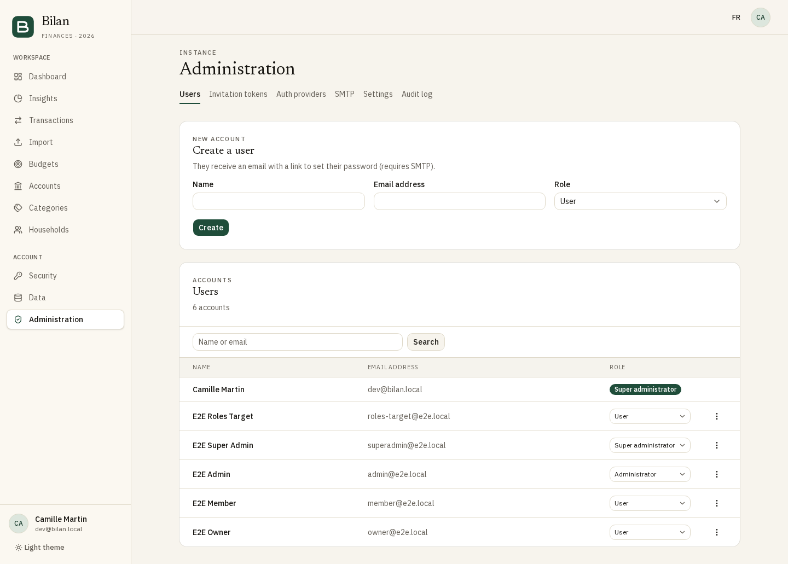
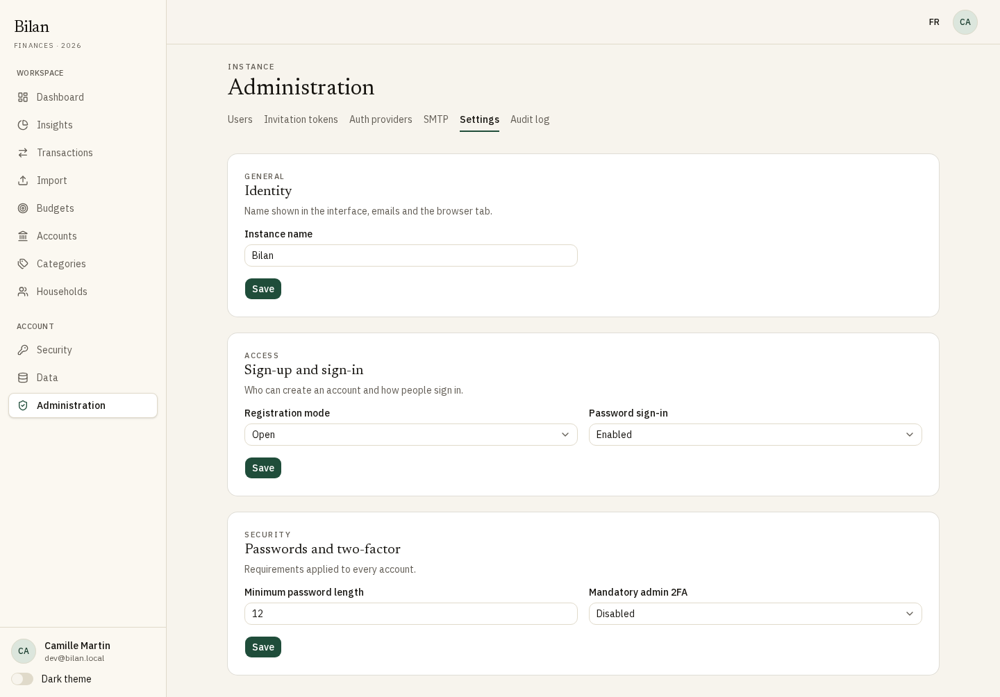
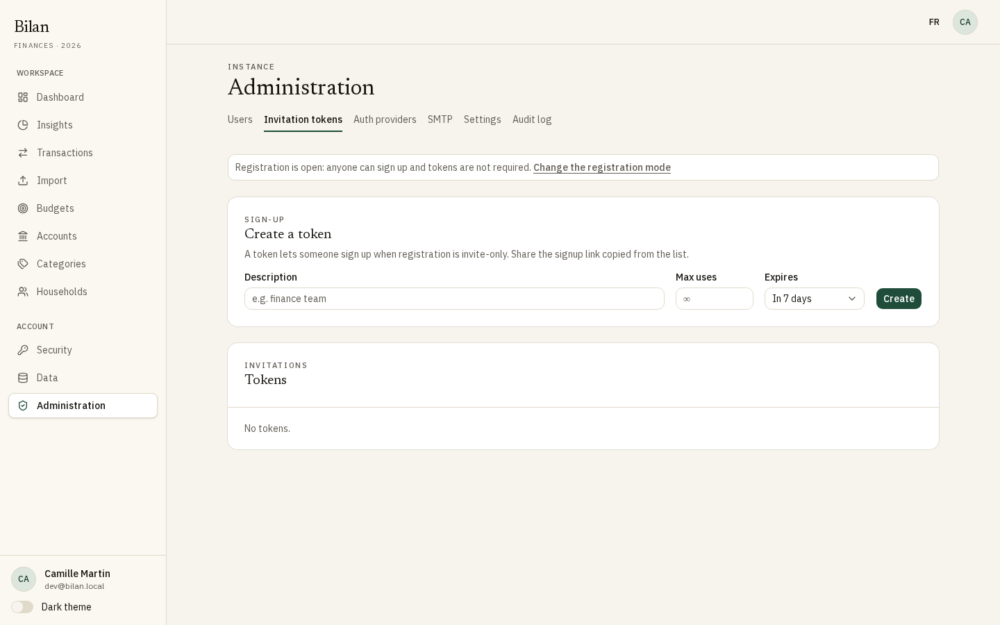
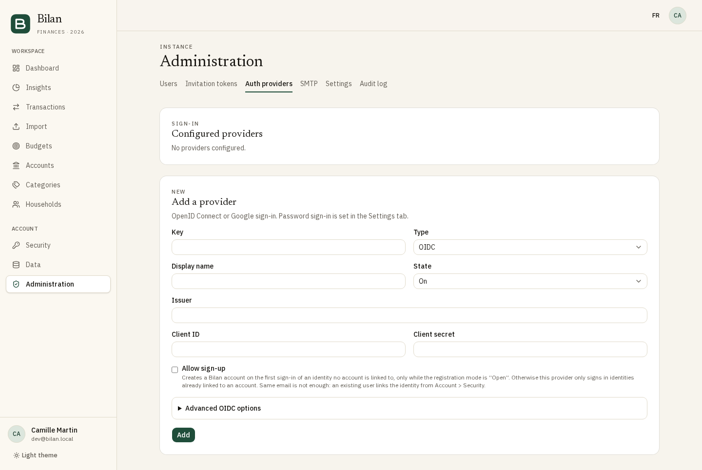
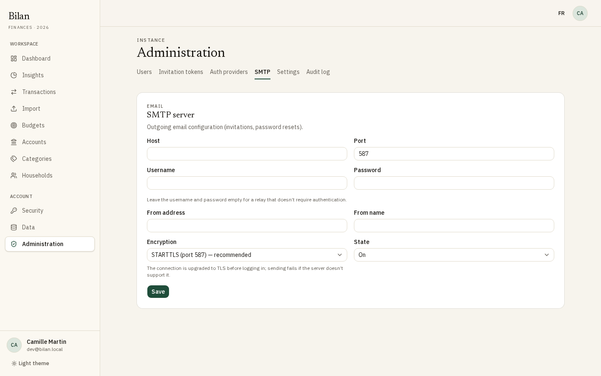
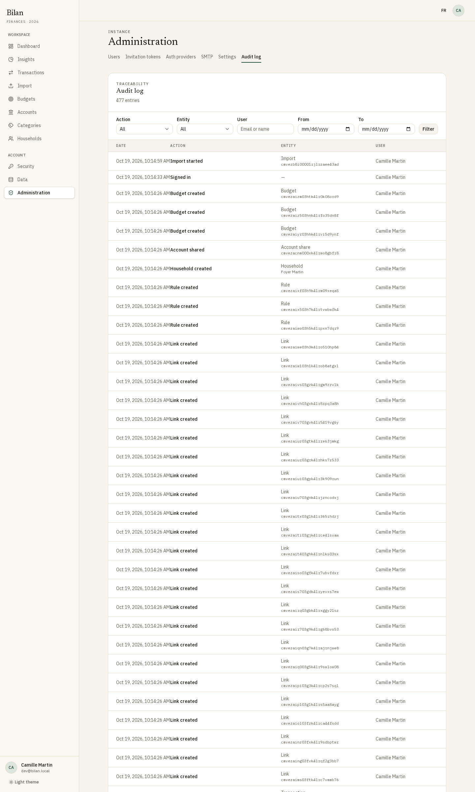

**English** · [Français](admin-guide.fr.md)

# Bilan administrator guide

This guide covers running a Bilan instance from the web interface: the first start, users and roles, sign-up and sign-in, single sign-on, e-mail, and the audit log. For installation, environment variables, backups and scheduled jobs, see the [self-hosting guide](self-hosting.md).

Almost everything is configured in the app. Changes take effect immediately, without a restart. Only the bootstrap secrets and the public address (`APP_URL`) live in the environment file.

## Contents

- [First start: the setup wizard](#first-start-the-setup-wizard)
- [The administration area](#the-administration-area)
- [Roles and permissions](#roles-and-permissions)
- [Managing users](#managing-users)
- [Sign-up and sign-in settings](#sign-up-and-sign-in-settings)
- [Invitation tokens](#invitation-tokens)
- [Single sign-on (OIDC and Google)](#single-sign-on-oidc-and-google)
- [E-mail (SMTP)](#e-mail-smtp)
- [E-mail address verification](#e-mail-address-verification)
- [Audit log](#audit-log)
- [Security notes](#security-notes)

## First start: the setup wizard

As long as the database has no user, every page redirects to the setup wizard (`/setup`). Open the app at its `APP_URL` and follow the four steps. Nothing is saved until you click **Finish** on the last step.

1. **Admin account**: name, e-mail address and password (at least 12 characters by default). This account becomes the first **Super administrator**. Its address is marked as verified, since nobody else could verify it.
2. **Email (SMTP)**: optional. Fill in the server details, or click **Skip** and configure it later under **Administration > SMTP**. Keep the default **STARTTLS (port 587)** encryption unless your provider asks for another one. See [E-mail (SMTP)](#e-mail-smtp).
3. **External login**: optional. Adds one generic OIDC provider, with the key `oidc`. A Google provider is added later, from **Auth providers**.
   - The wizard shows the **Redirect URL** to register at your identity provider: `<APP_URL>/api/auth/oauth2/callback/oidc`.
   - **Test connection** checks the issuer's discovery document. The test only contacts public `https` addresses, because the wizard is reachable before anyone signs in. An identity provider on a private network or `localhost` cannot be tested here, and the message says so, but it still works at sign-in: continue without testing.
   - The provider is created with sign-up not allowed. See [Allow sign-up](#allow-sign-up).
4. **Registration mode**: **Invite only** is the default and the recommended choice. See [Registration mode](#registration-mode).

Click **Finish**: the account is created and you are signed in. From then on, `/setup` returns a 404 page.

## The administration area

Open **Administration** in the sidebar (the entry only appears for administrators). The area has six tabs. Each one is shown only if your role allows it.

| Tab               | Purpose                                                         |
| ----------------- | --------------------------------------------------------------- |
| Users             | Create, search, change roles, disable and delete accounts       |
| Invitation tokens | Tokens that let people sign up when registration is invite-only |
| Auth providers    | SSO providers (OIDC, Google)                                    |
| SMTP              | Outgoing e-mail server                                          |
| Settings          | Instance name, registration mode, password and 2FA policies     |
| Audit log         | History of the actions performed on the instance                |

## Roles and permissions

Each account has one instance role: **User**, **Administrator** or **Super administrator**. Instance roles are separate from household roles, which households manage themselves.

| What                                                            | User | Administrator                 | Super administrator           |
| --------------------------------------------------------------- | ---- | ----------------------------- | ----------------------------- |
| Use the app (accounts, transactions, budgets, households)       | Yes  | Yes                           | Yes                           |
| See the user list and the audit log                             | No   | Yes                           | Yes                           |
| Create users                                                    | No   | Role **User** only            | **User** or **Administrator** |
| Disable and re-enable users                                     | No   | Users with role **User** only | Anyone but themselves         |
| Change roles                                                    | No   | No                            | Anyone but themselves         |
| Mark an e-mail address as verified                              | No   | No                            | Anyone but themselves         |
| Delete users permanently                                        | No   | No                            | Anyone but themselves         |
| Change the instance name                                        | No   | Yes                           | Yes                           |
| Registration mode, password sign-in, password length, admin 2FA | No   | No                            | Yes                           |
| Invitation tokens, auth providers, SMTP                         | No   | No                            | Yes                           |

Rank rules:

- Nobody can change their own role, disable or delete their own account from the admin area.
- Only a super administrator can act on an administrator or another super administrator.
- An administrator cannot create, promote or manage an account of equal or higher rank.
- The last active super administrator cannot be demoted, and cannot delete their own account.
- A disabled super administrator keeps the role but cannot act, and does not count as an active super administrator.

To give someone the **Super administrator** role, create them as a **User** or **Administrator**, then change their role.

Invitation tokens and **Mark email as verified** are reserved to super administrators on purpose: an administrator can create accounts, but cannot hand out sign-up tokens or vouch for someone's e-mail address.

## Managing users

### Create a user

1. Go to **Administration > Users**.
2. Under **Create a user**, enter the **Name** and **Email address**. Super administrators also pick the **Role** (**User** or **Administrator**).
3. Click **Create**.

The user receives an e-mail with a link to choose their password. The link is valid for 1 hour; after that, they use **Forgot password?** on the sign-in page. Following the link also verifies their e-mail address.

This flow needs a working SMTP server: the setup link is only delivered by e-mail, and Bilan never shows it to the administrator. Without SMTP, the account is still created, but the confirmation says that no e-mail was sent: the user cannot sign in until SMTP is configured, then they use **Forgot password?** on the sign-in page. On an instance without SMTP, let people sign up with an [invitation token](#invitation-tokens) instead.

### Search

Type part of a name or e-mail address in the search box and click **Search**. **Clear** resets the list. Badges next to a name show **Disabled** accounts and **Unverified email** addresses.

### Change a role

Super administrators see a role selector on each row (other administrators see a read-only badge).

1. Pick the new role in the selector.
2. Confirm with **Change role**. The change takes effect immediately.

Promoting to **Super administrator** shows a warning: that role has every right, including over other administrators and account deletion.

### Disable or re-enable a user

1. Open the row's actions menu (the three dots).
2. Choose **Disable**, then confirm.

The user's sessions are closed and every sign-in is refused (password, passkey, SSO). Their data is kept. Choose **Re-enable** to let them sign in again.

### Mark an e-mail address as verified

Super administrators only. Use this on instances without SMTP, where users cannot receive a verification link (see [E-mail address verification](#e-mail-address-verification)).

1. Open the row's actions menu and choose **Mark email as verified**.
2. Confirm with **Mark as verified**.

Only do this if you know the address belongs to that person: household invitations sent to this address will be offered to them.

### Delete a user

1. Open the row's actions menu and choose **Delete permanently**.
2. Read the impact summary. It lists, when relevant:
   - the bank accounts that disappear with their history, and whether household members lose access to shared ones;
   - the households handed over to another member, or deleted when the user is their only member;
   - budget lines of other people that will no longer be limited to one of the user's accounts.
3. Type the user's e-mail address to confirm, then click **Delete permanently**.

The account and all its data are erased, and the user's entries in the audit log are anonymized. This cannot be undone.

## Sign-up and sign-in settings

**Administration > Settings** has three cards, each with its own **Save** button. Administrators only see the first one.

| Setting                 | Values                      | Default     | Effect                                                                     |
| ----------------------- | --------------------------- | ----------- | -------------------------------------------------------------------------- |
| Instance name           | Text, up to 40 characters   | Bilan       | Shown in the interface, e-mails and the browser tab                        |
| Registration mode       | Open, Invite only, Disabled | Invite only | Who can create an account                                                  |
| Password sign-in        | Enabled, Disabled           | Enabled     | Whether e-mail and password sign-in and sign-up are offered                |
| Minimum password length | 8 to 128                    | 12          | Applies to new passwords (sign-up, reset, change)                          |
| Mandatory admin 2FA     | Enabled, Disabled           | Disabled    | Administrators must enable two-factor authentication to use the admin area |

### Registration mode

| Mode        | Sign-up page                                            | SSO sign-up                                  |
| ----------- | ------------------------------------------------------- | -------------------------------------------- |
| Open        | Anyone can create an account                            | Allowed for providers with **Allow sign-up** |
| Invite only | Requires a valid [invitation token](#invitation-tokens) | Never                                        |
| Disabled    | Shows "Registration is closed on this instance."        | Never                                        |

In every mode, administrators can still create accounts from **Users**.

The sign-in page only shows **Create an account** when the sign-up page offers a way to sign up: not in **Disabled** mode, nor when password sign-in is disabled and no SSO provider may create accounts.

### Password sign-in

When disabled, the sign-in page no longer offers e-mail and password. Users sign in with a passkey or an SSO identity. Make sure every user, and you first, has a passkey or an identity linked on an enabled provider: saving is refused while some users would be left with no way to sign in, and the message tells how many. Users created by an administrator who never chose their password count too.

### Mandatory admin 2FA

When enabled, an administrator or super administrator without two-factor authentication is sent to **Security** whenever they open the admin area, where a banner explains why, and their admin actions are refused. Their other pages work normally. Admin rights come back as soon as they enable two-factor authentication (authenticator app) on that page.

Enabling two-factor authentication asks for the account password. Bilan's two-factor authentication only protects password sign-ins: SSO and passkey sign-ins never ask for its code. So an administrator without a password (SSO only, possibly with passkeys) is exempt from this setting; their identity provider's own two-factor authentication is what protects them. If they later set a password (**Forgot password?** on the sign-in page), the setting applies to them too. While **Password sign-in** is disabled, the setting applies to no one, since no sign-in asks for the code.

An administrator with both a password and an SSO identity is subject to the setting. Once they have enabled two-factor authentication, a password sign-in asks for the code, and an SSO sign-in relies on the identity provider.

Enable your own two-factor authentication before turning this setting on.

## Invitation tokens

Only super administrators see this tab. An invitation token lets someone create an account while the registration mode is **Invite only**. A notice at the top of the tab reminds you when the mode is **Open** (tokens are not needed) or **Disabled** (tokens are rejected).

### Create a token

1. Go to **Administration > Invitation tokens**.
2. Fill in:
   - **Description**: optional, for your own reference (for example, who it is for).
   - **Max uses**: leave empty for unlimited, or enter 1 to 10,000.
   - **Expires**: in 1, 7 (default), 30 or 90 days, or **Never**.
3. Click **Create**.

### Share a token

In the **Tokens** list, use **Copy the signup link** on the token's row and send the link to the person. It opens the sign-up page with the token already filled in. The list shows each token's uses, expiry and status: **Active**, **Revoked**, **Expired** or **Used up**.

A failed sign-up does not consume a single-use token.

### Revoke or delete a token

- **Revoke** stops the token from being used. Accounts already created with it are not affected.
- **Delete** removes a token from the list. Revoke an active token before deleting it.

## Single sign-on (OIDC and Google)

Bilan supports any OpenID Connect provider (Authentik, Keycloak, Authelia, Zitadel, Microsoft Entra ID, and so on) and Google. Enabled providers appear as buttons on the sign-in page.

### Redirect URL to register at the identity provider

Declare this URL as an allowed redirect (callback) URI in the client you create at the identity provider:

| Provider type | Redirect URL                               |
| ------------- | ------------------------------------------ |
| OIDC          | `<APP_URL>/api/auth/oauth2/callback/<key>` |
| Google        | `<APP_URL>/api/auth/callback/google`       |

`<key>` is the provider's **Key** in Bilan. `<APP_URL>` is the exact public address from the environment file, without a trailing slash. Example: with `APP_URL=https://bilan.example.com` and the key `authentik`, the URL is `https://bilan.example.com/api/auth/oauth2/callback/authentik`.

The same URL is used for sign-in and for linking an identity to an existing account.

### Add a provider

1. Create a client (confidential, authorization code flow) at your identity provider, with the redirect URL above.
2. Go to **Administration > Auth providers**, card **Add a provider**.
3. Fill in the form, then click **Add**.

| Field         | Description                                                                                     |
| ------------- | ----------------------------------------------------------------------------------------------- |
| Key           | Lowercase letters, digits, `-` or `_`. Part of the OIDC redirect URL. Cannot be changed later.  |
| Type          | **OIDC** or **Google**. Cannot be changed later. Only one Google provider is allowed.           |
| Display name  | Label of the sign-in button                                                                     |
| State         | **On** shows the provider on the sign-in page; **Off** hides it and refuses sign-ins through it |
| Issuer        | OIDC only, required. The issuer URL; Bilan reads `<issuer>/.well-known/openid-configuration`.   |
| Client ID     | Required                                                                                        |
| Client secret | Required. Stored encrypted. When editing, leave blank to keep the current one.                  |
| Allow sign-up | See [Allow sign-up](#allow-sign-up)                                                             |

For an OIDC provider, **Advanced OIDC options** holds the optional settings:

| Field                                      | Description                                                                         |
| ------------------------------------------ | ----------------------------------------------------------------------------------- |
| Scopes                                     | Comma-separated. Default: `openid,email,profile`.                                   |
| Claim → name                               | Userinfo claim to use as the user's name, if not the standard one.                  |
| Claim → email                              | Userinfo claim to use as the e-mail address, if not the standard one.               |
| Authorization URL, Token URL, Userinfo URL | Set them only if the provider's discovery document is not usable: they override it. |
| PKCE                                       | Enable it if the provider supports or requires PKCE.                                |

A Google provider only takes a **Client ID** and a **Client secret**: the form hides the other fields. Create an OAuth client of type "Web application" in the Google Cloud console and add `<APP_URL>/api/auth/callback/google` to its authorized redirect URIs.

Password sign-in is not a provider: it is controlled by **Password sign-in** under **Settings**.

### Allow sign-up

**Allow sign-up** is off by default. A provider without it only signs in identities already linked to a Bilan account.

With **Allow sign-up** on, the first sign-in of an identity that no account is linked to creates a new Bilan account, but only while the registration mode is **Open**. In **Invite only** and **Disabled** mode, the provider never creates accounts. Providers with sign-up allowed also appear on the sign-up page when registration is open.

A matching e-mail address is never enough to link an identity to an existing account: a user with an existing account who signs in through SSO for the first time gets an error. They must link the identity first.

### How users link an identity

1. The user signs in to Bilan (password or passkey).
2. They open **Security**, card **Connected identities**, and click **Link** with the provider's name.
3. They sign in at the identity provider and come back to Bilan.

The identity's e-mail address must match the account's, and an identity can only be linked to one account. If their session is more than a day old, Bilan asks them to sign in again first. Users can unlink an identity from the same card, unless it is their only way to sign in.

### Edit, disable or delete a provider

Each configured provider has its own card with the same form. Click **Save** after a change.

- To stop using a provider temporarily, set **State** to **Off**. Linked users keep their link. While password sign-in is off, this is refused if a user would be left without any way to sign in.
- **Delete** removes the provider and every identity linked to it. The confirmation shows how many accounts are linked. Deletion is refused if a user would be left without any way to sign in (no password, passkey or other enabled provider): disable the provider instead. If password sign-in is off, disabling is refused too: turn password sign-in back on, or have those users add a passkey or another provider first.

### Troubleshooting

- **Sign-in and linking only work from `APP_URL`.** If users open the app through another address (IP, other host name, `http` instead of `https`), SSO and passkeys fail. Linking then reports "Can't link from this address." Serve the app through the HTTPS reverse proxy at `APP_URL`: see [Reverse proxy (HTTPS)](self-hosting.md#reverse-proxy-https).
- **Redirect URI mismatch** at the identity provider: compare the URL it received with the table above, including the key and the scheme.
- **E-mail not marked verified after SSO**: Bilan only trusts an `email_verified` claim equal to `true`, and only for the standard `email` claim (not a remapped one).

## E-mail (SMTP)

### Configure

Bilan does not ship a mail server: use an existing SMTP account (see [Requirements](self-hosting.md#requirements)).

1. Go to **Administration > SMTP**.
2. Fill in the form and click **Save**.

| Field        | Description                                                                                                                                                                                                                                                                                                                                                                           |
| ------------ | ------------------------------------------------------------------------------------------------------------------------------------------------------------------------------------------------------------------------------------------------------------------------------------------------------------------------------------------------------------------------------------- |
| Host         | SMTP server name                                                                                                                                                                                                                                                                                                                                                                      |
| Port         | Usually 587 (STARTTLS), 465 (implicit TLS) or 25 (local relay without encryption). Default: 587.                                                                                                                                                                                                                                                                                      |
| Username     | SMTP account. Leave the username and password empty for a relay that does not require authentication.                                                                                                                                                                                                                                                                                 |
| Password     | Stored encrypted. Leave blank to keep the current one; it is only kept if the host, port, encryption and username are unchanged. Required with a username.                                                                                                                                                                                                                            |
| From address | Sender address of every e-mail                                                                                                                                                                                                                                                                                                                                                        |
| From name    | Optional sender name                                                                                                                                                                                                                                                                                                                                                                  |
| Encryption   | **STARTTLS (port 587)**, the default and recommended: the connection is upgraded to TLS before logging in, and nothing is sent if the server does not support it. **Implicit TLS (port 465)**: TLS from the start of the connection. **None**: the password and e-mails, reset links included, travel in clear text; only for a relay on the same machine or a trusted local network. |
| State        | **On** sends e-mails; **Off** keeps the configuration but sends nothing                                                                                                                                                                                                                                                                                                               |

The default pair (587 with **STARTTLS**) suits most providers. For port 465, choose **Implicit TLS**. Changing the encryption also switches the port to the matching one (587, 465 or 25), unless you typed a custom port.

### Send a test e-mail

Click **Send a test email**. The test uses the saved configuration, even when it is **Off**, and sends to your own address. On failure, the message tells you whether the server rejected the credentials, could not be reached, timed out, or refused the sender. Details are in the server logs. You can send 5 tests per minute.

### Remove the configuration

**Remove the configuration** deletes the SMTP settings. No e-mail is sent until a new configuration is saved.

### What Bilan sends

| E-mail               | When                                                                       |
| -------------------- | -------------------------------------------------------------------------- |
| Address verification | After sign-up, and when the user clicks **Resend the email** in the banner |
| Password reset       | **Forgot password?** on the sign-in page (link valid 1 hour)               |
| Account created      | An administrator creates the user (password-setup link, valid 1 hour)      |
| Password changed     | After a password change or reset                                           |
| Household invitation | A household administrator invites someone (link and code)                  |
| Security alerts      | New sign-in (password, passkey or SSO), passkey added, two-factor disabled |

E-mails are written in the recipient's language.

### Without SMTP

Bilan works without SMTP, with these differences:

- Household invitations: the inviter sees "E-mail is disabled: share this link." with a link to copy and send by other means.
- Admin-created users do not receive their password-setup link, and the confirmation says so. Prefer invitation tokens or SSO sign-up.
- **Forgot password?** cannot deliver its link.
- No verification e-mail is sent and the verification banner is hidden. An administrator marks addresses as verified instead (see below).
- No security alerts are sent.

## E-mail address verification

Signing in never requires a verified address. Verification only matters for household invitations: the **Pending invitations for you** list on the households page, matched on the e-mail address alone, stays empty until the address is verified. Invitation links and codes keep working for unverified users.

An address becomes verified when:

- the user follows the link from the verification e-mail (valid 24 hours);
- the user completes a password reset, including the "choose your password" link of an admin-created account;
- an SSO provider asserts it (`email_verified: true` on the standard `email` claim);
- a super administrator uses **Mark email as verified** in **Users**;
- it is the first super administrator, created by the setup wizard.

Users cannot change their e-mail address after sign-up.

## Audit log

**Administration > Audit log** lists, newest first, the date, the action, the entity concerned and the user who acted (**system** for automatic tasks).

### What is tracked

Every change of state is logged, reads are not. This includes:

- authentication: sign-ins (password, passkey, 2FA step, SSO) and failed sign-ins, sign-ups, password changes and resets, two-factor changes, backup code regenerations, forgotten trusted devices, passkeys, revoked sessions, linked and unlinked SSO identities, address verifications;
- users: creation by an administrator, role changes, disabling, re-enabling, address marked verified, deletion;
- settings: every app setting, SMTP changes and tests, auth providers;
- invitation tokens, households and their invitations;
- users' financial activity: bank accounts and shares, transactions, imports, categories, rules, budgets, links;
- failed security e-mails and audit purges.

An SSO sign-in is logged as `auth.login.success` with `method: sso` and the provider key. The first SSO sign-in of an identity that creates an account is logged as the sign-up only (`auth.register.success`). A refused SSO sign-in (identity not linked, sign-up closed, account disabled, provider error) is logged as `auth.login.failed` with Better Auth's error code (`other` for an unexpected one). A sign-in cancelled at the provider is not logged, nor is one refused before Bilan reads the sign-in request.

### Filter

Combine any of these filters, then click **Filter** (**Reset** clears them):

- **Action**: a family (Authentication, Users, Settings, Invitation tokens, Households, Bank accounts, and so on);
- **Entity**: the kind of object concerned;
- **User**: part of the acting user's e-mail or name;
- **From** and **To**: dates, in your browser's time zone.

### Privacy

The log shows names only for admin-domain entities: users, households, household invitations (e-mail address), passkeys, auth providers, invitation tokens and settings. Users' financial data (bank accounts, transactions, categories, budgets, rules, imports) appears as identifiers only, so administrators cannot read it.

When a user is deleted, their entries are anonymized.

### Retention

Entries are kept 12 months. A daily scheduled job deletes older entries and logs an "Audit log purged" entry. The job runs from the `cron` service set up at installation: see [Scheduled jobs](self-hosting.md#scheduled-jobs).

## Security notes

### Sign-in rate limits

| Attempt                | Limit                                                          |
| ---------------------- | -------------------------------------------------------------- |
| Wrong password         | 5 per 15 minutes per IP address and account                    |
| Wrong password         | 30 per hour per account, all IP addresses together             |
| Two-factor code        | 5 per 10 minutes per sign-in, then the password is asked again |
| Sign-up                | 3 per hour per e-mail address                                  |
| Password reset request | 3 per hour per e-mail address                                  |

A successful sign-in clears the per-IP counter. Over the limit, the user is asked to wait, and the refusal is logged in the audit log. Counters are kept in memory: restarting the application resets them.

The per-IP limits, the signed-in devices list and the new sign-in alerts rely on the client IP forwarded by your reverse proxy. Check `TRUSTED_IP_HEADER`: see [Client IP behind the reverse proxy](self-hosting.md#client-ip-behind-the-reverse-proxy).

### Sessions and trusted devices

- A session lasts 7 days and is extended after a day of activity.
- Users see their signed-in devices under **Security** and can sign them out.
- After a successful two-factor sign-in, a user can trust the device: the two-factor step is then skipped on that device, and asked again after 30 days without signing in from it. Users see their trusted devices under **Security** and can forget one or all of them. These grants are also dropped when the user signs out their other devices, changes or resets their password, or enables or disables two-factor authentication.
- A password reset signs the user out everywhere.
- Disabling a user closes all their sessions at once.

### Administrator accounts

- Enable two-factor authentication on every administrator account, then turn on **Mandatory admin 2FA**.
- Keep at least two active super administrators, so the instance stays manageable if one loses access.
- Grant **Administrator** rather than **Super administrator** when someone only needs to help users.
