[English](user-guide.md) · **Français**

# Guide de l’utilisateur de Bilan

Bilan suit vos comptes bancaires, vos transactions et vos budgets, sur votre propre serveur. Vous pouvez l’utiliser seul ou partager des comptes et des budgets avec les personnes de votre foyer.

Ce guide présente l’application du point de vue de l’utilisateur. L’installation d’une instance est décrite dans le [guide d’auto-hébergement](self-hosting.fr.md), et les réglages de l’instance dans le [guide d’administration](admin-guide.fr.md).

## Sommaire

1. [Premiers pas](#premiers-pas)
2. [Comptes](#comptes)
3. [Transactions](#transactions)
4. [Importer des relevés](#importer-des-relevés)
5. [Catégories, règles et marchands](#catégories-règles-et-marchands)
6. [Liens entre transactions](#liens-entre-transactions)
7. [Budgets](#budgets)
8. [Foyers](#foyers)
9. [Tableau de bord et analyses](#tableau-de-bord-et-analyses)
10. [Sécurité du compte](#sécurité-du-compte)
11. [Vos données](#vos-données)

## Premiers pas

### Se connecter

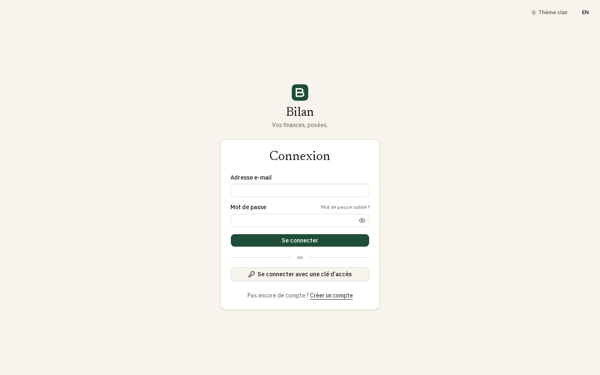

1. Saisissez votre **Adresse e-mail** et votre **Mot de passe**, puis cliquez sur **Se connecter**.
2. Si la double authentification est activée, saisissez le code à 6 chiffres de votre application d’authentification à l’étape **Vérification**. Cliquez sur **Utiliser un code de secours** si vous n’avez pas votre téléphone. Cochez **Faire confiance à cet appareil** pour ne plus saisir le code sur cet appareil : il sera redemandé après 30 jours sans connexion depuis celui-ci.

Vous pouvez aussi utiliser **Se connecter avec une clé d’accès**, ou un bouton **Continuer avec …** si votre administrateur a configuré Google ou un autre fournisseur d’identité. Ces connexions ne demandent pas le code de double authentification.

Bon à savoir :

- Après 5 tentatives échouées en 15 minutes, la connexion est bloquée un moment ; la page indique combien de temps attendre.
- Une identité d’un fournisseur externe n’est pas reliée à votre compte Bilan simplement parce que l’e-mail est le même. Liez-la d’abord depuis **Sécurité** (voir [Identités connectées](#identités-connectées)).
- Une session dure 7 jours et se prolonge chaque jour où vous utilisez l’application.

### Créer un compte

Cliquez sur **Créer un compte** depuis la page de connexion. Ce que vous voyez dépend de la configuration de l’instance :

- **Inscriptions ouvertes** : renseignez **Nom**, **Adresse e-mail**, **Mot de passe** et **Confirmer le mot de passe**, puis cliquez sur **Créer le compte**.
- **Sur invitation** (le réglage par défaut) : un champ **Jeton d’invitation** apparaît en premier. Votre administrateur vous transmet un jeton, ou un lien d’inscription qui le remplit pour vous.
- **Fermées** : la page de connexion n’affiche pas de lien **Créer un compte**, et la page d’inscription affiche « Les inscriptions sont fermées sur cette instance. » Demandez à votre administrateur de créer votre compte.

Le mot de passe doit faire au moins 12 caractères par défaut (votre administrateur peut choisir un autre minimum). Vous êtes connecté aussitôt, et Bilan crée un jeu de catégories de départ dans votre langue.

### Mot de passe oublié

1. Cliquez sur **Mot de passe oublié ?** depuis la page de connexion.
2. Saisissez votre e-mail et cliquez sur **Envoyer le lien**.
3. Ouvrez le lien reçu par e-mail (valable 1 heure), choisissez un **Nouveau mot de passe** et cliquez sur **Réinitialiser**.

La réinitialisation vous déconnecte partout et oublie vos appareils de confiance.

### Vérifier votre adresse e-mail

Quand l’instance peut envoyer des e-mails, un bandeau **Vérifiez votre adresse e-mail** reste en haut de chaque page jusqu’à ce que vous cliquiez sur le lien envoyé par Bilan (valable 24 heures). Utilisez **Renvoyer l’e-mail** s’il n’est pas arrivé.

La vérification compte pour les foyers : les invitations envoyées à votre adresse n’apparaissent sur la page **Foyers** qu’une fois l’adresse vérifiée. Un lien ou un code d’invitation fonctionne déjà avant.

### Démarrer

Tant que vous n’avez aucune transaction, le tableau de bord affiche une carte **Bienvenue** en deux étapes :

1. **Créer un compte bancaire** : voir [Comptes](#comptes).
2. **Importer un relevé ou saisir une transaction** : voir [Importer des relevés](#importer-des-relevés) et [Saisir une transaction à la main](#saisir-une-transaction-à-la-main).

### Se repérer

Sur ordinateur, la barre latérale a deux groupes :

- **Espace** : Tableau de bord, Analyses, Transactions, Importer, Budgets, Comptes, Catégories, Foyers.
- **Compte** : Sécurité, Données, et Administration si vous êtes administrateur.

En haut à droite, le bouton **EN**/**FR** change de langue. Bilan retient votre choix et l’utilise aussi pour les e-mails qu’il vous envoie. Vos initiales ouvrent un menu avec **Se déconnecter**.

Le bouton de thème se trouve en bas de la barre latérale. Il propose **Clair**, **Sombre** et **Système**. **Système** (le choix par défaut) suit le réglage de votre appareil.

### Sur téléphone

| Tableau de bord                                                  | Transactions                                                     |
| ---------------------------------------------------------------- | ---------------------------------------------------------------- |
| 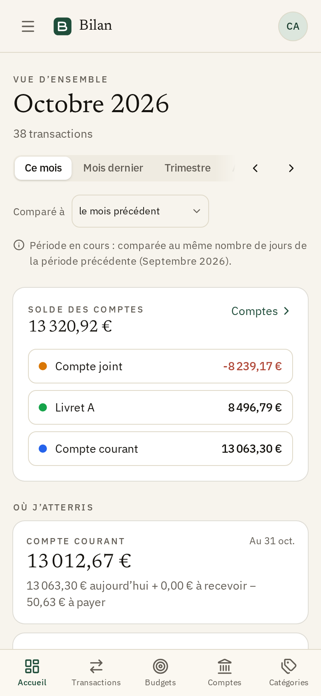 | 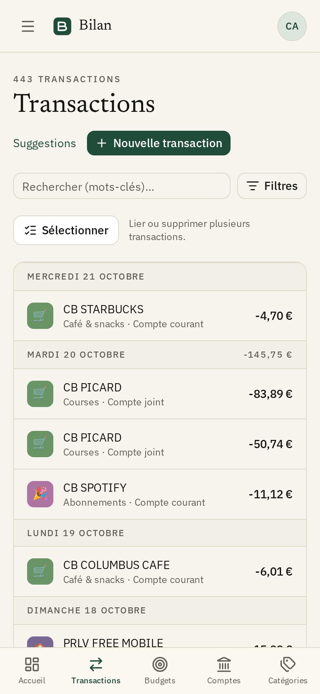 |

- La barre du bas donne un accès rapide à **Accueil**, **Transactions**, **Budgets**, **Comptes** et **Catégories**.
- Le bouton de menu en haut à gauche ouvre tout le reste : Analyses, Importer, Foyers, Sécurité, Données, le bouton de thème et le bouton de langue.
- Sur la page des transactions, les filtres sont derrière le bouton **Filtres**.

Bilan peut s’installer comme une application : utilisez l’option **Installer** ou **Ajouter à l’écran d’accueil** de votre navigateur. Une connexion reste nécessaire : vos données financières ne sont jamais stockées sur l’appareil.

## Comptes

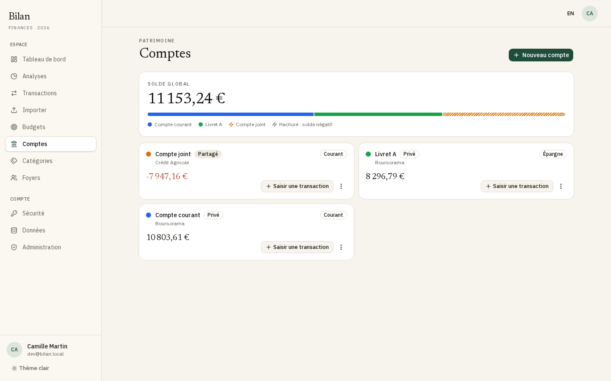

Un compte regroupe des transactions : compte courant, livret, carte, etc. Le **Solde global** en haut additionne tous les comptes actifs que vous voyez, y compris ceux partagés avec vous. Les soldes négatifs sont hachurés.

### Ajouter un compte

1. Allez dans **Comptes** et cliquez sur **Nouveau compte**.
2. Choisissez le **Type de compte** : Courant, Épargne, Crédit ou Autre.
3. Saisissez le **Nom du compte** et, si vous le souhaitez, la **Banque**.
4. Saisissez le **Solde initial** : le solde avant la première transaction que vous enregistrerez. Il peut être négatif.
5. Saisissez éventuellement l’**IBAN**. Bilan le vérifie et le stocke chiffré.
6. Choisissez une **Couleur** et cliquez sur **Créer le compte**.

Le solde d’un compte est son solde initial plus toutes ses transactions. Les montants sont en euros.

Un nouveau compte est privé. Pour le partager, voir [Partager un compte](#partager-un-compte).

### Voir l’IBAN

La carte n’affiche que les 4 derniers caractères. Cliquez sur l’œil (**Afficher l’IBAN**) pour voir l’IBAN complet, puis de nouveau pour le masquer. Seul le propriétaire du compte voit l’IBAN ; les personnes avec qui vous le partagez ne le voient jamais.

Si vous vous êtes connecté il y a moins de 10 minutes, l’IBAN s’affiche aussitôt. Sinon, Bilan vous demande d’abord de confirmer votre identité :

- Si vous vous connectez avec un mot de passe, saisissez-le et cliquez sur **Afficher l’IBAN**. Pendant les 5 minutes suivantes, Bilan ne le redemande pas. Après 5 mots de passe erronés en 15 minutes, patientez avant de réessayer.
- Si votre compte n’a pas de mot de passe (fournisseur d’identité ou clé d’accès uniquement), ou si la connexion par mot de passe est désactivée, cliquez sur **Se reconnecter** : votre session est fermée, puis vous revenez sur la page des comptes une fois reconnecté. L’IBAN s’affiche alors aussitôt.

Chaque affichage d’un IBAN complet est enregistré dans le journal d’activité, sans l’IBAN lui-même.

Pour changer ou retirer l’IBAN, ouvrez **Modifier** dans le menu de la carte. Laissez le champ vide pour garder celui enregistré, ou cochez **Retirer l’IBAN enregistré**.

### Archiver ou supprimer un compte

Le menu **⋮** d’une carte (propriétaire uniquement) propose **Modifier**, **Partager**, **Archiver** et **Supprimer**.

- **Archiver** convient à un compte que vous n’utilisez plus mais dont vous voulez garder l’historique. Il disparaît des saisies et du solde global, et passe dans une section **Comptes archivés**. Ses transactions restent dans votre historique, vos budgets et le tableau de bord. Vous ne pouvez plus y saisir ni y importer de transactions, et seuls le libellé et la note de ses transactions restent modifiables. **Désarchiver** le fait revenir.
- **Supprimer** efface définitivement le compte et toutes ses transactions. Bilan indique d’abord ce qui va disparaître : transactions, imports, partages, lignes de budget limitées à ce compte, budgets qui ne portaient que sur lui, et liens avec d’autres comptes. Saisissez le nom du compte pour confirmer, puis cliquez sur **Supprimer définitivement**.

Astuce : si vous voulez seulement alléger la liste, archivez plutôt que de supprimer.

### Comptes partagés avec vous

Un compte qu’un autre membre du foyer partage avec vous affiche **Lecture** ou **Écriture** et « Partagé par … ». Vos propres comptes affichent **Privé** ou **Partagé**. Voir [Ce que permettent Lecture et Écriture](#ce-que-permettent-lecture-et-écriture).

## Transactions

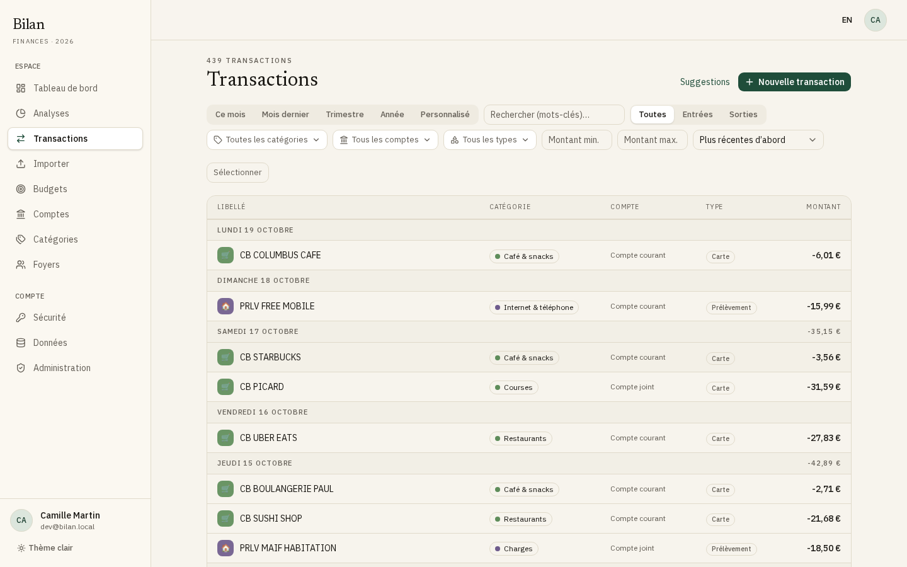

La page **Transactions** liste les transactions de tous les comptes que vous voyez, regroupées par jour. Quand un jour compte plusieurs transactions, son en-tête affiche le total du jour.

### Filtrer et trier

- **Période** : Ce mois, Mois dernier, Trimestre, Année, ou Personnalisé (choisissez un début et une fin, puis **Appliquer**). Sans période choisie, la liste couvre toutes les dates.
- **Toutes / Entrées / Sorties**.
- **Catégorie** : une catégorie inclut aussi ses sous-catégories. **Sans catégorie** retrouve les transactions non classées.
- **Compte** et **Type** (Carte, Virement, Prélèvement, Chèque, Retrait, Autre).
- **Montant min.** / **Montant max.** : ils comparent le montant sans son signe, donc 50 retrouve −50 comme +50.
- **Tri** : Plus récentes d’abord, Plus anciennes d’abord, Plus grosses dépenses d’abord, Plus grosses entrées d’abord.

La liste affiche 100 transactions à la fois : cliquez sur **Afficher 100 de plus** en bas. Au-delà de 1 000, affinez les filtres pour voir les plus anciennes.

Sur téléphone, touchez **Filtres**, ajustez, puis touchez **Voir … transactions**. **Réinitialiser** efface les filtres et le tri.

### Rechercher

Tapez dans **Rechercher (mots-clés)…**. La recherche porte sur le début des mots du libellé :

- « lec » trouve « LECLERC », mais « clerc » ne trouve rien.
- Les mots de moins de 3 lettres sont ignorés.
- Avec plusieurs mots, une transaction doit les contenir tous.
- Les majuscules et les accents ne comptent pas.
- Les montants, les notes et les catégories ne sont pas recherchés : utilisez les filtres de montant pour les montants.

### Détail d’une transaction

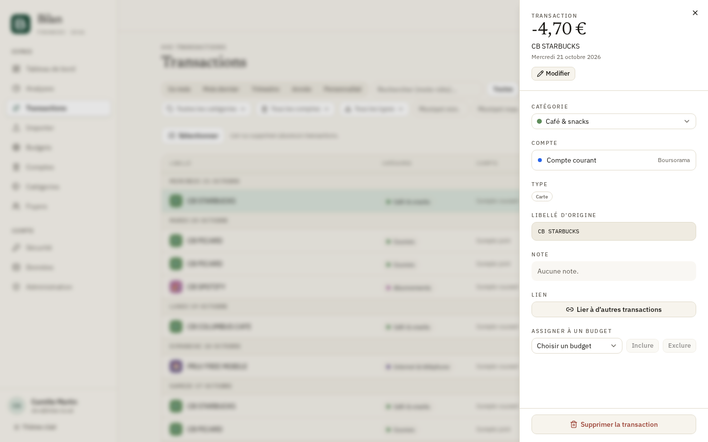

Cliquez sur une transaction pour ouvrir son détail :

- **Catégorie** : choisissez une catégorie ; elle est enregistrée aussitôt. Voir [Apprendre de vos choix](#apprendre-de-vos-choix).
- **Libellé d’origine** : le libellé exactement tel que votre banque l’a écrit. Il ne change jamais, même si vous renommez la transaction.
- **Note** : votre commentaire, ajouté avec **Modifier**.
- **Liée à** : affiché quand la transaction fait partie d’un [lien](#liens-entre-transactions).
- **Assigner à un budget** : voir [Inclure ou exclure une transaction](#inclure-ou-exclure-une-transaction).
- **Supprimer la transaction** en bas.

**Modifier** permet de changer le libellé et la note. Pour les transactions saisies à la main, vous pouvez aussi changer la date, le montant et le type. Les transactions importées gardent le montant, la date et le type du relevé bancaire.

### Saisir une transaction à la main

1. Cliquez sur **Nouvelle transaction** (ou **Saisir une transaction** sur la carte d’un compte).
2. Choisissez le **Compte**, la **Date** et le **Montant** : un montant négatif est une dépense, un montant positif une entrée.
3. Saisissez le **Libellé**, le **Type**, et éventuellement une **Catégorie** et une **Note**.
4. Cliquez sur **Ajouter**.

Si vous laissez la catégorie vide, vos [règles](#règles) essaient d’en trouver une d’après le libellé.

### Sélectionner plusieurs transactions

1. Cliquez sur **Sélectionner** au-dessus de la liste (sur téléphone, c’est un interrupteur dans **Filtres**).
2. Cochez les transactions. Celles des comptes que vous pouvez seulement consulter ne sont pas sélectionnables.
3. Cliquez sur **Lier** (2 transactions ou plus) ou **Supprimer** dans la barre qui apparaît.

Avant la suppression, Bilan liste les effets : liens qui seront dissous et budgets dont les transactions sortiront. Vous pouvez supprimer jusqu’à 500 transactions à la fois. La suppression est irréversible.

## Importer des relevés

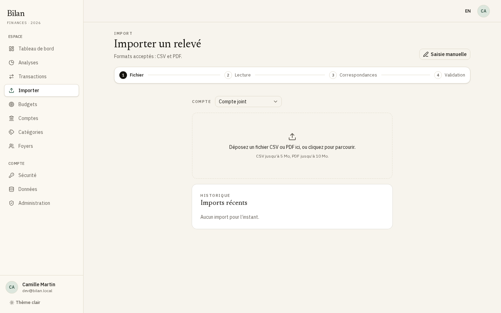

Bilan importe des fichiers CSV (jusqu’à 5 Mo) et des relevés PDF (jusqu’à 10 Mo) exportés depuis votre banque.

### Importer un fichier CSV

1. Allez dans **Importer** et choisissez le **Compte**.
2. Déposez le fichier sur la page ou cliquez pour le choisir.
3. Vérifiez les réglages à gauche (pré-remplis d’après le fichier) :
   - **Compte de destination** : vous pouvez encore changer de compte ici.
   - **Correspondance des colonnes** : quelle colonne contient la **Date**, le **Libellé** et le **Montant**. Si votre banque sépare les sorties et les entrées dans deux colonnes, mettez **Montant** sur « — » et choisissez plutôt **Débit** et **Crédit**. **Type** est facultatif.
   - **Décimales** : Virgule ou Point.
   - **Ordre des dates** : JJ/MM ou MM/JJ.
   - **Catégoriser automatiquement** : applique vos [règles](#règles). La case est cochée par défaut.
4. Relisez l’aperçu. Vous pouvez décocher une ligne pour l’ignorer, ou lui choisir une catégorie.
5. Cliquez sur **Valider l’import**.

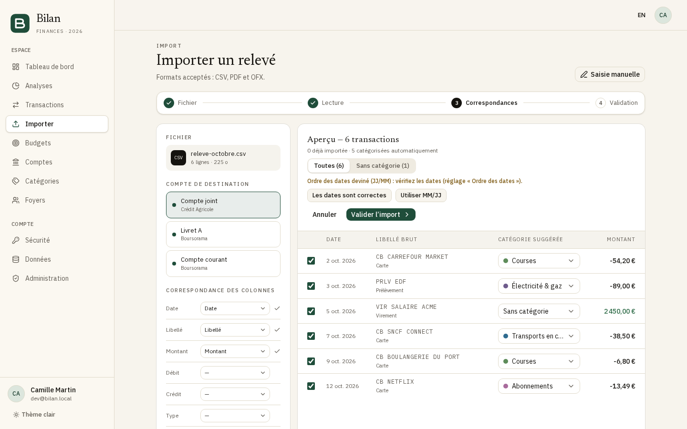

Points à vérifier dans l’aperçu :

- **Décimales** : quand Bilan a dû deviner, un avertissement vous demande de vérifier les montants. Cliquez sur **C’est correct**, ou sur le bouton qui passe à l’autre séparateur.
- **Ordre des dates** : Bilan ne choisit MM/JJ que lorsque le fichier ne peut pas se lire en JJ/MM (par exemple 12/25). Quand toutes les dates conviennent aux deux ordres, il retient JJ/MM et un avertissement vous demande de vérifier les dates. Cliquez sur **Les dates sont correctes**, ou sur **Utiliser MM/JJ**. Les dates écrites 2026-10-15 ne sont jamais ambiguës.
- **Doublons** : une ligne de même date, même montant et même libellé bancaire qu’une transaction déjà importée sur ce compte est marquée **doublon** et ignorée. Impossible de la forcer. Les transactions saisies à la main ne sont jamais considérées comme des doublons. Les lignes identiques d’un même fichier sont toutes conservées.
- **Lignes illisibles** : les lignes avec une date ou un montant non reconnus, un montant hors limites ou un libellé vide sont ignorées. Bilan indique leur nombre et jusqu’à 5 exemples avec leur numéro de ligne. Si toute une colonne pose problème, elle est signalée à gauche : essayez une autre correspondance.

Changer la correspondance, le compte, le séparateur décimal ou l’ordre des dates recalcule l’aperçu, et vous perdez les lignes décochées et les catégories choisies.

Bilan ne mémorise pas la correspondance d’un import à l’autre, mais il reconnaît les noms de colonnes habituels en français et en anglais.

### Importer un relevé PDF

Déposez le PDF sur la même page. Bilan lit les relevés **LCL** et **Revolut** (relevés en français). L’aperçu indique la banque détectée. Pour les autres banques, il signale une banque non reconnue et tente une lecture générique des lignes « date, libellé, montant » : relisez l’aperçu avec attention. Les PDF scannés (images) ne sont pas lisibles.

Un relevé Revolut peut contenir plusieurs sections (compte courant, dépôt). Chaque section a son propre choix de **Compte de destination**. Choisissez **Ne pas importer** pour en ignorer une.

Pas de séparateur décimal ni d’ordre des dates à régler pour les PDF. Les doublons, les catégories et l’aperçu fonctionnent comme pour les CSV.

### Annuler un import

Mauvais fichier, mauvais compte ? Annulez tout l’import :

- juste après l’import, cliquez sur **Annuler l’import** dans le récapitulatif, ou
- plus tard, ouvrez le menu **⋯** de l’import dans **Imports récents** sur la page **Importer** et choisissez **Annuler l’import**.

Bilan indique combien de transactions seront supprimées, et prévient si certaines sont liées à d’autres transactions, affectées à un budget ou modifiées depuis l’import. Cliquez sur **Supprimer les transactions** pour confirmer.

Toutes les transactions de cet import sont supprimées, y compris celles modifiées depuis. L’import reste dans l’historique avec le statut **Annulé**, et vous pouvez réimporter le même fichier ensuite. Il n’y a pas de délai, mais il faut un accès en écriture à chaque compte concerné par l’import.

## Catégories, règles et marchands

La page **Catégories** a trois onglets : **Catégories**, **Règles** et **Marchands**.

### Catégories

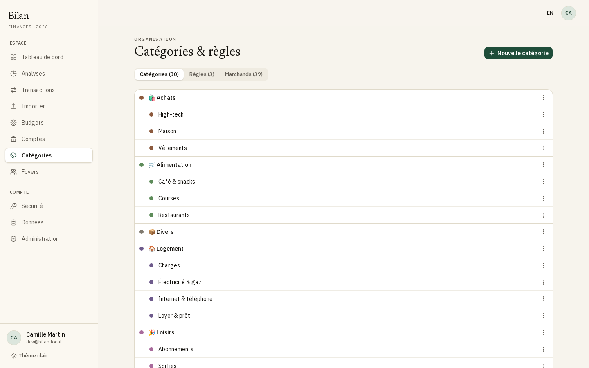

Bilan vous fournit au départ des catégories et sous-catégories, modifiables et supprimables comme les vôtres.

Pour en créer une :

1. Cliquez sur **Nouvelle catégorie**.
2. Saisissez un **Nom** et choisissez une **Catégorie parente**, ou **Aucune (catégorie racine)**.
3. Choisissez la **Portée** : **Personnelle** (visible uniquement par vous) ou un foyer (visible par tous ses membres). La portée ne peut plus être changée ensuite.
4. Choisissez une **Couleur**. Le bouton **+** ouvre un sélecteur de couleur libre. Une sous-catégorie peut reprendre la couleur de son parent.
5. Choisissez un **Symbole**, ou saisissez n’importe quel caractère ou emoji avec **+**.
6. Cliquez sur **Créer la catégorie**.

Pour supprimer une catégorie, ouvrez son menu **⋮** et choisissez **Supprimer**. Ses sous-catégories sont supprimées aussi. Si des transactions, des règles ou des lignes de budget l’utilisent, choisissez où les rattacher avec **Déplacer vers**. Avec **Aucune catégorie**, les transactions deviennent non catégorisées et les règles et lignes de budget sont supprimées.

### Règles

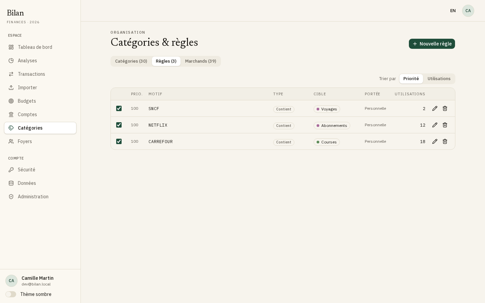

Une règle attribue une catégorie aux transactions dont le libellé bancaire correspond à un motif.

1. Dans l’onglet **Règles**, cliquez sur **Nouvelle règle**.
2. Saisissez le **Motif** et choisissez la **Correspondance** : **Contient**, **Égal**, **Commence par** ou **Regex**.
3. Choisissez la **Catégorie** et la **Priorité** : quand plusieurs règles correspondent, le nombre le plus élevé l’emporte (100 par défaut).
4. Si vous gérez un foyer, choisissez la **Portée** : **Personnelle** ou le foyer. Les règles d’un foyer s’appliquent aux transactions de tous ses membres.
5. Cochez **Sensible à la casse** si besoin. Par défaut, majuscules et accents sont ignorés.
6. Cliquez sur **Enregistrer**.

La case en début de ligne active ou désactive une règle. **Utilisations** compte les transactions catégorisées par la règle.

Quand les règles s’appliquent :

- pendant un import, si **Catégoriser automatiquement** est coché ;
- quand vous saisissez une transaction à la main sans choisir de catégorie.

Les règles ne modifient jamais les transactions déjà enregistrées, et ne remplacent jamais une catégorie que vous avez choisie vous-même.

### Apprendre de vos choix

Quand vous changez la catégorie d’une transaction, Bilan propose **Créer une règle pour les transactions similaires ?**. Il suggère un motif tiré du libellé bancaire, modifiable, ainsi que le type de correspondance. Cliquez sur **Créer la règle** pour enregistrer une règle personnelle, ou sur **Non merci**. Les transactions existantes ne sont pas reclassées.

### Marchands

L’onglet **Marchands** liste les endroits où vous dépensez, débarrassés du bruit bancaire (« CB », « PRLV SEPA », dates, références). Cliquez sur le crayon pour donner à un marchand un **Nom affiché**, ou regrouper plusieurs libellés bancaires sous un même nom. Les marchands renommés avec le même nom sont additionnés.

Cela ne concerne que la liste des marchands et la carte **Top marchands** des [Analyses](#analyses). Les libellés des transactions ne changent pas.

## Liens entre transactions

Un virement entre deux de vos comptes apparaît deux fois : une sortie d’un côté, une entrée de l’autre. Un remboursement annule un achat. Lier ces transactions évite à Bilan de les compter deux fois :

- des transactions liées qui s’annulent (un virement, un remboursement complet) sont écartées des totaux du tableau de bord et des budgets ;
- sinon (un remboursement partiel par exemple), le lien compte une seule fois, pour la différence.

Les transactions liées restent dans la liste avec l’étiquette **Liée**.

### Lier des transactions

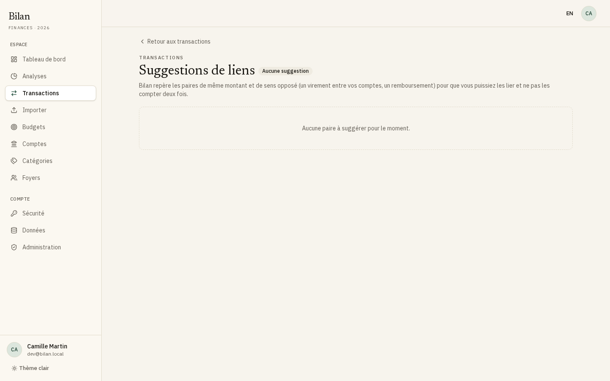

- **Depuis les suggestions** : sur **Transactions**, cliquez sur **Suggestions**. Bilan propose des paires de même montant et de sens opposé, à 30 jours d’écart au plus. Cliquez sur **Lier** pour accepter une paire ou **Ignorer** pour l’écarter. Les paires ignorées sont listées plus bas, et **Restaurer** permet de les suggérer de nouveau. **Réglages** modifie, pour vous seul, l’**Écart maximal (jours)** entre les deux opérations (0 pour le même jour, jusqu’à 365) et le **Montant minimum** en dessous duquel aucune paire n’est suggérée.
- **À la main** : [sélectionnez](#sélectionner-plusieurs-transactions) deux transactions ou plus et cliquez sur **Lier**.

Rien n’est lié automatiquement. Il faut un accès en écriture à chaque compte concerné.

### Délier

Ouvrez l’une des transactions et cliquez sur **Délier** dans la section **Liée à**. Supprimer une transaction la retire de son lien. Un lien qui ne contient plus qu’une transaction disparaît.

## Budgets

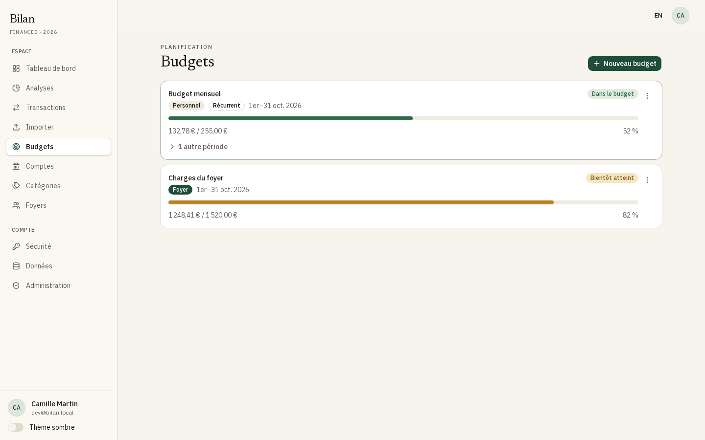

Un budget fixe ce que vous prévoyez de dépenser par catégorie ou par compte sur une période, et suit ce que vous dépensez réellement.

### Créer un budget

1. Allez dans **Budgets** et cliquez sur **Nouveau budget**.
2. Saisissez un **Nom** et, si vous le souhaitez, une **Description**.
3. Choisissez la **Portée** : **Personnel**, ou un foyer que vous gérez (voir [Budgets de foyer](#budgets-de-foyer)). Elle ne peut plus être changée ensuite.
4. Choisissez la **Période** : Semaine, Mois, Trimestre, Année ou Personnalisée, puis la date de **Début**. La date de fin découle de la période.
5. Cochez **Récurrent** pour un budget qui se répète à chaque période.
6. Ajoutez des **Lignes**. Pour chaque ligne, choisissez une **Catégorie** (ou **Toutes catégories**), un **Compte** (ou **Tous comptes**) et un **Montant prévu**. Une ligne peut aussi avoir un **Libellé**, affiché à la place du nom de la catégorie ou du compte.
7. Cliquez sur **Créer le budget**.

Comment les lignes comptent les dépenses :

- Une ligne de catégorie compte cette catégorie et ses sous-catégories. Un remboursement dans cette catégorie diminue le montant dépensé.
- Quand une ligne parente et une ligne de sous-catégorie correspondent toutes les deux, la transaction va à la plus précise.
- Une ligne **Toutes catégories / Tous comptes** reprend toutes les dépenses qui n’entrent dans aucune autre ligne.
- Les transactions liées sont comptées comme expliqué dans [Liens entre transactions](#liens-entre-transactions).

### Suivre un budget

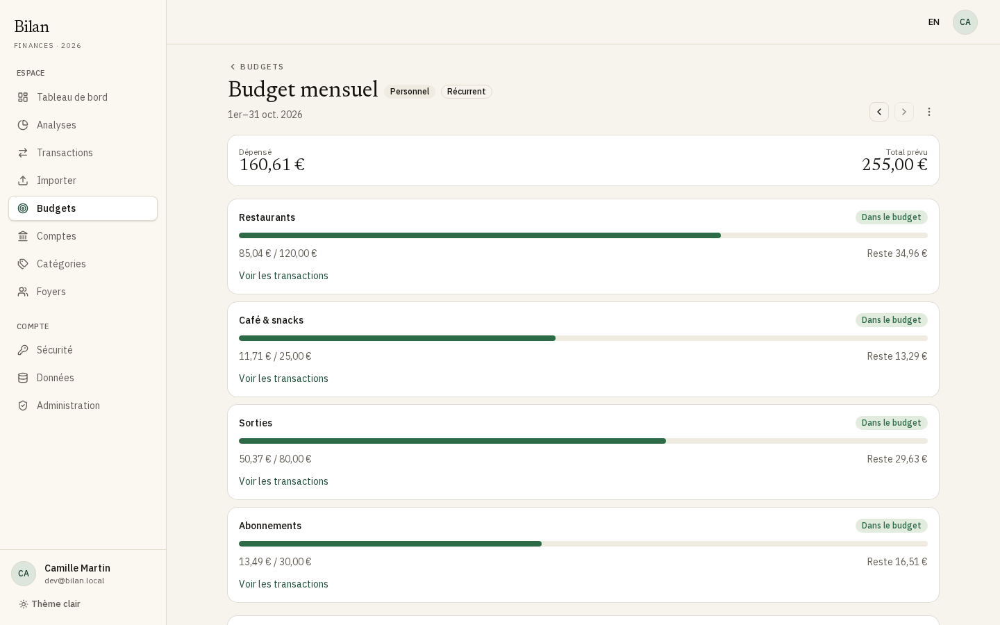

Chaque ligne, et le budget dans son ensemble, affiche un statut :

| Statut              | Signification                                |
| ------------------- | -------------------------------------------- |
| **Dans le budget**  | moins de 80 % du montant prévu               |
| **Bientôt atteint** | 80 % ou plus, sans l’avoir atteint           |
| **Atteint**         | exactement le montant prévu, au centime près |
| **Dépassé**         | plus que le montant prévu                    |

Astuce : **Atteint** demande le montant exact, au centime près. D’ici là, le pourcentage reste sous 100 % (99,6 % s’affiche 99 %), et tout dépassement affiche au moins 101 %. Une ligne prévue à 0 € reste **Dans le budget** tant que rien n’est dépensé ; la moindre dépense la passe en **Dépassé**, sans pourcentage (—).

Cliquez sur un budget pour ouvrir son détail : chaque ligne avec « Reste … » ou « Dépassé de … », **Voir les transactions** pour les lignes de catégorie, et la liste des transactions **Comptées dans ce budget**.

### Renouveler un budget récurrent

Quand la période d’un budget récurrent se termine, un bouton **Renouveler** sur sa carte crée la période suivante avec les mêmes lignes. Ce qui n’a pas été dépensé n’est pas reporté. Votre administrateur peut aussi mettre en place le renouvellement automatique. Les périodes d’une même série sont regroupées sur une carte : ouvrez **… autres périodes** pour les voir, ou utilisez les flèches de la page de détail.

### Modifier, archiver ou supprimer un budget

Le menu **⋮** de la carte d’un budget ou de sa page de détail propose **Modifier**, **Archiver** et **Supprimer**.

- **Archivez** un budget que vous ne suivez plus mais que vous voulez garder. Il quitte la liste, le tableau de bord et le menu **Assigner à un budget**, et il n’est plus renouvelé. Ses lignes et ses affectations sont conservées : le détail d’une transaction affiche toujours son affectation, marquée **Archivé**, et vous pouvez la retirer. Les budgets archivés sont regroupés sous **Budgets archivés** en bas de la liste : ouvrez-en un pour le consulter, ou choisissez **Désarchiver** dans son menu pour le rétablir.
- **Supprimer** efface le budget et ses lignes. Les transactions ne sont pas touchées, et les autres périodes d’un budget récurrent sont conservées.

### Inclure ou exclure une transaction

Depuis le détail d’une transaction, sous **Assigner à un budget** :

1. **Choisir un budget**.
2. Cliquez sur **Inclure** pour compter la transaction dans ce budget même si elle ne correspond à aucune ligne, sort de la période ou se trouve sur un compte que le budget ne couvre pas. Cliquez sur **Exclure** pour l’en écarter.
3. L’affectation apparaît en dessous avec **Incluse** ou **Exclue**. Cliquez sur **Retirer** pour l’annuler.

### Budgets de foyer

Un budget dont la portée est un foyer appartient au foyer :

- Les propriétaires et les admins le créent, le modifient, le renouvellent, l’archivent et le suppriment. Tous les membres peuvent le consulter et y inclure ou en exclure des transactions.
- Il compte les transactions des comptes partagés avec ce foyer.

Un membre peut aussi **Inclure** une transaction de l’un de ses comptes privés. Elle compte alors dans les totaux pour tout le monde, et tous les membres la voient en entier dans le budget : date, montant, libellé, catégorie et nom du compte. Seule cette transaction devient visible : le compte privé et ses autres transactions restent masqués. Si ce membre quitte ensuite le foyer ou en est retiré, la transaction ne compte plus dans les budgets du foyer.

Vous ne pouvez **Inclure** qu’une transaction de l’un de vos comptes ou d’un compte partagé avec ce foyer : un compte qu’un autre foyer partage avec vous ne peut pas être inclus.

## Foyers

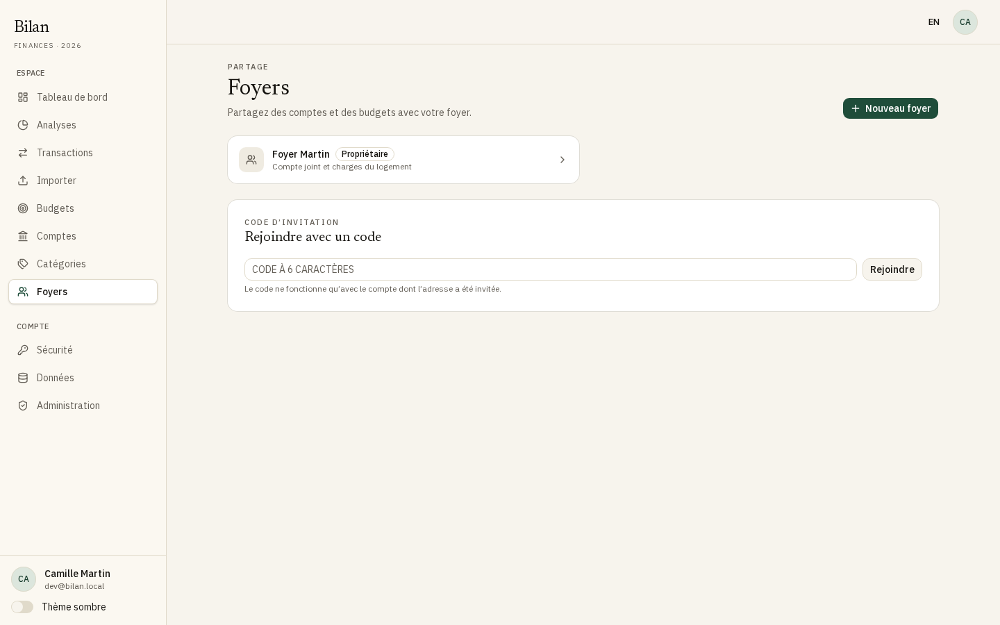

Un foyer permet à plusieurs personnes de partager des comptes, des budgets, des catégories et des règles. Les comptes de chacun restent privés tant qu’il ne décide pas d’en partager un.

### Créer un foyer

Allez dans **Foyers**, cliquez sur **Nouveau foyer**, saisissez le **Nom du foyer** et une **Description** facultative, puis cliquez sur **Créer le foyer**. Vous en devenez propriétaire.

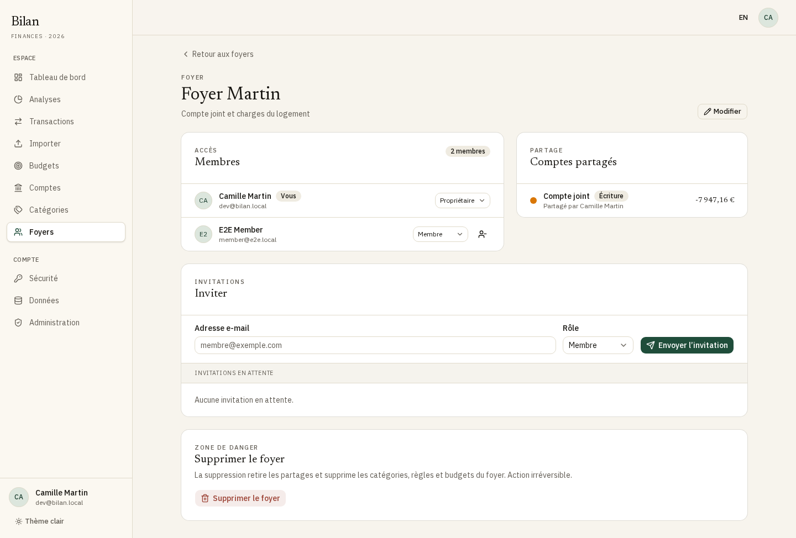

### Inviter quelqu’un

Les propriétaires et les admins peuvent inviter :

1. Sur la page du foyer, sous **Inviter**, saisissez l’**Adresse e-mail** de la personne.
2. Choisissez le **Rôle** : Membre ou Admin.
3. Cliquez sur **Envoyer l’invitation**.

Chaque invitation comporte un lien et un code à 6 caractères, et expire au bout de 7 jours. Si l’instance ne peut pas envoyer d’e-mail, Bilan le signale et affiche le **Lien d’invitation** : copiez-le avec **Copier le lien d’invitation** et transmettez-le vous-même.

**Invitations en attente** affiche, pour chaque invitation, le code, la date d’expiration et un bouton de copie. Le **X** la révoque. Inviter de nouveau la même adresse renouvelle son invitation.

### Accepter ou refuser une invitation

Vous pouvez accepter une invitation de trois façons :

- **Sur la page Foyers** : sous **Invitations en attente pour vous**, cliquez sur **Accepter l’invitation** ou **Refuser**. Les invitations n’apparaissent ici qu’une fois votre adresse e-mail vérifiée.
- **Avec le lien** : ouvrez-le en étant connecté et cliquez sur **Accepter l’invitation**.
- **Avec le code** : sur la page **Foyers**, saisissez-le sous **Rejoindre avec un code** et cliquez sur **Rejoindre**.

Une invitation ne fonctionne qu’avec le compte dont l’adresse e-mail a été invitée. Le lien et le code fonctionnent même avant la vérification de votre adresse.

### Rôles

| Action                                                                        | Membre | Admin                 | Propriétaire |
| ----------------------------------------------------------------------------- | ------ | --------------------- | ------------ |
| Voir les membres, les comptes partagés et les budgets du foyer                | oui    | oui                   | oui          |
| Partager ses propres comptes, inclure ou exclure des transactions des budgets | oui    | oui                   | oui          |
| Modifier le foyer, inviter des personnes                                      | non    | oui                   | oui          |
| Gérer les budgets, catégories et règles du foyer                              | non    | oui                   | oui          |
| Retirer des membres                                                           | non    | les membres seulement | oui          |
| Changer les rôles, supprimer le foyer                                         | non    | non                   | oui          |

Pour transmettre un foyer, un propriétaire donne le rôle **Propriétaire** à un autre membre. Un foyer peut avoir plusieurs propriétaires, mais en garde toujours au moins un.

### Partager un compte

1. Dans **Comptes**, ouvrez le menu **⋮** du compte et choisissez **Partager**.
2. Pour chaque foyer, choisissez **Aucun**, **Lecture** ou **Écriture**. Le changement s’applique immédiatement. Repasser sur **Aucun** un foyer avec lequel le compte était partagé retire aussi les inclusions et exclusions de ses transactions dans les budgets de ce foyer : aucune n’y compte plus.

#### Ce que permettent Lecture et Écriture

- **Lecture** : les membres voient le compte, son solde et toutes ses transactions, notes comprises. Ils peuvent inclure ses transactions dans des budgets ou les en exclure.
- **Écriture** : tout ce que permet Lecture, plus ajouter, modifier, recatégoriser, supprimer, importer, lier et délier des transactions.
- Vous seul, en tant que propriétaire, pouvez modifier, partager, archiver ou supprimer le compte, et voir son IBAN.

Vos comptes privés et leurs transactions ne sont jamais visibles des autres membres, sauf une transaction que vous incluez dans un budget de foyer (voir [Budgets de foyer](#budgets-de-foyer)). Un budget de foyer ne compte que les comptes partagés avec ce foyer.

### Quitter ou supprimer un foyer

La **Zone de danger** en bas de la page du foyer propose :

- **Quitter** : vous perdez l’accès aux comptes et budgets partagés du foyer. Vos comptes cessent d’être partagés avec le foyer, et vos transactions sortent de ses budgets (incluses comme exclues). Le dernier propriétaire ne peut pas quitter.
- **Supprimer le foyer** (propriétaires) : retire les membres, les invitations et les partages, ainsi que les catégories, règles et budgets du foyer. Les transactions qui utilisaient une catégorie du foyer deviennent non catégorisées. Les comptes et les transactions sont conservés. La confirmation chiffre ce qui est touché.

Il en va de même pour un membre retiré par un propriétaire ou un administrateur. Une ligne de budget du foyer limitée à l’un de ses comptes reste, ne compte plus rien et s’affiche comme un compte masqué : modifiez-la ou supprimez-la.

## Tableau de bord et analyses

Le tableau de bord et les analyses portent sur tous les comptes que vous voyez : les vôtres, ceux partagés avec vous, et les comptes archivés.

### Choisir la période

Sur les deux pages, choisissez **Ce mois**, **Mois dernier**, **Trimestre**, **Année** ou **Personnalisé**, et utilisez les flèches pour passer à la période précédente ou suivante.

Pour un mois seul, **Comparé à** permet de comparer avec **le mois précédent** ou la moyenne sur 3, 6 ou 12 mois. Les autres périodes sont comparées à la période précédente de même durée.

Tant que la période est en cours, Bilan la compare au même nombre de jours de la période de comparaison, et une note l’indique.

Astuce : les virements entre vos comptes comptent comme entrées et dépenses tant que vous ne les liez pas. Voir [Liens entre transactions](#liens-entre-transactions).

### Tableau de bord

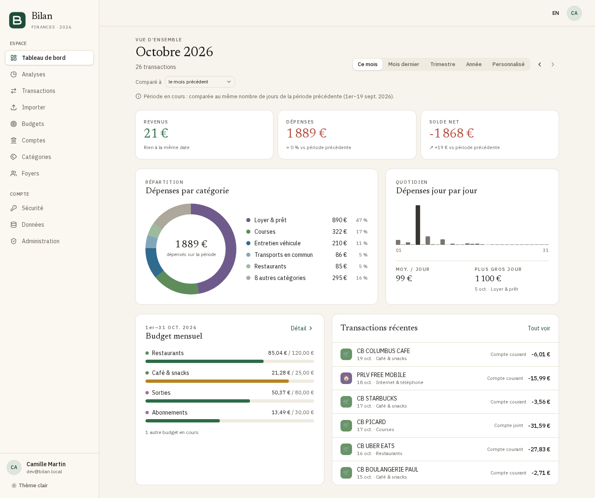

- **Revenus**, **Dépenses** et **Solde net**, chacun avec son évolution par rapport à la comparaison.
- **Dépenses par catégorie** : un anneau avec les six plus grosses catégories, le reste regroupé.
- **Dépenses jour par jour** (périodes jusqu’à 45 jours) ou **Dépenses par mois** (périodes plus longues), avec la moyenne et le plus gros jour ou mois.
- **Budget en cours** : votre budget du moment, ligne par ligne. Cliquez sur **Détail** pour l’ouvrir.
- **Transactions récentes** : les six dernières de la période. **Tout voir** ouvre la liste complète.

### Analyses

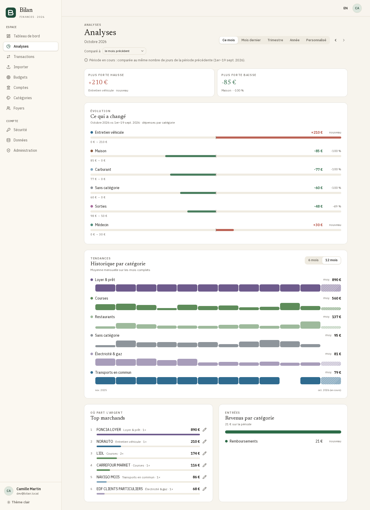

- **Plus forte hausse** et **Plus forte baisse** : les catégories dont les dépenses ont le plus changé.
- **Ce qui a changé** : les six catégories qui ont le plus évolué, du montant de comparaison au montant actuel.
- **Historique par catégorie** : les dépenses mensuelles de vos six principales catégories sur **6 mois** ou **12 mois**, avec la moyenne mensuelle. Le mois en cours est hachuré.
- **Top marchands** : où part votre argent. Le crayon renomme un marchand (voir [Marchands](#marchands)).
- **Revenus par catégorie**.

La plupart des lignes sont cliquables et ouvrent les transactions correspondantes.

## Sécurité du compte

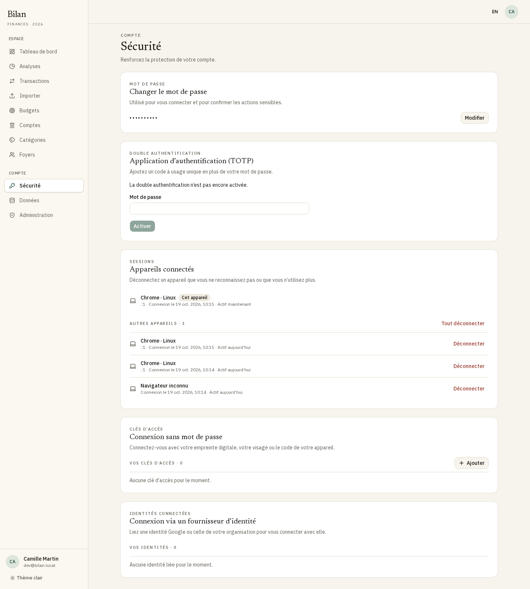

Allez dans **Sécurité** dans la barre latérale.

### Changer de mot de passe

Cliquez sur **Modifier**, saisissez votre **Mot de passe actuel** puis le nouveau deux fois, et cliquez sur **Changer le mot de passe**. **Déconnecter mes autres appareils** est activé par défaut. Bilan vous envoie un e-mail pour confirmer le changement.

### Double authentification

Pour l’activer :

1. Sous **Application d’authentification (TOTP)**, saisissez votre **Mot de passe** et cliquez sur **Activer**.
2. Scannez le QR code avec votre application d’authentification (ou saisissez la clé affichée).
3. Gardez les **Codes de secours** en lieu sûr. Chacun sert une fois si vous perdez votre téléphone. Ils ne sont affichés qu’à ce moment-là.
4. Saisissez le code affiché par l’application et cliquez sur **Vérifier et activer**.

Pour la désactiver, saisissez votre **Mot de passe** et un **Code d’authentification** (de l’application, ou un code de secours), puis cliquez sur **Désactiver**. Les deux sont obligatoires.

Tant qu’elle est activée, la carte indique combien de **Codes de secours** il vous reste. Pour en obtenir de nouveaux, cliquez sur **Générer de nouveaux codes**, saisissez votre **Mot de passe** et un **Code d’authentification**, puis cliquez de nouveau sur **Générer de nouveaux codes**. Vos anciens codes cessent aussitôt de fonctionner. Gardez les nouveaux avec **Copier** ou **Télécharger** : ils ne sont affichés qu’à ce moment-là.

Si votre compte n’a pas de mot de passe (vous vous connectez par un fournisseur d’identité ou avec une clé d’accès), la carte n’a rien à configurer : la double authentification de Bilan ne protège que les connexions par mot de passe, et c’est celle de votre fournisseur d’identité qui s’applique.

Votre administrateur peut rendre la double authentification obligatoire pour les administrateurs qui ont un mot de passe. Tant qu’un tel administrateur ne l’a pas activée, les pages d’administration le renvoient vers cette page, où un bandeau en explique la raison.

### Appareils de confiance

Quand la double authentification est activée, **Appareils de confiance** liste les navigateurs où vous avez coché **Faire confiance à cet appareil** : navigateur et système quand ils sont connus, dernière utilisation et date d’expiration. Cliquez sur **Oublier** à côté d’un appareil, ou sur **Tout oublier**. Un appareil oublié redemande le code à sa prochaine connexion par mot de passe.

### Clés d’accès

Une clé d’accès permet de vous connecter avec votre empreinte, votre visage ou le code de votre appareil au lieu du mot de passe. Cliquez sur **Ajouter** sous **Connexion sans mot de passe** et suivez les instructions de votre appareil. Vous pouvez renommer ou supprimer chaque clé.

Si votre connexion date de plus de 24 heures, Bilan vous demande de vous reconnecter avant d’en ajouter une.

### Appareils connectés

**Appareils connectés** liste les endroits où vous êtes connecté : navigateur, système, adresse IP et dernière activité. Cliquez sur **Déconnecter** à côté d’un appareil que vous ne reconnaissez pas, ou sur **Tout déconnecter** pour tous les autres appareils.

Les appareils de confiance sont aussi oubliés quand vous cliquez sur **Tout déconnecter**, changez de mot de passe avec **Déconnecter mes autres appareils** activé, réinitialisez votre mot de passe, ou activez ou désactivez la double authentification.

### Identités connectées

Si votre administrateur a configuré Google ou un autre fournisseur d’identité, cliquez sur **Lier …** sous **Connexion via un fournisseur d’identité**. L’adresse e-mail de l’identité doit correspondre à celle de votre compte. Vous pourrez la délier plus tard, sauf si c’est votre seul moyen de connexion.

### Alertes de connexion

Quand l’instance peut envoyer des e-mails, Bilan vous écrit après :

- une nouvelle connexion avec votre mot de passe, une clé d’accès, un code de secours ou un fournisseur d’identité ;
- un changement ou une réinitialisation du mot de passe ;
- l’ajout d’une clé d’accès ;
- la désactivation de la double authentification.

L’alerte indique la date, la méthode de connexion, l’adresse IP et l’appareil. Si ce n’était pas vous, changez votre mot de passe tout de suite. Ces alertes ne peuvent pas être désactivées.

## Vos données

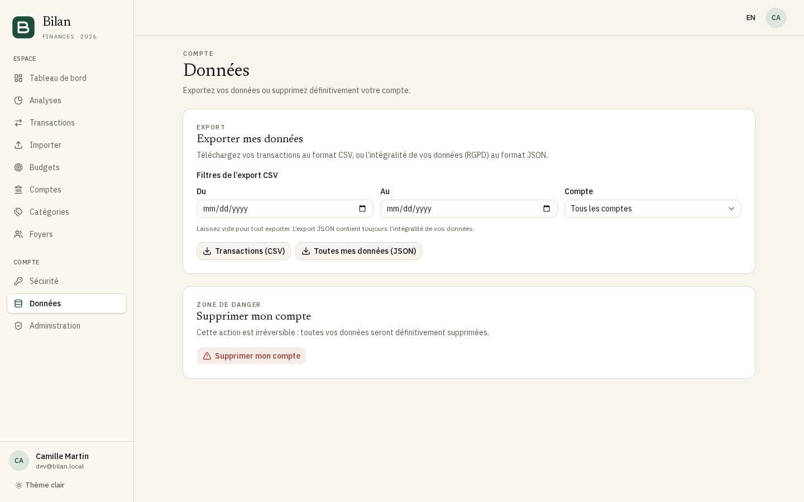

Allez dans **Données** dans la barre latérale.

### Exporter

- **Transactions (CSV)** : les transactions des comptes que vous voyez, avec date, montant, type, libellé, compte et catégorie. Par défaut, le fichier les contient toutes ; pour le restreindre, choisissez une période (**Du**, **Au**) ou un **Compte** au-dessus des boutons. Le fichier s’ouvre dans un tableur et peut être réimporté dans Bilan. En français, il utilise le point-virgule comme séparateur et la virgule décimale.
- **Toutes mes données (JSON)** : tout ce qui vous appartient, pour vos archives ou pour changer d’outil : profil, vos propres comptes (IBAN compris), leurs transactions avec notes et libellés d’origine, catégories, règles, noms de marchands, budgets, foyers, liens, historique des imports et votre journal d’activité récent. Les comptes que d’autres partagent avec vous n’y figurent pas. Comme il contient vos IBAN complets, il vous demande de confirmer votre identité comme pour [voir un IBAN](#voir-liban) si votre connexion date de plus de 10 minutes.

### Supprimer votre compte

Cliquez sur **Supprimer mon compte**, saisissez votre **Mot de passe** (ou votre adresse e-mail si vous vous connectez uniquement via un fournisseur d’identité), puis cliquez sur **Supprimer définitivement**. La confirmation détaille ce qui disparaît : nombre de comptes et de transactions, foyers transmis ou supprimés. La suppression est immédiate et définitive :

- vos comptes et leurs transactions sont supprimés, y compris ceux partagés avec un foyer : les autres membres les perdent aussi ;
- pour chaque foyer dont vous êtes propriétaire, un autre membre devient propriétaire ; un foyer sans autre membre est supprimé ;
- les catégories, règles et budgets propres au foyer sont conservés.

Astuce : exportez vos données d’abord si vous voulez en garder une copie.
