**English** · [Français](user-guide.fr.md)

# Bilan user guide

Bilan keeps track of your bank accounts, transactions and budgets, on your own server. You can use it alone or share accounts and budgets with the people you live with.

This guide walks through the app as a user. Running an instance is covered in the [self-hosting guide](self-hosting.md), and the instance settings in the [administration guide](admin-guide.md).

## Contents

1. [Getting started](#getting-started)
2. [Accounts](#accounts)
3. [Transactions](#transactions)
4. [Importing statements](#importing-statements)
5. [Categories, rules and merchants](#categories-rules-and-merchants)
6. [Links: transfers and refunds](#links-transfers-and-refunds)
7. [Budgets](#budgets)
8. [Households](#households)
9. [Dashboard and insights](#dashboard-and-insights)
10. [Account security](#account-security)
11. [Your data](#your-data)

## Getting started

### Sign in

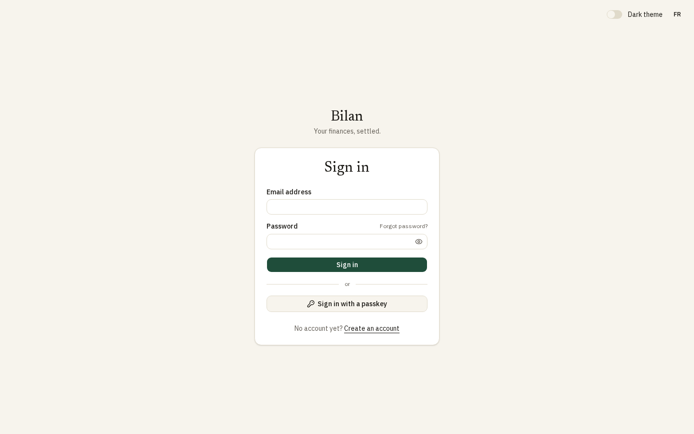

1. Enter your **Email address** and **Password**, then click **Sign in**.
2. If two-factor authentication is on, enter the 6-digit code from your authenticator app on the **Verification** step. Click **Use a backup code** if you don't have your phone. Tick **Trust this device** to skip the code on this device: it is asked again after 30 days without signing in from it.

You can also use **Sign in with a passkey**, or a **Continue with …** button when your administrator has set up Google or another identity provider. These sign-ins don't ask for the 2FA code.

Tips:

- After 5 failed attempts in 15 minutes, sign-in is blocked for a while and the page tells you how long to wait.
- An identity provider account is not linked to your Bilan account just because the e-mail is the same. Link it first from **Security** (see [Connected identities](#connected-identities)).
- A session lasts 7 days and is extended each day you use the app.

### Create an account

Click **Create an account** on the sign-in page. What you see depends on how the instance is configured:

- **Open registration**: fill in **Name**, **Email address**, **Password** and **Confirm password**, then click **Create account**.
- **Invite only** (the default): an **Invitation token** field appears first. Your administrator gives you a token or a sign-up link that fills it in for you.
- **Closed**: the sign-in page has no **Create an account** link, and the sign-up page shows "Registration is closed on this instance." Ask your administrator to create your account.

The password must be at least 12 characters long by default (your administrator may choose another minimum). You are signed in right away and Bilan creates a starter set of categories in your language.

### Forgot your password

1. Click **Forgot password?** on the sign-in page.
2. Enter your e-mail and click **Send link**.
3. Open the link from the e-mail (valid for 1 hour), choose a **New password** and click **Reset**.

Resetting your password signs you out everywhere and forgets your trusted devices.

### Verify your e-mail address

When the instance can send e-mail, a **Verify your email address** banner stays at the top of every page until you click the link Bilan sent you (valid for 24 hours). Use **Resend the email** if it didn't arrive.

Verification matters for households: invitations sent to your address only show up on the **Households** page once the address is verified. An invitation link or code works before that.

### First steps

Until you have a transaction, the dashboard shows a **Welcome** card with two steps:

1. **Create a bank account**: see [Accounts](#accounts).
2. **Import a statement or add a transaction**: see [Importing statements](#importing-statements) and [Add a transaction by hand](#add-a-transaction-by-hand).

### Find your way around

On a computer, the sidebar has two groups:

- **Workspace**: Dashboard, Insights, Transactions, Import, Budgets, Accounts, Categories, Households.
- **Account**: Security, Data, and Administration if you are an administrator.

At the top right, the **FR**/**EN** button switches the language. Bilan remembers your choice and also uses it for the e-mails it sends you. Your initials open a menu with **Sign out**.

The **Dark theme** switch sits at the bottom of the sidebar. Until you use it, Bilan follows your system theme.

### On a phone

| Dashboard                                               | Transactions                                                  |
| ------------------------------------------------------- | ------------------------------------------------------------- |
| 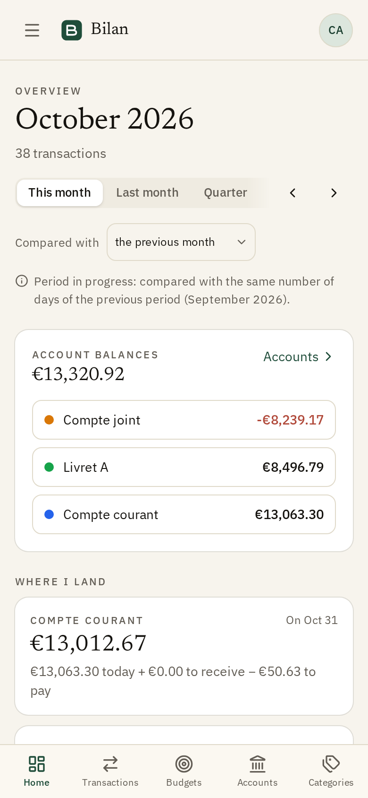 | 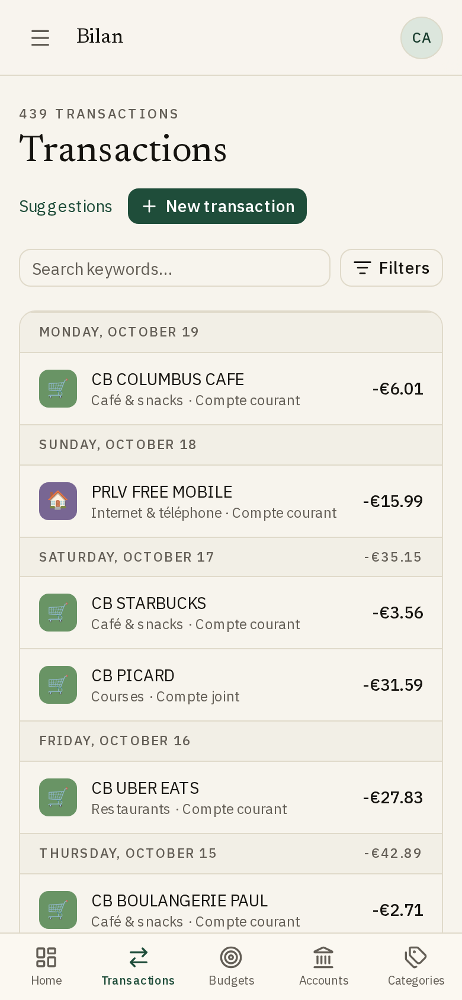 |

- The bottom bar gives quick access to **Home**, **Activity** (transactions), **Budgets**, **Accounts** and **Categories**.
- The menu button at the top left opens everything else: Insights, Import, Households, Security, Data, the theme switch and the language button.
- On the transactions page, filters live behind the **Filters** button.

Bilan can be installed as an app: use your browser's **Install** or **Add to Home Screen** option. It still needs a connection: your financial data is never stored on the device.

## Accounts

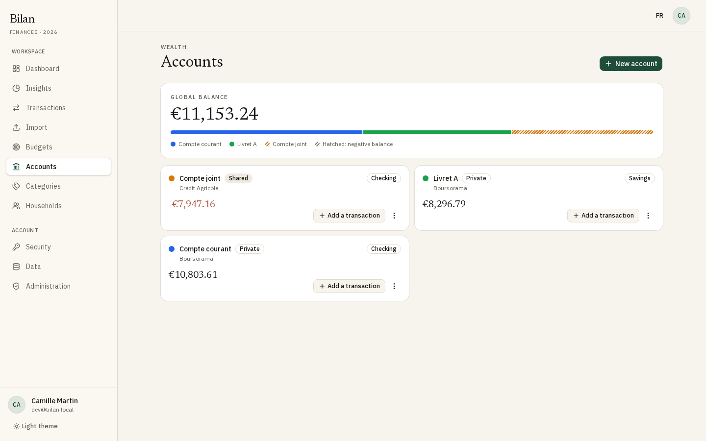

An account holds transactions: a checking account, a savings account, a card, and so on. The **Global balance** at the top adds up every active account you can see, including accounts shared with you. Negative balances are drawn hatched.

### Add an account

1. Go to **Accounts** and click **New account**.
2. Pick the **Account type**: Checking, Savings, Credit or Other.
3. Enter the **Account name**, and optionally the **Bank**.
4. Enter the **Opening balance**: the balance before the first transaction you will record. It can be negative.
5. Optionally enter the **IBAN**. Bilan checks it and stores it encrypted.
6. Pick a **Color** and click **Create account**.

An account's balance is its opening balance plus all its transactions. Amounts are in euros.

A new account is private. To share it, see [Share an account](#share-an-account).

### See the IBAN

The card shows only the last 4 characters. Click the eye button (**Show IBAN**) to display the full IBAN, and click it again to hide it. Only the account owner can see the IBAN; people you share the account with never do.

To change or remove the IBAN, open **Edit** in the card's menu. Leave the field blank to keep the saved one, or tick **Remove the saved IBAN**.

### Archive or delete an account

The **⋮** menu on a card (owner only) offers **Edit**, **Share**, **Archive** and **Delete**.

- **Archive** an account you no longer use but whose history you want to keep. It leaves the entry forms and the global balance, and moves to an **Archived accounts** section. Its transactions stay in your history, budgets and dashboard. You can't add or import transactions into it, and only the label and note of its transactions can be edited. Use **Unarchive** to bring it back.
- **Delete** removes the account and all its transactions for good. Bilan first shows what will go: transactions, imports, shares, budget lines limited to this account, budgets that only covered it, and links with other accounts. Type the account name to confirm, then click **Delete permanently**.

Tip: if you only want to tidy up the list, archive rather than delete.

### Accounts shared with you

An account another household member shares with you shows **Read** or **Write** and "Shared by …". Your own accounts show **Private** or **Shared**. See [What Read and Write allow](#what-read-and-write-allow).

## Transactions

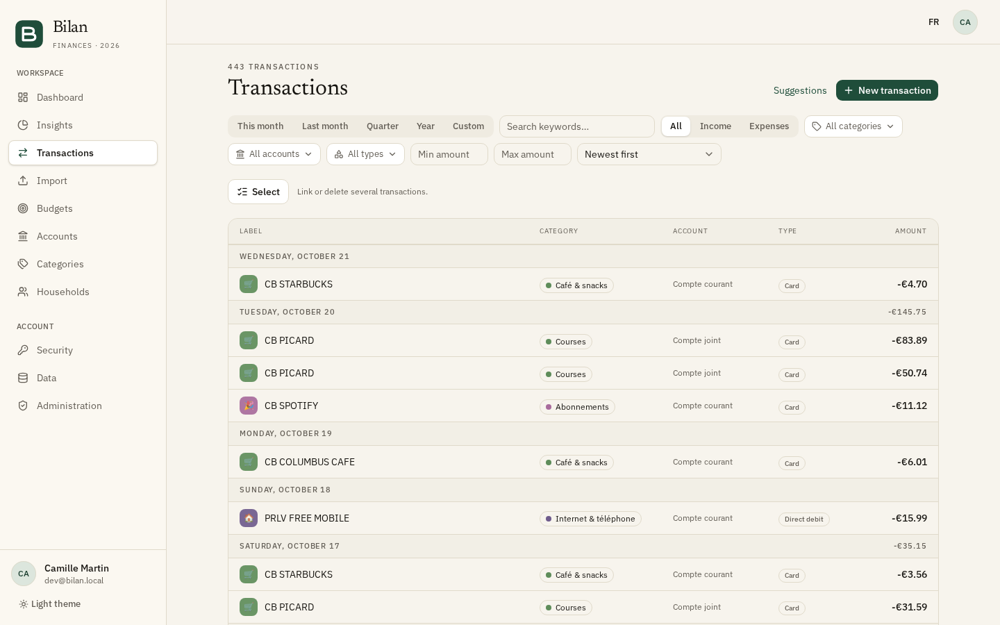

The **Transactions** page lists the transactions of every account you can see, grouped by day. When a day has several transactions, its header shows the day's total.

### Filter and sort

- **Period**: This month, Last month, Quarter, Year, or Custom (pick a start and end date, then **Apply**). With no period selected, the list covers all dates.
- **All / Income / Expenses**.
- **Category**: a category also includes its sub-categories. **Uncategorized** finds transactions without a category.
- **Account** and **Type** (Card, Transfer, Direct debit, Cheque, ATM, Other).
- **Min amount** / **Max amount**: these compare the amount without its sign, so 50 matches both −50 and +50.
- **Sort**: Newest first, Oldest first, Largest expenses first, Largest income first.

The list shows 100 transactions at a time: click **Show 100 more** below it. Past 1,000, narrow the filters to reach older ones.

On a phone, tap **Filters**, adjust, then tap **Show … transactions**. **Reset** clears filters and sort.

### Search

Type in **Search keywords…**. The search looks at the beginning of words in the label:

- "lec" finds "LECLERC", but "clerc" doesn't.
- Words shorter than 3 letters are ignored.
- With several words, a transaction must match all of them.
- Case and accents don't matter.
- Amounts, notes and categories are not searched: use the amount filters for amounts.

### Transaction details

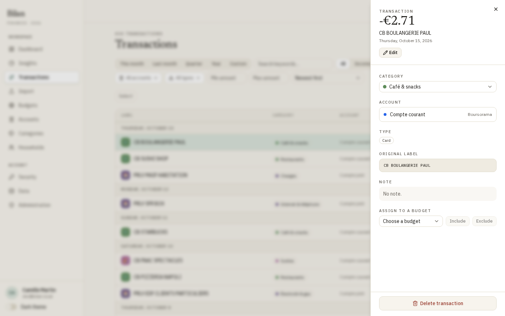

Click a transaction to open its details:

- **Category**: pick a category; it is saved immediately. See [Learn from your choices](#learn-from-your-choices).
- **Original label**: the label exactly as your bank wrote it. It never changes, even if you rename the transaction.
- **Note**: your own comment, added with **Edit**.
- **Linked to**: shown when the transaction is part of a [link](#links-transfers-and-refunds).
- **Assign to a budget**: see [Include or exclude a transaction](#include-or-exclude-a-transaction).
- **Delete transaction** at the bottom.

**Edit** lets you change the label and note. For transactions you entered by hand, you can also change the date, amount and type. Imported transactions keep the amount, date and type from the bank statement.

### Add a transaction by hand

1. Click **New transaction** (or **Add a transaction** on an account card).
2. Pick the **Account**, the **Date** and the **Amount**: a negative amount is an expense, a positive one is income.
3. Enter the **Label**, the **Type**, and optionally a **Category** and a **Note**.
4. Click **Add**.

If you leave the category empty, your [rules](#rules) try to find one from the label.

### Select several transactions

1. Click **Select** above the list (on a phone, it's a switch in **Filters**).
2. Tick the transactions. Those on accounts you can only read can't be selected.
3. Click **Link** (2 or more transactions) or **Delete** in the bar that appears.

Before deleting, Bilan lists the side effects: links that will be dissolved and budgets the transactions will leave. You can delete up to 500 transactions at once. Deletion can't be undone.

## Importing statements

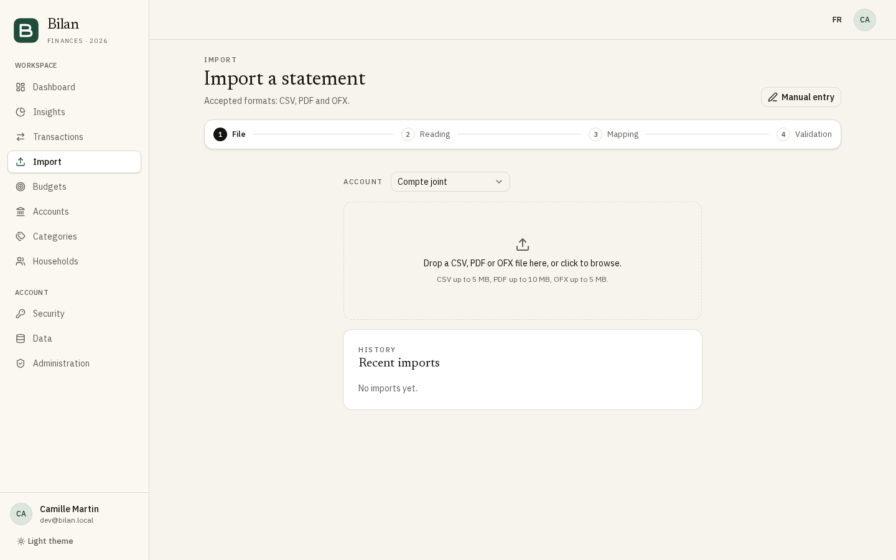

Bilan imports CSV files (up to 5 MB) and PDF statements (up to 10 MB) exported from your bank.

### Import a CSV file

1. Go to **Import** and choose the **Account**.
2. Drop the file on the page or click to browse.
3. Check the settings on the left (they come pre-filled from the file):
   - **Target account**: you can still switch account here.
   - **Column mapping**: which column holds the **Date**, the **Label** and the **Amount**. If your bank uses separate columns for money out and money in, set **Amount** to "—" and map **Debit** and **Credit** instead. **Type** is optional.
   - **Decimal mark**: Comma or Dot.
   - **Date order**: DD/MM or MM/DD.
   - **Categorize automatically**: applies your [rules](#rules). It is on by default.
4. Review the preview. You can untick a row to skip it, or pick a category for it.
5. Click **Validate import**.

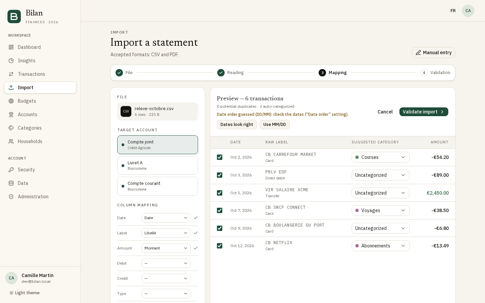

Things to check in the preview:

- **Decimal mark**: when Bilan had to guess, a warning asks you to check the amounts. Click **Looks right**, or the button that switches to the other mark.
- **Date order**: Bilan picks MM/DD only when the file can't be read as DD/MM (for example 12/25). When every date fits both orders, it assumes DD/MM and shows no warning. For a US-style file, check that the dates are right. Dates written as 2026-10-15 are never ambiguous.
- **Duplicates**: a row with the same date, amount and bank label as a transaction already imported into this account is marked **duplicate** and skipped. You can't force it in. Transactions you entered by hand are never treated as duplicates. Identical rows within the same file are all kept.
- **Unreadable rows**: rows with an unrecognized date or amount, an amount out of range or an empty label are skipped. Bilan shows how many there were and up to 5 examples with their line number. If a whole column is wrong, the sidebar flags it: try another column mapping.

Changing the mapping, the account or the decimal mark rebuilds the preview, and you lose the rows you unticked and the categories you picked.

Bilan doesn't remember the mapping between imports, but it recognizes the usual column names in French and English.

### Import a PDF statement

Drop the PDF on the same page. Bilan reads statements from **LCL** and **Revolut** (French-language statements). For other banks it tries a generic reading of "date, label, amount" lines, so check the preview carefully. Scanned PDFs (images) can't be read.

A Revolut statement can contain several sections (current account, deposit). Each section gets its own **Target account** choice. Pick **Don't import** to skip one.

There is no decimal mark or date order to set for PDFs. Duplicates, categories and the preview work as for CSV files.

### Undo an import

You imported the wrong file or picked the wrong account? Undo the whole import:

- right after importing, click **Undo import** on the summary, or
- later, open the **⋯** menu of the import in **Recent imports** on the **Import** page and choose **Undo import**.

Bilan shows how many transactions will be deleted, and warns you if some are linked to other transactions, assigned to a budget, or were edited since the import. Click **Delete the transactions** to confirm.

All of that import's transactions are deleted, edited ones included. The import stays in the history as **Undone**, and you can import the same file again afterwards. There is no time limit, but you need write access to every account the import went into.

## Categories, rules and merchants

The **Categories** page has three tabs: **Categories**, **Rules** and **Merchants**.

### Categories

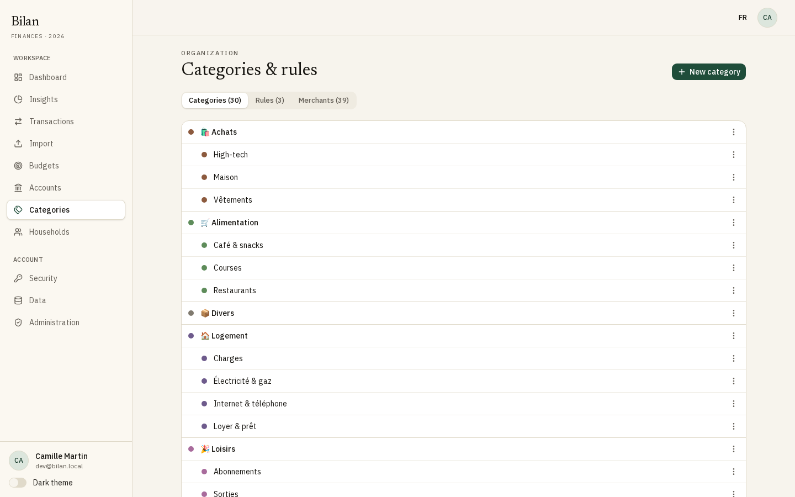

Bilan starts you with a set of categories and sub-categories that you can edit or delete like your own.

To create one:

1. Click **New category**.
2. Enter a **Name** and choose a **Parent category**, or **None (root category)**.
3. Choose the **Scope**: **Personal** (visible only to you) or a household (visible to every member). The scope can't be changed later.
4. Pick a **Color**. The **+** button opens a custom colour picker. A sub-category can use its parent's colour.
5. Pick a **Symbol**, or enter any character or emoji with **+**.
6. Click **Create category**.

To delete a category, open its **⋮** menu and choose **Delete**. Its sub-categories are deleted too. If transactions, rules or budget lines use it, choose where to move them with **Move to**. With **No category**, transactions become uncategorized and the rules and budget lines are deleted.

### Rules

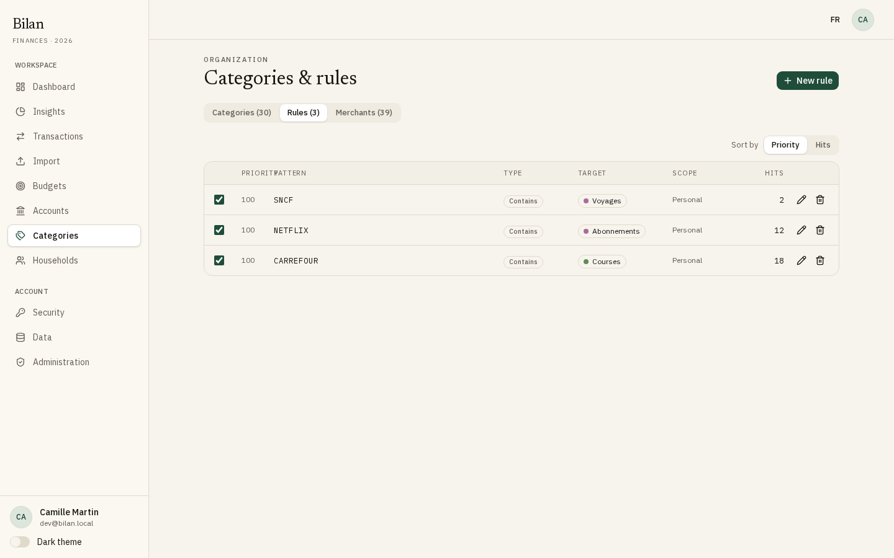

A rule gives a category to transactions whose bank label matches a pattern.

1. On the **Rules** tab, click **New rule**.
2. Enter the **Pattern** and pick the **Match**: **Contains**, **Equals**, **Starts with** or **Regex**.
3. Pick the **Category** and the **Priority**: when several rules match, the highest number wins (100 by default).
4. If you manage a household, choose the **Scope**: **Personal** or the household. Household rules apply to every member's transactions.
5. Tick **Case-sensitive** if needed. By default, case and accents are ignored.
6. Click **Save**.

The checkbox at the start of each row turns a rule on or off. **Hits** counts the transactions the rule has categorized.

When rules run:

- during an import, when **Categorize automatically** is ticked;
- when you add a transaction by hand without choosing a category.

Rules never change transactions that are already recorded, and never override a category you chose yourself.

### Learn from your choices

When you change a transaction's category, Bilan offers to **Create a rule for similar transactions?**. It suggests a pattern taken from the bank label, which you can edit along with the match type. Click **Create rule** to save a personal rule, or **No thanks**. Existing transactions are not re-categorized.

### Merchants

The **Merchants** tab lists the places you spend money, with bank noise removed ("CB", "PRLV SEPA", dates, references). Click the pencil to give a merchant a **Display name**, or group several bank labels under one name. Merchants renamed to the same name are added up.

This only affects the merchant list and the **Top merchants** card in [Insights](#insights). Transaction labels don't change.

## Links: transfers and refunds

A transfer between two of your accounts appears twice: money out of one, money in to the other. A refund cancels out a purchase. Linking these transactions stops Bilan from counting them twice:

- linked transactions that cancel out (a transfer, a full refund) are left out of the dashboard and budget totals;
- otherwise (a partial refund, for example), the link counts once, for the difference.

Linked transactions stay in the list with a **Linked** tag.

### Link transactions

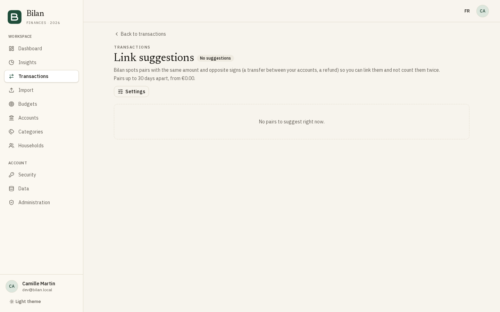

- **From suggestions**: on **Transactions**, click **Suggestions**. Bilan suggests pairs with the same amount and opposite signs, at most 30 days apart. Click **Link** to accept a pair or **Ignore** to dismiss it. Ignored pairs are listed further down, and **Restore** makes a pair eligible again.
- **By hand**: [select](#select-several-transactions) two or more transactions and click **Link**.

Nothing is linked automatically. Linking requires write access to every account involved.

### Unlink

Open one of the transactions and click **Unlink** in the **Linked to** section. Deleting a transaction removes it from its link. A link with only one transaction left disappears.

## Budgets

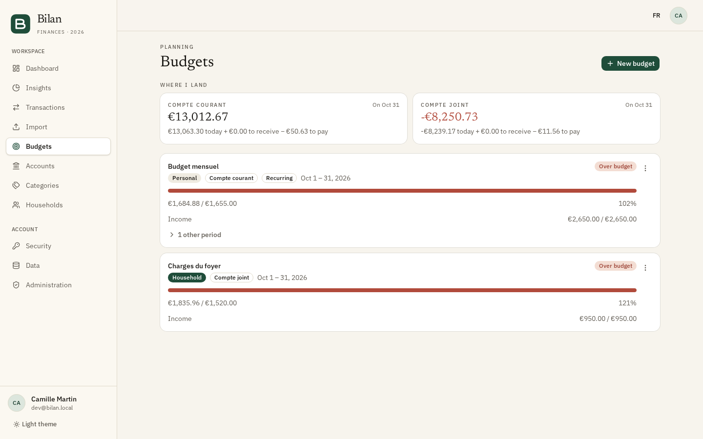

A budget sets how much you plan to spend per category or account over a period, and tracks what you actually spend.

### Create a budget

1. Go to **Budgets** and click **New budget**.
2. Enter a **Name**.
3. Choose the **Scope**: **Personal**, or a household you manage (see [Household budgets](#household-budgets)). It can't be changed later.
4. Choose the **Period**: Week, Month, Quarter, Year or Custom, then the **Start** date. The end date follows from the period.
5. Tick **Recurring** for a budget that repeats every period.
6. Add **Lines**. For each line, pick a **Category** (or **All categories**), an **Account** (or **All accounts**) and a **Planned amount**.
7. Click **Create budget**.

How lines count spending:

- A category line counts that category and its sub-categories. A refund in that category reduces the amount spent.
- When a parent line and a sub-category line both match, the transaction goes to the more specific one.
- An **All categories / All accounts** line takes every expense that no other line matches.
- Linked transactions are counted as explained in [Links](#links-transfers-and-refunds).

### Follow a budget

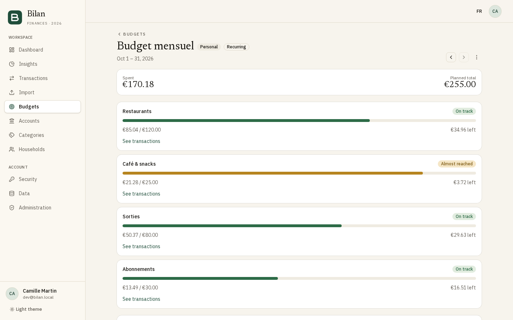

Each line and the budget as a whole show a status:

| Status          | Meaning                                 |
| --------------- | --------------------------------------- |
| **On track**    | under 80 % of the planned amount        |
| **Near limit**  | 80 % or more, not reached yet           |
| **Reached**     | exactly the planned amount, to the cent |
| **Over budget** | more than the planned amount            |

Tip: 99.6 % is shown as 100 % but is still **Near limit**. **Reached** needs the exact amount.

Click a budget to open its details: each line with "… left" or "Over by …", **See transactions** for category lines, and the list of transactions **Counted in this budget**.

### Renew a recurring budget

When a recurring budget's period ends, a **Renew** button on its card creates the next period with the same lines. Unspent amounts are not carried over. Your administrator can also set up automatic renewal. The periods of a series are grouped on one card: open **… other periods** to see them, or use the arrows on the details page.

### Include or exclude a transaction

From a transaction's details, under **Assign to a budget**:

1. **Choose a budget**.
2. Click **Include** to count the transaction in that budget even if it doesn't match a line, falls outside the period, or is on an account the budget doesn't cover. Click **Exclude** to keep it out.
3. The assignment appears below with **Included** or **Excluded**. Click **Remove** to undo it.

### Household budgets

A budget with a household scope belongs to the household:

- Owners and admins create, edit, renew and delete it. Every member can view it, and can include or exclude transactions.
- It counts transactions from the accounts shared with that household.

A member can also **Include** a transaction from one of their private accounts. It then counts in the totals for everyone, and every member sees it in the budget in full: date, amount, label, category and account name. Only that transaction becomes visible: the private account and its other transactions stay hidden.

## Households

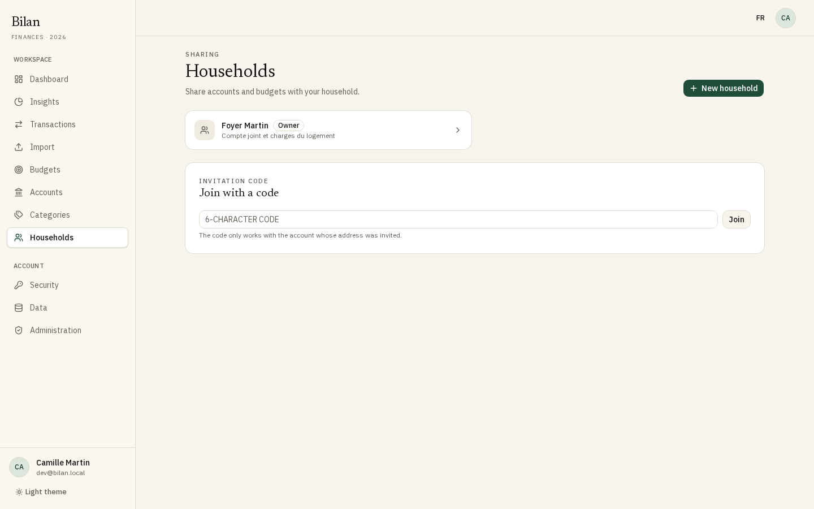

A household lets several people share accounts, budgets, categories and rules. Each person's accounts stay private until they decide to share one.

### Create a household

Go to **Households**, click **New household**, enter the **Household name** and an optional **Description**, then click **Create household**. You become its owner.

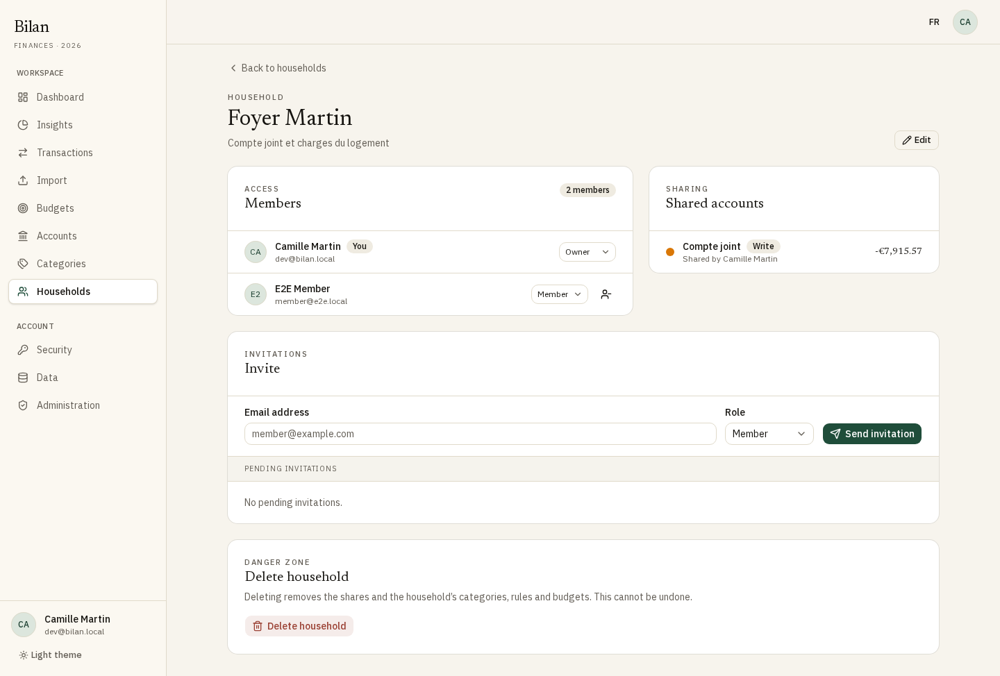

### Invite someone

Owners and admins can invite people:

1. On the household page, under **Invite**, enter the person's **Email address**.
2. Choose the **Role**: Member or Admin.
3. Click **Send invitation**.

Each invitation comes with a link and a 6-character code, and expires after 7 days. If the instance can't send e-mail, Bilan says so and shows the **Invitation link**: copy it with **Copy invitation link** and send it yourself.

**Pending invitations** shows the code, the expiry date and a copy button for each invitation. The **X** revokes it. Inviting the same address again renews its invitation.

### Accept or decline an invitation

You can accept an invitation in three ways:

- **On the Households page**: under **Pending invitations for you**, click **Accept invitation** or **Decline**. Invitations only appear here once your e-mail address is verified.
- **With the link**: open it while signed in and click **Accept invitation**.
- **With the code**: on the **Households** page, enter it under **Join with a code** and click **Join**.

An invitation only works for the account whose e-mail address was invited. The link and code work even before your address is verified.

### Roles

| Action                                                              | Member | Admin        | Owner |
| ------------------------------------------------------------------- | ------ | ------------ | ----- |
| See members, shared accounts and household budgets                  | yes    | yes          | yes   |
| Share your own accounts, include or exclude transactions in budgets | yes    | yes          | yes   |
| Edit the household, invite people                                   | no     | yes          | yes   |
| Manage household budgets, categories and rules                      | no     | yes          | yes   |
| Remove members                                                      | no     | members only | yes   |
| Change roles, delete the household                                  | no     | no           | yes   |

To hand over a household, an owner sets another member's role to **Owner**. A household can have several owners, but always keeps at least one.

### Share an account

1. On **Accounts**, open the account's **⋮** menu and choose **Share**.
2. For each household, choose **None**, **Read** or **Write**. The change applies immediately.

#### What Read and Write allow

- **Read**: members see the account, its balance and all its transactions, notes included. They can include or exclude its transactions in budgets.
- **Write**: everything in Read, plus adding, editing, recategorizing, deleting, importing, linking and unlinking transactions.
- Only you, the owner, can edit, share, archive or delete the account, and see its IBAN.

Your private accounts and their transactions are never visible to other members, except a transaction you include in a household budget (see [Household budgets](#household-budgets)). A household budget only counts the accounts shared with that household.

### Leave or delete a household

The **Danger zone** at the bottom of the household page offers:

- **Leave**: you lose access to the household's shared accounts and budgets. The last owner can't leave.
- **Delete household** (owners): removes the members, invitations and shares, along with the household's categories, rules and budgets. Transactions that used a household category become uncategorized. Accounts and transactions themselves are kept.

Tip: leaving a household doesn't stop sharing your accounts with it, and once you have left you can no longer change that from the app. Set each of your accounts to **None** for that household before you leave.

## Dashboard and insights

The dashboard and insights cover every account you can see: your own, the ones shared with you, and archived ones.

### Choose the period

On both pages, pick **This month**, **Last month**, **Quarter**, **Year** or **Custom**, and use the arrows to move to the previous or next period.

For a single month, **Compared with** lets you compare against **the previous month** or the 3-, 6- or 12-month average. Other periods are compared with the previous period of the same length.

While the period is still running, Bilan compares it with the same number of days of the comparison period, and a note says so.

Tip: transfers between your accounts count as income and expenses until you link them. See [Links](#links-transfers-and-refunds).

### Dashboard

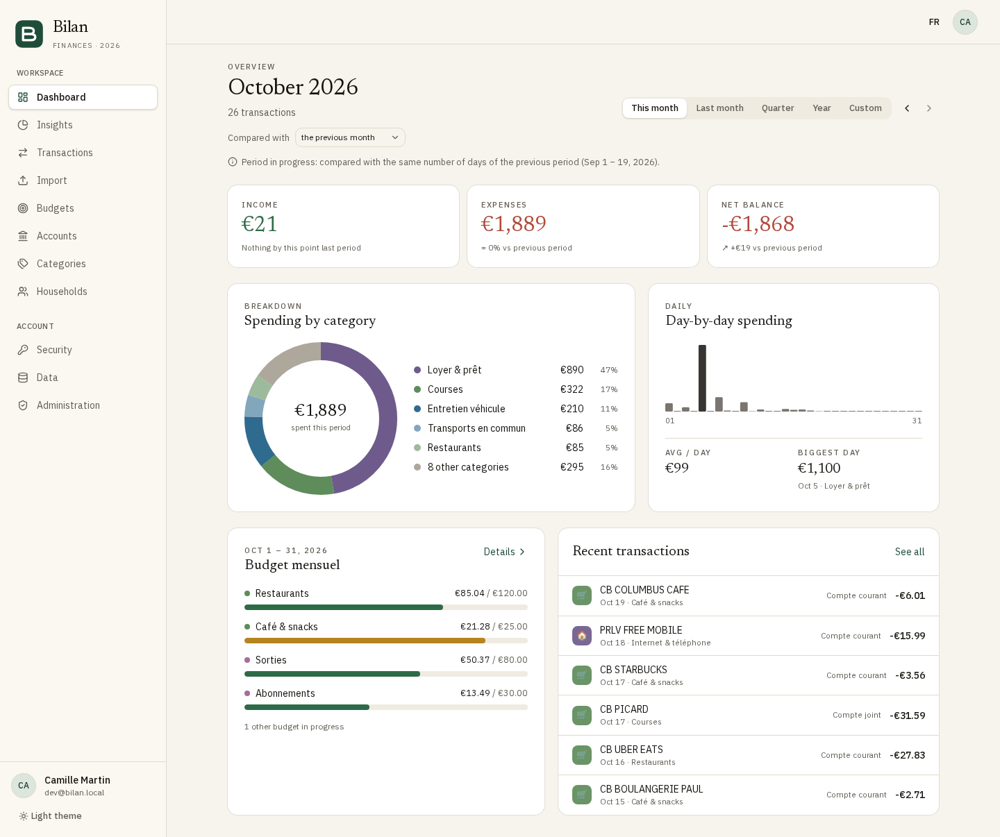

- **Income**, **Expenses** and **Net balance**, each with its change against the comparison.
- **Spending by category**: a donut with the six largest categories, the rest grouped.
- **Day-by-day spending** (periods up to 45 days) or **Monthly spending** (longer periods), with the average and the biggest day or month.
- **Budget in progress**: your current budget, line by line. Click **Details** to open it.
- **Recent transactions**: the latest six in the period. **See all** opens the full list.

### Insights

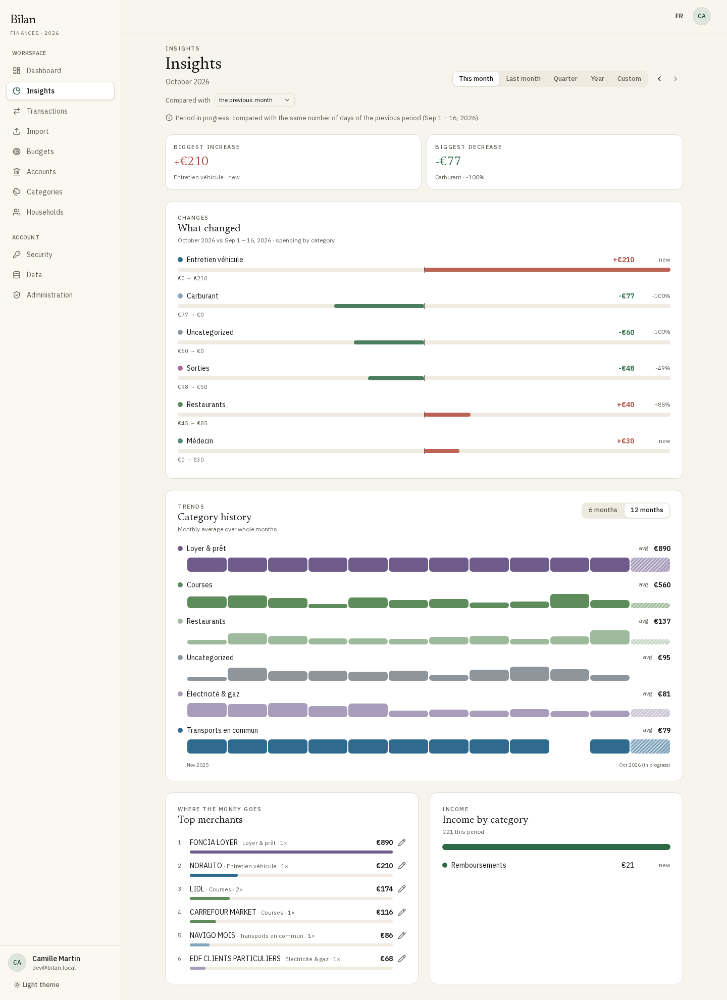

- **Biggest increase** and **Biggest decrease**: the categories whose spending changed most.
- **What changed**: the six categories with the largest change, from the comparison amount to the current one.
- **Category history**: monthly spending of your top six categories over **6 months** or **12 months**, with the monthly average. The current month is hatched.
- **Top merchants**: where your money goes. The pencil renames a merchant (see [Merchants](#merchants)).
- **Income by category**.

Most rows are clickable and open the matching transactions.

## Account security

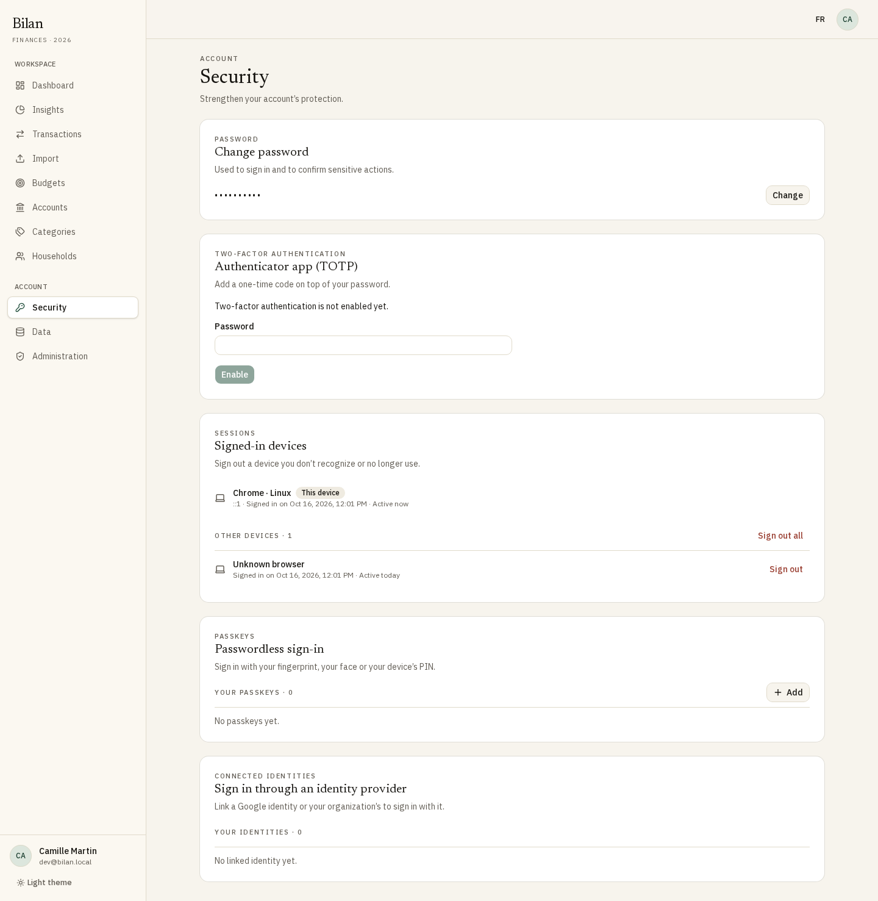

Go to **Security** in the sidebar.

### Change your password

Click **Change**, enter your **Current password** and the new one twice, then click **Change password**. **Sign out my other devices** is on by default. Bilan e-mails you to confirm the change.

### Two-factor authentication

To turn it on:

1. Under **Authenticator app (TOTP)**, enter your **Password** and click **Enable**.
2. Scan the QR code with your authenticator app (or type the key shown).
3. Save the **Backup codes** somewhere safe. Each works once if you lose your phone. They are shown only this once.
4. Enter the code from the app and click **Verify and enable**.

To turn it off, enter your **Password** and an **Authentication code** (from the app, or a backup code), then click **Disable**. Both are required.

Your administrator can require two-factor authentication for administrators. Until an administrator sets it up, administration pages send them back to this page.

### Passkeys

A passkey lets you sign in with your fingerprint, face or device PIN instead of your password. Click **Add** under **Passwordless sign-in** and follow your device's prompts. You can rename or delete each passkey.

If you signed in more than 24 hours ago, Bilan asks you to sign in again before adding one.

### Signed-in devices

**Signed-in devices** lists where you are signed in: browser, system, IP address and last activity. Click **Sign out** next to a device you don't recognize, or **Sign out all** for every other device.

Trusted devices (those that skip the 2FA code) are forgotten when you click **Sign out all**, change your password with **Sign out my other devices** on, reset your password, or turn two-factor authentication on or off.

### Connected identities

If your administrator has set up Google or another identity provider, click **Link …** under **Sign in through an identity provider**. The identity's e-mail address must match your account's. You can unlink it later, unless it is your only way to sign in.

### Sign-in alerts

When the instance can send e-mail, Bilan e-mails you after:

- a new sign-in with your password, a passkey or a backup code;
- a password change or reset;
- a new passkey;
- two-factor authentication being turned off.

The alert gives the date, IP address and device. If it wasn't you, change your password right away. These alerts can't be turned off.

## Your data

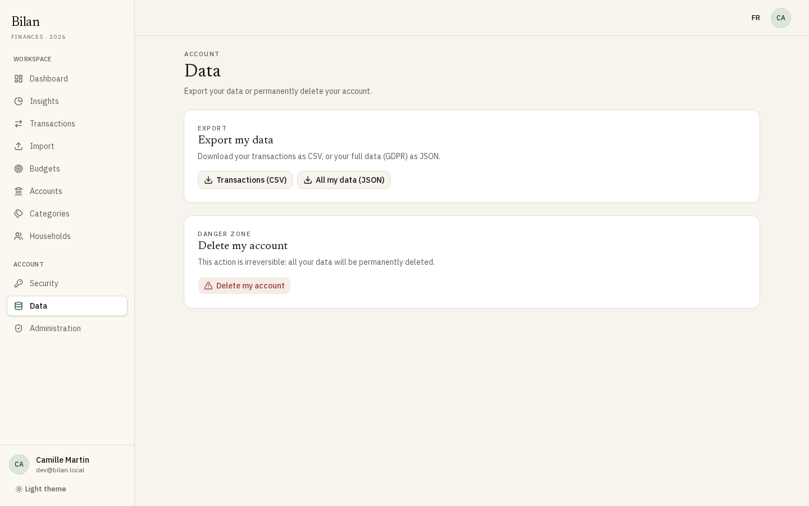

Go to **Data** in the sidebar.

### Export

- **Transactions (CSV)**: every transaction on the accounts you can see, with date, amount, type, label, account and category. The file opens in a spreadsheet and can be imported back into Bilan. In French the file uses a semicolon separator and decimal comma.
- **All my data (JSON)**: everything that belongs to you, for your records or to move elsewhere: profile, your own accounts (IBAN included), their transactions with notes and original labels, categories, rules, merchant names, budgets, households, links, import history and your recent activity log. Accounts other people share with you are not included.

### Delete your account

Click **Delete my account**, type your **Password** (or your e-mail address if you sign in only through an identity provider), then click **Delete permanently**. Deletion is immediate and final:

- your accounts and their transactions are deleted, including those shared with a household: other members lose them too;
- for each household you own, another member becomes owner; a household with no other member is deleted;
- the household's own categories, rules and budgets are kept.

Tip: export your data first if you want to keep a copy.
