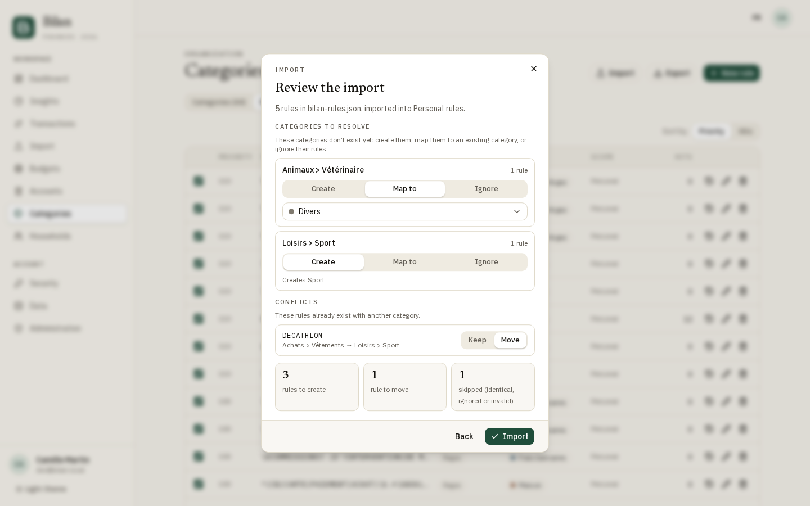

**English** · [Français](user-guide.fr.md)

# Bilan user guide

Bilan keeps track of your bank accounts, transactions and budgets, on your own server. You can use it alone or share accounts and budgets with the people you live with.

This guide walks through the app as a user. Running an instance is covered in the [self-hosting guide](self-hosting.md), and the instance settings in the [administration guide](admin-guide.md).

## Contents

1. [Getting started](#getting-started)
2. [Accounts](#accounts)
3. [Transactions](#transactions)
4. [Importing statements](#importing-statements)
5. [Categories, rules and merchants](#categories-rules-and-merchants)
6. [Links: transfers and refunds](#links-transfers-and-refunds)
7. [Budgets](#budgets)
8. [Households](#households)
9. [Dashboard and insights](#dashboard-and-insights)
10. [Account security](#account-security)
11. [Your data](#your-data)

## Getting started

### Sign in

1. Enter your **Email address** and **Password**, then click **Sign in**.
2. If two-factor authentication is on, enter the 6-digit code from your authenticator app on the **Verification** step. Click **Use a backup code** if you don't have your phone. Tick **Trust this device** to skip the code on this device: it is asked again after 30 days without signing in from it.

You can also use **Sign in with a passkey**, or a **Continue with …** button when your administrator has set up Google or another identity provider. These sign-ins don't ask for the 2FA code.

Tips:

- After 5 failed attempts in 15 minutes, sign-in is blocked for a while and the page tells you how long to wait.
- An identity provider account is not linked to your Bilan account just because the e-mail is the same. Link it first from **Security** (see [Connected identities](#connected-identities)).
- A session lasts 7 days and is extended each day you use the app.

### Create an account

Click **Create an account** on the sign-in page. What you see depends on how the instance is configured:

- **Open registration**: fill in **Name**, **Email address**, **Password** and **Confirm password**, then click **Create account**.
- **Invite only** (the default): an **Invitation token** field appears first. Your administrator gives you a token or a sign-up link that fills it in for you.
- **Closed**: the sign-in page has no **Create an account** link, and the sign-up page shows "Registration is closed on this instance." Ask your administrator to create your account.

The password must be at least 12 characters long by default (your administrator may choose another minimum). You are signed in right away and Bilan creates a starter set of categories in your language.

### Forgot your password

1. Click **Forgot password?** on the sign-in page.
2. Enter your e-mail and click **Send link**.
3. Open the link from the e-mail (valid for 1 hour), choose a **New password** and click **Reset**.

Resetting your password signs you out everywhere and forgets your trusted devices.

### Verify your e-mail address

When the instance can send e-mail, a **Verify your email address** banner stays at the top of every page until you click the link Bilan sent you (valid for 24 hours). Use **Resend the email** if it didn't arrive.

Verification matters for households: invitations sent to your address only show up on the **Households** page once the address is verified. An invitation link or code works before that.

### First steps

Until you have a transaction, the dashboard shows a **Welcome** card with two steps:

1. **Create a bank account**: see [Accounts](#accounts).
2. **Import a statement or add a transaction**: see [Importing statements](#importing-statements) and [Add a transaction by hand](#add-a-transaction-by-hand).

### Find your way around

On a computer, the sidebar has two groups:

- **Workspace**: Dashboard, Insights, Transactions, Import, Budgets, Accounts, Categories, Households.
- **Account**: Security, Data, and Administration if you are an administrator.

At the top right, the **FR**/**EN** button switches the language. Bilan remembers your choice and also uses it for the e-mails it sends you. Your initials open a menu with **Sign out**.

The theme button sits at the bottom of the sidebar. It offers **Light**, **Dark** and **System**. **System** (the default) follows your device's setting.

### On a phone

| Dashboard                                               | Transactions                                                  |
| ------------------------------------------------------- | ------------------------------------------------------------- |
|  |  |

- The bottom bar gives quick access to **Home**, **Transactions**, **Budgets**, **Accounts** and **Categories**.
- The menu button at the top left opens everything else: Insights, Import, Households, Security, Data, the theme button and the language button.
- On the transactions page, filters live behind the **Filters** button.

Bilan can be installed as an app: use your browser's **Install** or **Add to Home Screen** option. It still needs a connection: your financial data is never stored on the device.

## Accounts

An account holds transactions: a checking account, a savings account, a card, and so on. The **Global balance** at the top adds up every active account you can see, including accounts shared with you. Negative balances are drawn hatched.

### Add an account

1. Go to **Accounts** and click **New account**.
2. Pick the **Account type**: Checking, Savings, Credit or Other.
3. Enter the **Account name**, and optionally the **Bank**.
4. Enter the **Opening balance**: the balance before the first transaction you will record. It can be negative.
5. Optionally enter the **IBAN**. Bilan checks it and stores it encrypted.
6. Pick a **Color** and click **Create account**.

An account's balance is its opening balance plus all its transactions. Amounts are in euros.

A new account is private. To share it, see [Share an account](#share-an-account).

### See the IBAN

The card shows only the last 4 characters. Click the eye button (**Show IBAN**) to display the full IBAN, and click it again to hide it. Only the account owner can see the IBAN; people you share the account with never do.

If you signed in less than 10 minutes ago, the IBAN shows right away. Otherwise Bilan first asks you to confirm it's you:

- If you sign in with a password, enter it and click **Show IBAN**. For the next 5 minutes, Bilan doesn't ask again. After 5 wrong passwords in 15 minutes, wait before trying again.
- If your account has no password (identity provider or passkey only), or password sign-in is turned off, click **Sign in again**: you are signed out, then brought back to the accounts page once signed in. The IBAN then shows right away.

Every display of a full IBAN is recorded in the activity log, without the IBAN itself.

To change or remove the IBAN, open **Edit** in the card's menu. Leave the field blank to keep the saved one, or tick **Remove the saved IBAN**.

### Archive or delete an account

The **⋮** menu on a card (owner only) offers **Edit**, **Share**, **Archive** and **Delete**.

- **Archive** an account you no longer use but whose history you want to keep. It leaves the entry forms and the global balance, and moves to an **Archived accounts** section. Its transactions stay in your history, budgets and dashboard. You can't add or import transactions into it, and only the label and note of its transactions can be edited. Use **Unarchive** to bring it back.
- **Delete** removes the account and all its transactions for good. Bilan first shows what will go: transactions, imports, shares, budget lines limited to this account, budgets that only covered it, and links with other accounts. Type the account name to confirm, then click **Delete permanently**.

Tip: if you only want to tidy up the list, archive rather than delete.

### Accounts shared with you

An account another household member shares with you shows **Read** or **Write** and "Shared by …". Your own accounts show **Private** or **Shared**. See [What Read and Write allow](#what-read-and-write-allow).

## Transactions

The **Transactions** page lists the transactions of every account you can see, grouped by day. When a day has several transactions, its header shows the day's total.

### Filter and sort

- **Period**: This month, Last month, Quarter, Year, or Custom (pick a start and end date, then **Apply**). With no period selected, the list covers all dates.
- **All / Income / Expenses**.
- **Category**: a category also includes its sub-categories. **Uncategorized** finds transactions without a category.
- **Account** and **Type** (Card, Transfer, Direct debit, Cheque, ATM, Other).
- **Min amount** / **Max amount**: these compare the amount without its sign, so 50 matches both −50 and +50.
- **Sort**: Newest first, Oldest first, Largest expenses first, Largest income first.

The list shows 100 transactions at a time: click **Show 100 more** below it. Past 1,000, narrow the filters to reach older ones.

On a phone, tap **Filters**, adjust, then tap **Show … transactions**. **Reset** clears filters and sort.

### Search

Type in **Search keywords…**. The search looks at the beginning of words in the label:

- "lec" finds "LECLERC", but "clerc" doesn't.
- Words shorter than 3 letters are ignored.
- With several words, a transaction must match all of them.
- Case and accents don't matter.
- Amounts, notes and categories are not searched: use the amount filters for amounts.

### Transaction details

Click a transaction to open its details:

- **Category**: pick a category; it is saved immediately. See [Learn from your choices](#learn-from-your-choices).
- **Original label**: the label exactly as your bank wrote it. It never changes, even if you rename the transaction.
- **Assigned month**: the month the transaction counts in. See [Count a transaction in another month](#count-a-transaction-in-another-month).
- **Note**: your own comment, added with **Edit**.
- **Linked to**: shown when the transaction is part of a [link](#links-transfers-and-refunds).
- **Assign to a budget**: see [Include or exclude a transaction](#include-or-exclude-a-transaction).
- **Delete transaction** at the bottom.

**Edit** lets you change the label and note. For transactions you entered by hand, you can also change the date, amount and type. Imported transactions keep the amount, date and type from the bank statement.

### Add a transaction by hand

1. Click **New transaction** (or **Add a transaction** on an account card).
2. Pick the **Account**, the **Date** and the **Amount**: a negative amount is an expense, a positive one is income.
3. Enter the **Label**, the **Type**, and optionally a **Category** and a **Note**.
4. Click **Add**.

If you leave the category empty, your [rules](#rules) try to find one from the label.

### Select several transactions

1. Click **Select** above the list (on a phone, the switch in **Filters** works too).
2. Tick the transactions. Those on accounts you can only read can't be selected.
3. Click **Link** (2 or more transactions) or **Delete** in the bar that appears.

Before deleting, Bilan lists the side effects: links that will be dissolved and budgets the transactions will leave. You can delete up to 500 transactions at once. Deletion can't be undone.

### Count a transaction in another month

Some transactions belong to another month than the day they hit your account: a salary paid on the last working day of the month that funds the next one, or a yearly bill you file under the previous month.

- **One transaction**: in its details, pick a month under **Assigned month**, past or future. **Back to automatic** cancels your choice.
- **A whole category**: edit the category and turn on **Count toward the next month**, then set the **Number of days**. Transactions of that category dated in the last days of a month then count in the next month. Turn it on for **Salary** with 5 days and every end-of-month salary counts in the following month. It applies to the category's existing transactions too, but not to its sub-categories. A month you picked by hand always wins.

Both sides of a [linked](#link-transactions) transfer between your accounts count in the same month: picking a month for one side, or going back to automatic, does the same for the other side (if you can edit its account). When you link two transfers and only one of them has a month picked by hand, the other side takes that month.

The transaction keeps its real date in the list, with a **Counted in …** mention. The dashboard, insights and budgets count it in its assigned month. To see a salary that already counts in next month, the dashboard and insights let you open the next month.

## Importing statements

Bilan imports CSV files (up to 5 MB), PDF statements (up to 10 MB) and OFX files (up to 5 MB) exported from your bank. OFX is the most reliable of the three: it is a structured format, so there is no column to map and no decimal mark or date order to guess.

### Import a CSV file

1. Go to **Import** and choose the **Account**.
2. Drop the file on the page or click to browse.
3. Check the settings on the left (they come pre-filled from the file):
   - **Target account**: you can still switch account here.
   - **Column mapping**: which column holds the **Date**, the **Label** and the **Amount**. If your bank uses separate columns for money out and money in, set **Amount** to "—" and map **Debit** and **Credit** instead. **Type** is optional.
   - **Decimal mark**: Comma or Dot.
   - **Date order**: DD/MM or MM/DD.
   - **Categorize automatically**: applies your [rules](#rules). It is on by default.
4. Review the preview. You can untick a row to skip it, or pick a category for it.
5. Click **Validate import**.

Things to check in the preview:

- **Decimal mark**: when Bilan had to guess, a warning asks you to check the amounts. Click **Looks right**, or the button that switches to the other mark.
- **Date order**: Bilan picks MM/DD only when the file can't be read as DD/MM (for example 12/25). When every date fits both orders, it assumes DD/MM and a warning asks you to check the dates. Click **Dates look right**, or **Use MM/DD**. Dates written as 2026-10-15 are never ambiguous.
- **Duplicates**: a row with the same date, amount and bank label (extra spaces ignored) as a transaction already imported into this account is marked **duplicate** and skipped. You can't force it in. Transactions you entered by hand are never treated as certain duplicates. Identical rows within the same file are all kept.
- **Probable duplicates**: a row that isn't a certain duplicate, but whose account already has a transaction (imported or entered by hand) on the same day for the same amount, is flagged **Probable duplicate**, with the matching transaction shown under "Already in the account". It is unticked, so it is skipped unless you tick it (**Import anyway**). This catches the same purchase entered by hand, or labelled differently by the bank. The counter at the top lists how many there are, and the **Probable duplicates** filter isolates them for review.
- **Filters**: above the rows, **All**, **Uncategorized** and **Probable duplicates** narrow the preview, each with its row count. **Uncategorized** keeps the rows no rule categorized, leaving out duplicates already imported: handy to sort out a large first import. A category picked by hand leaves the row listed. This filter is hidden while **Categorize automatically** is unticked.
- **Rules from your picks**: after you pick a category by hand, **Create a rule** appears under it. It opens the same dialog as on the transactions screen, so the next imports categorize that merchant on their own. When a rule had suggested another category and you can edit it, the dialog also offers to change that rule instead. Otherwise the new rule takes precedence over it. Once saved, the preview is recalculated and the other rows the rule matches take its category.
- **Unreadable rows**: rows with an unrecognized date or amount, an amount out of range or an empty label are skipped. Bilan shows how many there were and up to 5 examples with their line number. If a whole column is wrong, the sidebar flags it: try another column mapping.

Changing the mapping, the account, the decimal mark or the date order rebuilds the preview, and you lose the rows you unticked and the categories you picked.

Bilan doesn't remember the mapping between imports, but it recognizes the usual column names in French and English.

### Import a PDF statement

Drop the PDF on the same page. Bilan reads statements from **LCL** and **Revolut** (French-language statements). The preview shows the detected bank. For other banks it warns that the bank isn't recognized and tries a generic reading of "date, label, amount" lines, so check the preview carefully. Scanned PDFs (images) can't be read.

A Revolut statement can contain several sections (current account, deposit). Each section gets its own **Target account** choice. Pick **Don't import** to skip one.

There is no decimal mark or date order to set for PDFs. Duplicates (certain and probable), categories and the preview work as for CSV files.

### Import an OFX file

Most banks let you download your history as an **OFX** file (sometimes called "Money" or "Microsoft Money"), next to the CSV and PDF options. Look for it in the export or download menu of your account history, choose a period (a long one the first time, for instance two years), and pick the OFX format.

Then drop the file on the **Import** page like a CSV. Bilan reads both the old OFX 1.x and the newer 2.x formats, in UTF-8 or Windows-1252.

- **Label**: the bank's name for the operation. When it is empty, Bilan uses the memo, and for a cheque without a name, **CHEQUE** followed by its number. When both a name and a different memo exist, the memo goes into the transaction's **note**.
- **Type** (card, transfer, direct debit, cheque...): Bilan reads it from the label first, then from the type the bank gives.
- **Several accounts in one file**: each statement is listed with its account type and the last 4 characters of its account number (for example **Current account ••1234**). Pick a **Target account** for each one, or **Don't import** to skip it, as for a Revolut PDF.
- **Duplicates**: certain and probable duplicates work as for CSV files. This is what makes regular exports that overlap each other, or an OFX that overlaps a PDF statement of the same account, safe to import: what is already there is skipped, and a near match is left for you to review.
- **Unreadable rows**: transactions with an unreadable date or amount are skipped and listed, as for CSV files.

#### Check the balance

When the file gives the bank's balance (most bank statements do, credit-card statements don't), the preview shows a **balance check**:

- **Bank balance on** *date*: the balance the bank reports at the end of the file.
- **Balance after import**: what Bilan would show for the account at that date: the opening balance, plus the account's transactions, plus the rows that will be imported.
- **Gap**, or **Balances match**.

The balance after import follows your changes: unticking a row, or ticking a probable duplicate, updates the gap on the spot. A gap usually means operations are missing from the account, or that the account's opening balance is wrong.

#### Set the opening balance

When the file starts the history of the account (the account has no transaction before the file's first day) and there is a gap, a checkbox offers to **Set the opening balance so the balance matches the bank's**. Tick it and Bilan changes the account's [opening balance](#accounts) at the same time as the import, so the balance matches the bank's. This is how you load a bank history into a new account without computing the opening balance by hand.

- Only the **owner** of the account sees the checkbox, because only the owner can change the opening balance. With write access only, you see the gap but can't adjust it.
- It isn't offered on an account that already has older transactions: there, a gap points to missing operations, and adjusting would hide them.

### Undo an import

You imported the wrong file or picked the wrong account? Undo the whole import:

- right after importing, click **Undo import** on the summary, or
- later, open the **⋯** menu of the import in **Recent imports** on the **Import** page and choose **Undo import**.

Bilan shows how many transactions will be deleted, and warns you if some are linked to other transactions, assigned to a budget, or were edited since the import. If the import adjusted an account's opening balance, the dialog says it will go back to its previous value. If you changed that opening balance yourself since, it is left as it is and the dialog tells you so. Click **Delete the transactions** to confirm.

All of that import's transactions are deleted, edited ones included. The import stays in the history as **Undone**, and you can import the same file again afterwards. There is no time limit, but you need write access to every account the import went into.

## Categories, rules and merchants

The **Categories** page has three tabs: **Categories**, **Rules** and **Merchants**.

### Categories

Bilan starts you with a set of categories and sub-categories that you can edit or delete like your own.

To create one:

1. Click **New category**.
2. Enter a **Name** and choose a **Parent category**, or **None (root category)**.
3. Choose the **Scope**: **Personal** (visible only to you) or a household (visible to every member). The scope can't be changed later.
4. Pick a **Color**. The **+** button opens a custom colour picker. A sub-category can use its parent's colour.
5. Pick a **Symbol**, or enter any character or emoji with **+**.
6. Optionally turn on **Count toward the next month**: see [Count a transaction in another month](#count-a-transaction-in-another-month).
7. Optionally turn on **Counts as savings**: spending in this category and its sub-categories counts toward the dashboard's **Net savings** (money put aside on an account Bilan doesn't track, such as a brokerage account or a child's savings book). It is on for the default **Savings** category.
8. Click **Create category**.

To delete a category, open its **⋮** menu and choose **Delete**. Its sub-categories are deleted too. If transactions, rules or budget lines use it, choose where to move them with **Move to**. With **No category**, transactions become uncategorized and the rules and budget lines are deleted.

### Rules

A rule gives a category to transactions whose bank label matches a pattern.

A new account starts with a set of ready-made rules on the default categories: national retailers, utilities, subscriptions, motorways, pharmacies, taxes, bank fees… so a first import is already partly categorized. Edit, turn off or delete them like your own. Transfers between people and local shops are never covered: add your own rules for them.

1. On the **Rules** tab, click **New rule**.
2. Enter the **Pattern** and pick the **Match**: **Contains**, **Equals**, **Starts with** or **Regex**.
3. Pick the **Category** and the **Priority**: when several rules match, the highest number wins (100 by default). At equal priority, the longest pattern wins, then the most recent rule.
4. If you manage a household, choose the **Scope**: **Personal** or the household. Household rules apply to every member's transactions.
5. Tick **Case-sensitive** if needed. By default, case and accents are ignored.
6. Click **Save**.

The checkbox at the start of each row turns a rule on or off. **Hits** counts the transactions the rule has categorized.

When rules run:

- during an import, when **Categorize automatically** is ticked;
- when you add a transaction by hand without choosing a category.

### Apply a rule to existing transactions

After you save a rule that matches transactions already in Bilan, the dialog shows a summary:

- how many transactions **move** to the rule's category, and how many of them are currently in another category;
- how many **stay** with another rule that takes precedence (raise this rule's priority to take them over);
- how many were **categorized by hand**: they never move.

Click **Reclassify** to apply the rule, or **Later** to leave the transactions as they are. To apply a rule later, click the clock icon on its row in the **Rules** tab.

Only transactions on accounts you can edit are reclassified. Rules never override a category you chose yourself.

### Import and export rules

On the **Rules** tab, **Export** saves your rules to a `bilan-rules-YYYY-MM-DD.json` file and **Import** reads one back. Use them to back up your rules, to move them to another Bilan instance or to share them with a household.

**Export.** If you belong to a household, choose **Rules to export**: **Personal rules** or a household, then click **Download**. The file contains the patterns, match types, priorities and category names, never your transactions.

**Import.**

1. Click **Import**, choose the file and, if you manage a household, **Import into**: **Personal rules** or the household. Click **Continue**. Nothing is saved yet.
2. In **Categories to resolve**, each category of the file that doesn't exist yet in the destination offers three choices: **Create** it (this is the default; only the missing levels are created, existing parent categories are reused), **Map to** one of your existing categories, or **Ignore** its rules. Bilan first looks for the same path in the destination (for example *Alimentation > Courses*), ignoring case and accents: *epargne* matches *Épargne*. Otherwise it reuses a category whose path ends with the file's path, if there is exactly one. The others are created unless you map or ignore them.
3. In **Conflicts**, a rule that already exists with another category shows the change. Choose **Keep** the current category (the default) or **Move** the rule to the one in the file; a move changes only the category, not the pattern, priority or other settings. Rules that already exist with the same category are skipped.
4. Check the counts of rules to create, to move and skipped, then click **Import**. Invalid rules in the file are listed and skipped; the others are still imported. The import itself is all-or-nothing: if it fails, no rule or category is saved.

Imported categories and rules are always created in the destination you chose. When it is done, click **Reclassify existing transactions** to [apply the imported rules](#apply-a-rule-to-existing-transactions) to transactions already in Bilan, or **Close** to leave them as they are. Disabled rules are left out: they don't reclassify anything until you enable them.

Importing into a household requires being an administrator or owner of it.

### Learn from your choices

When you change a transaction's category, Bilan offers to **Create a rule for similar transactions?**. It suggests a pattern taken from the bank label, which you can edit along with the match type. Click **Create rule** to save a personal rule, or **No thanks**. If other transactions match, you can then [apply the rule to them](#apply-a-rule-to-existing-transactions).

### Merchants

The **Merchants** tab lists the places you spend money, with bank noise removed ("CB", "PRLV SEPA", dates, references). Click the pencil to give a merchant a **Display name**, or group several bank labels under one name. Merchants renamed to the same name are added up.

This only affects the merchant list and the **Top merchants** card in [Insights](#insights). Transaction labels don't change.

## Links: transfers and refunds

A transfer between two of your accounts appears twice: money out of one, money in to the other. A refund cancels out a purchase. Linking these transactions stops Bilan from counting them twice:

- linked transactions that cancel out (a transfer, a full refund) are left out of the dashboard and budget totals;
- otherwise (a partial refund, for example), the link counts once, for the difference.

Linked transactions stay in the list with a **Linked** tag.

### Link transactions

- **From suggestions**: on **Transactions**, click **Suggestions**. Bilan suggests pairs with the same amount and opposite signs, at most 30 days apart. Within one account, only pairs whose labels look alike (same merchant, or a shared word like a fee and its rebate) are suggested; the most likely pairs come first. Click **Link** to accept a pair or **Ignore** to dismiss it. Ignored pairs are listed further down, and **Restore** makes a pair eligible again. **Settings** changes, for you only, the **Maximum gap (days)** between the two transactions (0 for the same day, up to 365) and the **Minimum amount** below which pairs aren't suggested.
- **By hand**: [select](#select-several-transactions) two or more transactions and click **Link**. You can also open a transaction and click **Link to other transactions**: it is selected, and stays selected while you search or filter for the others (the selection bar names it).

Linking requires write access to every account involved.

### Automatic links

Bilan links the two sides of a transfer between two accounts you own by itself, when you import a statement or add a transaction by hand: both sides are transfers, same amount in opposite directions, at most 4 days apart, and one obvious match. A transfer that matches a card payment, a direct debit or a cash withdrawal is only suggested, never linked by itself. When it isn't sure (two transfers of the same amount on the same day, for example), the pair stays in the suggestions. Transfers to an account someone shares with you are never linked automatically.

To undo an automatic link, [unlink](#unlink) it: Bilan won't link that pair again, and stops suggesting it to you and to the accounts' owner. If you restore the pair from the ignored pairs, it comes back as a suggestion only, never linked automatically again.

### Unlink

Open one of the transactions and click **Unlink** in the **Linked to** section. Deleting a transaction removes it from its link. A link with only one transaction left disappears.

## Budgets

A budget sets how much you plan to spend per category or account over a period, and tracks what you actually spend. Attached to an account, it becomes that account's envelope: planned income, transfers and spending, and where the account lands at the end of the period (see [Budget on an account](#budget-on-an-account)).

### Create a budget

1. Go to **Budgets** and click **New budget**.
2. Enter a **Name** and, if you like, a **Description**.
3. Choose the **Scope**: **Personal**, or a household you manage (see [Household budgets](#household-budgets)). It can't be changed later.
4. Optionally choose an **Account** (see [Budget on an account](#budget-on-an-account)). Leave **None: all accounts** for a budget across your accounts.
5. Choose the **Period**: Week, Month, Quarter, Year or Custom, then the **Start** date. The end date follows from the period.
6. Tick **Recurring** for a budget that repeats every period.
7. Add **Lines**. For each line, pick a **Category** (or **All categories**), an **Account** (or **All accounts**) and a **Planned amount**. A line can also have a **Label**, shown instead of the category or account name.
8. Click **Create budget**.

How lines count spending:

- A category line counts that category and its sub-categories. A refund in that category reduces the amount spent.
- When a parent line and a sub-category line both match, the transaction goes to the more specific one.
- An **All categories / All accounts** line takes every expense that no other line matches.
- Linked transactions are counted as explained in [Links](#links-transfers-and-refunds).

### Budget on an account

A budget attached to an account follows that account only: the money that comes in, the money that goes out, and the transfers to your other accounts. Use one per checking account, for example one for your personal account and one for the household's joint account.

- An account has at most one budget at a time: two budgets on the same account can't overlap, even partly. Archived budgets don't count.
- A personal budget uses one of your own accounts; a household budget, an account shared with the household.
- Transfers to your other accounts count in full: a transfer to your savings account is money that left this account.

Each line has a **Type**:

| Type         | What it counts on the account                                                      |
| ------------ | ---------------------------------------------------------------------------------- |
| **Expense**  | spending in the category and its sub-categories (a refund reduces it)              |
| **Income**   | money received in the category, for example your salary                           |
| **Transfer** | transfers **To** or **From** another of your accounts, chosen in **Other account** |

A transaction counts in one line only. Transfer lines come first, then the most specific category line. A transfer is matched once it is linked to the other account's side (see [Automatic links](#automatic-links)), or when that account holds the same amount the other way within 4 days. Money coming from another account never counts as a refund of an expense line.

Going over a line reads differently by type: **Over by …** for an expense, **+… more than planned** for income or a transfer, and **+… saved on top** for a transfer to a savings account, which doesn't push the budget over.

A transfer line is set once, in the budget of the account the money leaves. The other account's budget shows it as a read-only line, **Planned in …**, when both budgets have the same period type and start and you can see both. If that budget already has its own **From** line for this account, only its own line counts.

**Out of budget** is always the last line. It collects what the account paid that no other line takes: uncategorized transactions, categories without a line, unplanned transfers. You can give it an optional **Margin** for the unexpected. Click it to list those transactions; click a transaction to open it in **Transactions**, where you can recategorize it or include it elsewhere. When a transfer is left there because it isn't linked yet, a link to the link suggestions appears.

**Unplanned income** lists the money received that no Income or Transfer line takes. What came from a savings account shows as **Taken from savings this period**.

#### Where the account lands

During the current period, the **Budgets** page opens with **Where I land**: one card per account with a budget in progress (the dashboard shows the same cards). Its balance at the period's end is:

> today's balance + income still expected − spending still to come

- Today's balance only counts transactions dated today or earlier.
- Income still expected: what each Income line and incoming transfer has not received yet.
- Spending still to come: what each Expense line and outgoing transfer has not spent yet, plus what is left of the Out-of-budget margin. A line already over counts as 0.
- A transaction already dated later in the period isn't in today's balance: it counts in what is still to come when it is more than what is left of its line.
- A transaction from another account included in the budget counts in its line, but not in the landing: it never touched this account.

Past and future periods show planned versus actual only. Savings accounts get no budget and no landing: their balance shows on the dashboard.

### Follow a budget

Each line and the budget as a whole show a status:

| Status             | Meaning                                 |
| ------------------ | --------------------------------------- |
| **On track**       | under 80 % of the planned amount        |
| **Almost reached** | 80 % or more, not reached yet           |
| **Reached**        | exactly the planned amount, to the cent |
| **Over budget**    | more than the planned amount            |

Tip: **Reached** needs the exact amount, to the cent. Until then the percentage stays below 100 % (99.6 % is shown as 99 %), and any overspend shows at least 101 %. A line planned at 0 € stays **On track** while nothing is spent; any spending puts it **Over budget**, with no percentage (—).

Click a budget to open its details: each line with "… left" or "Over by …", **See transactions** for category lines, and the list of transactions **Counted in this budget**.

During the current period, a budget with no account shows **Projected balance on …**: the current balance of your checking accounts, minus what the lines still plan to spend (an over-budget line counts as 0). Savings accounts and income still to come are left out. A budget on an account shows its landing instead (see [Where the account lands](#where-the-account-lands)). Either figure also shows on the dashboard's current budget card.

### Renew a recurring budget

When a recurring budget's period ends, a **Renew** button on its card creates the next period with the same account, lines and margin. If another budget already covers the next period on that account, the budget isn't renewed. Unspent amounts are not carried over. Your administrator can also set up automatic renewal. The periods of a series are grouped on one card: open **… other periods** to see them, or use the arrows on the details page.

### Edit, archive or delete a budget

The **⋮** menu on a budget's card or details page offers **Edit**, **Archive** and **Delete**.

- **Archive** a budget you no longer follow but want to keep. It leaves the list, the dashboard and the **Assign to a budget** menu, and it is no longer renewed. Its lines and assignments are kept: a transaction's details still show its assignment, marked **Archived**, and you can remove it. Archived budgets are grouped under **Archived budgets** at the bottom of the list: open one to view it, or choose **Unarchive** in its menu to bring it back.
- **Delete** removes the budget and its lines. Transactions are not affected, and the other periods of a recurring budget are kept.

### Include or exclude a transaction

From a transaction's details, under **Assign to a budget**:

1. **Choose a budget**.
2. Click **Include** to count the transaction in that budget even if it doesn't match a line, falls outside the period, or is on an account the budget doesn't cover. Click **Exclude** to keep it out.
3. The assignment appears below with **Included** or **Excluded**. Click **Remove** to undo it.

An included transaction that matches no line counts in the budget total, under a separate **Out of budget** card: it never changes a line.

### Household budgets

A budget with a household scope belongs to the household:

- Owners and admins create, edit, renew, archive and delete it. Every member can view it, and can include or exclude transactions.
- It counts transactions from the accounts shared with that household.

A member can also **Include** a transaction from one of their private accounts. It then counts in the totals for everyone, and every member sees it in the budget in full: date, amount, label, category and account name. Only that transaction becomes visible: the private account and its other transactions stay hidden. If that member later leaves the household or is removed from it, the transaction stops counting in the household budgets.

You can only **Include** a transaction from one of your own accounts or from an account shared with this household: an account another household shares with you can't be included.

## Households

A household lets several people share accounts, budgets, categories and rules. Each person's accounts stay private until they decide to share one.

### Create a household

Go to **Households**, click **New household**, enter the **Household name** and an optional **Description**, then click **Create household**. You become its owner.

### Invite someone

Owners and admins can invite people:

1. On the household page, under **Invite**, enter the person's **Email address**.
2. Choose the **Role**: Member or Admin.
3. Click **Send invitation**.

Each invitation comes with a link and a 6-character code, and expires after 7 days. If the instance can't send e-mail, Bilan says so and shows the **Invitation link**: copy it with **Copy invitation link** and send it yourself.

**Pending invitations** shows the code, the expiry date and a copy button for each invitation. The **X** revokes it. Inviting the same address again renews its invitation.

### Accept or decline an invitation

You can accept an invitation in three ways:

- **On the Households page**: under **Pending invitations for you**, click **Accept invitation** or **Decline**. Invitations only appear here once your e-mail address is verified.
- **With the link**: open it while signed in and click **Accept invitation**.
- **With the code**: on the **Households** page, enter it under **Join with a code** and click **Join**.

An invitation only works for the account whose e-mail address was invited. The link and code work even before your address is verified.

### Roles

| Action                                                              | Member | Admin        | Owner |
| ------------------------------------------------------------------- | ------ | ------------ | ----- |
| See members, shared accounts and household budgets                  | yes    | yes          | yes   |
| Share your own accounts, include or exclude transactions in budgets | yes    | yes          | yes   |
| Edit the household, invite people                                   | no     | yes          | yes   |
| Manage household budgets, categories and rules                      | no     | yes          | yes   |
| Remove members                                                      | no     | members only | yes   |
| Change roles, delete the household                                  | no     | no           | yes   |

To hand over a household, an owner sets another member's role to **Owner**. A household can have several owners, but always keeps at least one.

### Share an account

1. On **Accounts**, open the account's **⋮** menu and choose **Share**.
2. For each household, choose **None**, **Read** or **Write**. The change applies immediately. Switching a household the account was shared with back to **None** also drops the inclusions and exclusions of its transactions in that household's budgets, so none of them count there any more.

#### What Read and Write allow

- **Read**: members see the account, its balance and all its transactions, notes included. They can include or exclude its transactions in budgets.
- **Write**: everything in Read, plus adding, editing, recategorizing, deleting, importing, linking and unlinking transactions.
- Only you, the owner, can edit, share, archive or delete the account, and see its IBAN.

Your private accounts and their transactions are never visible to other members, except a transaction you include in a household budget (see [Household budgets](#household-budgets)). A household budget only counts the accounts shared with that household.

### Leave or delete a household

The **Danger zone** at the bottom of the household page offers:

- **Leave**: you lose access to the household's shared accounts and budgets. Your accounts stop being shared with the household, and your transactions leave its budgets (included or excluded ones alike). The last owner can't leave.
- **Delete household** (owners): removes the members, invitations and shares, along with the household's categories, rules and budgets. Transactions that used a household category become uncategorized. Accounts and transactions themselves are kept. The confirmation counts what is affected.

The same happens to a member an owner or admin removes. A household budget line limited to one of their accounts stays, counts nothing, and shows as a hidden account: edit or delete it.

## Dashboard and insights

The dashboard and insights cover every account you can see: your own, the ones shared with you, and archived ones.

### Choose the period

On both pages, pick **This month**, **Last month**, **Quarter**, **Year** or **Custom**, and use the arrows to move to the previous or next period. You can go as far as next month, marked as upcoming: it shows the transactions [assigned to it](#count-a-transaction-in-another-month) in advance.

For a single month, **Compared with** lets you compare against **the previous month** or the 3-, 6- or 12-month average. Other periods are compared with the previous period of the same length.

While the period is still running, Bilan compares it with the same number of days of the comparison period, and a note says so.

Tip: transfers between your own accounts are linked automatically and left out of income and expenses. A transfer Bilan couldn't link counts as both until you link it. See [Links](#links-transfers-and-refunds).

### Dashboard

- **Account balances**: the current balance of each non-archived account and their total, whatever the selected period. **Accounts** opens the accounts page.
- **Where I land**: one card per account whose [budget](#where-the-account-lands) is in progress today, with its balance at the period's end. Like the balances, it shows today's budgets whatever the selected period. Click a card to open its budget.
- **Income**, **Expenses** and **Net balance**, each with its change against the comparison.
- **Net savings**: linked transfers into your savings accounts minus those out of them, plus spending in categories that [count as savings](#categories), with its change against the comparison.
- **Spending by category**: a donut with the six largest categories, the rest grouped.
- **Day-by-day spending** (periods up to 45 days) or **Monthly spending** (longer periods), with the average and the biggest day or month.
- **Budget in progress**: your current budget, line by line. Click **Details** to open it.
- **Recent transactions**: the latest six in the period. **See all** opens the full list.

### Insights

- **Biggest increase** and **Biggest decrease**: the categories whose spending changed most.
- **What changed**: the six categories with the largest change, from the comparison amount to the current one.
- **Category history**: monthly spending of your top six categories over **6 months** or **12 months**, with the monthly average. The current month is hatched.
- **Top merchants**: where your money goes. The pencil renames a merchant (see [Merchants](#merchants)).
- **Income by category**.

Most rows are clickable and open the matching transactions.

## Account security

Go to **Security** in the sidebar.

### Change your password

Click **Change**, enter your **Current password** and the new one twice, then click **Change password**. **Sign out my other devices** is on by default. Bilan e-mails you to confirm the change.

### Two-factor authentication

To turn it on:

1. Under **Authenticator app (TOTP)**, enter your **Password** and click **Enable**.
2. Scan the QR code with your authenticator app (or type the key shown).
3. Save the **Backup codes** somewhere safe. Each works once if you lose your phone. They are shown only this once.
4. Enter the code from the app and click **Verify and enable**.

To turn it off, enter your **Password** and an **Authentication code** (from the app, or a backup code), then click **Disable**. Both are required.

While it is on, the card shows how many **Backup codes** you have left. To get a new set, click **Generate new codes**, enter your **Password** and an **Authentication code**, then click **Generate new codes** again. Your previous codes stop working at once. Save the new ones with **Copy** or **Download**: they are shown only this once.

If your account has no password (you sign in through an identity provider or with a passkey), the card has nothing to set up: Bilan's two-factor authentication only protects password sign-ins, and your identity provider's own two-factor authentication applies instead.

Your administrator can require two-factor authentication for administrators who have a password. Until such an administrator sets it up, administration pages send them back to this page, and a banner explains why.

### Trusted devices

When two-factor authentication is on, **Trusted devices** lists the browsers where you ticked **Trust this device**: browser and system when known, last use and expiry date. Click **Forget** next to a device, or **Forget all**. A forgotten device asks for the code again at its next sign-in with your password.

### Passkeys

A passkey lets you sign in with your fingerprint, face or device PIN instead of your password. Click **Add** under **Passwordless sign-in** and follow your device's prompts. You can rename or delete each passkey.

If you signed in more than 24 hours ago, Bilan asks you to sign in again before adding one.

### Signed-in devices

**Signed-in devices** lists where you are signed in: browser, system, IP address and last activity. Click **Sign out** next to a device you don't recognize, or **Sign out all** for every other device.

Trusted devices are also forgotten when you click **Sign out all**, change your password with **Sign out my other devices** on, reset your password, or turn two-factor authentication on or off.

### Connected identities

If your administrator has set up Google or another identity provider, click **Link …** under **Sign in through an identity provider**. The identity's e-mail address must match your account's. You can unlink it later, unless it is your only way to sign in.

### Sign-in alerts

When the instance can send e-mail, Bilan e-mails you after:

- a new sign-in with your password, a passkey, a backup code or an identity provider;
- a password change or reset;
- a new passkey;
- two-factor authentication being turned off.

The alert gives the date, the sign-in method, the IP address and the device. If it wasn't you, change your password right away. These alerts can't be turned off.

## Your data

Go to **Data** in the sidebar.

### Export

- **Transactions (CSV)**: the transactions on the accounts you can see, with date, amount, type, label, account, category and, when it differs from the real month, the assigned month. By default the file has all of them; to narrow it, set a date range (**From**, **To**) or pick an **Account** above the buttons. The file opens in a spreadsheet and can be imported back into Bilan. In French the file uses a semicolon separator and decimal comma.
- **All my data (JSON)**: everything that belongs to you, for your records or to move elsewhere: profile, your own accounts (IBAN included), their transactions with notes and original labels, categories, rules, merchant names, budgets, households, links, import history and your recent activity log. Accounts other people share with you are not included. Since it contains your full IBANs, it asks you to confirm it's you the same way as [showing an IBAN](#see-the-iban) if you signed in more than 10 minutes ago.

### Delete your account

Click **Delete my account**, type your **Password** (or your e-mail address if you sign in only through an identity provider), then click **Delete permanently**. The confirmation lists what will go: how many accounts and transactions, the households handed over or deleted. Deletion is immediate and final:

- your accounts and their transactions are deleted, including those shared with a household: other members lose them too;
- for each household you own, another member becomes owner; a household with no other member is deleted;
- the household's own categories, rules and budgets are kept.

Tip: export your data first if you want to keep a copy.
